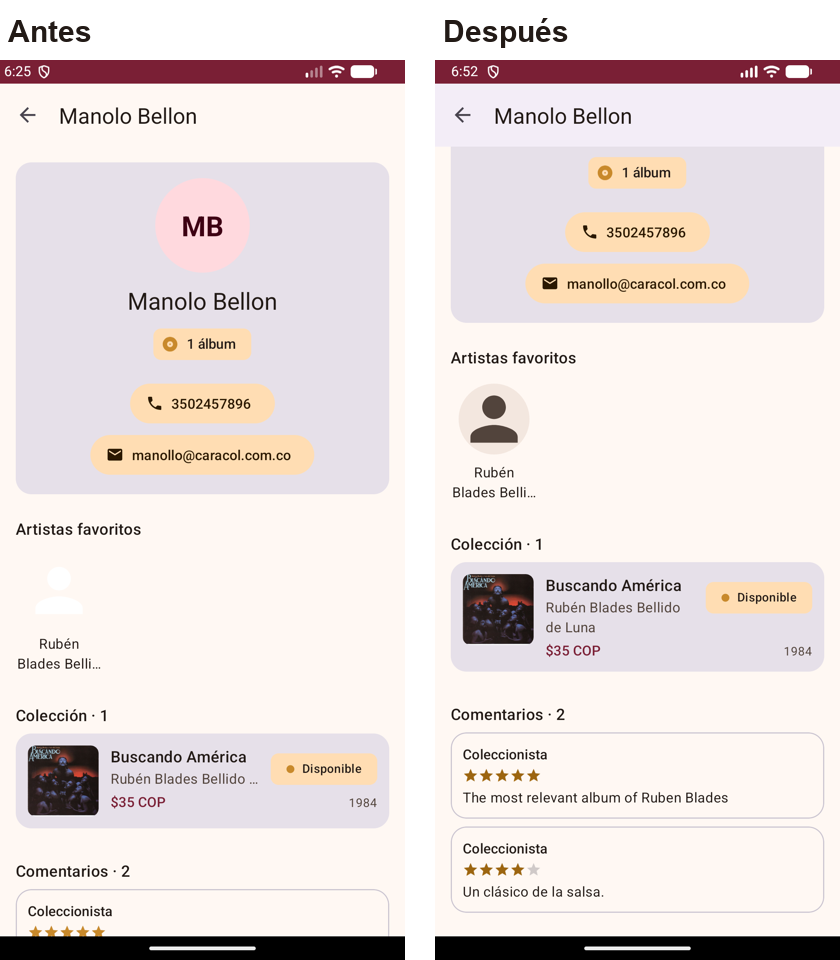
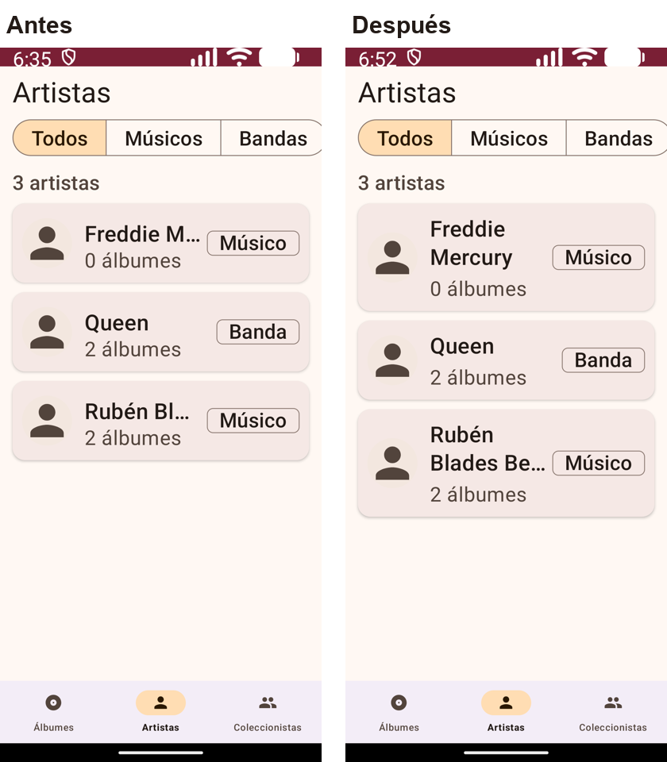

# Revisión de accesibilidad · Sprint 3

Revisión de accesibilidad de las 8 pantallas de HU01 a HU08 ([#69](https://github.com/manuel-jose-marin/vinilos-mobile/issues/69)), con las reglas de la sección *Accesibilidad en la arquitectura* del [[diseño arquitectónico del Sprint 3|Diseno-arquitectonico-Sprint-3]] y los criterios de la fila *Accesibilidad* de la [[estrategia de pruebas|Estrategia-pruebas-Sprint-3]]: etiquetas de contenido, áreas táctiles de 48 dp, contraste mínimo y orden de lectura.

**Resultado:** ninguna pantalla tiene errores de Accessibility Test Framework. Se encontraron **6 defectos** (4 de severidad media y 2 de baja), todos corregidos en el mismo PR y cada uno con una prueba que fallaba antes de la corrección. Queda pendiente una pasada manual con TalkBack.

## 1. Cómo se revisó

| Técnica | Herramienta | Qué cubre |
|---|---|---|
| Revisión automática | `AccessibilityTest` (9 pruebas Espresso) con [Accessibility Test Framework](https://github.com/google/Accessibility-Test-Framework-for-Android) 3.1.2, el mismo motor de Accessibility Scanner | Las 8 pantallas con datos reales de BackVynils, incluidos los formularios vacíos y con errores de validación. Revisa etiquetas para lectores de pantalla, áreas táctiles, contraste de texto e imágenes (sobre una captura), orden de lectura y textos repetidos. Falla si hay errores; las advertencias quedan en logcat con la etiqueta `A11Y`. |
| Medición de contraste | Fórmula de WCAG 2.1 sobre los colores del tema y sobre píxeles de capturas | Los pares de colores del tema y cada advertencia de contraste de ATF, para separar defectos de falsos positivos. |
| Árbol de accesibilidad | `uiautomator dump` | Lo que TalkBack recibe de cada control: texto, descripción y si es enfocable. |
| Texto grande | `font_scale` al 200 % (el máximo de Android) | Textos cortados, encimados o fuera de pantalla. |
| Teclado abierto | Formulario de álbum y hoja "Agregar track" | Que "Cancelar" y "Agregar" sigan visibles (criterio 10 de HU08). |
| Revisión de código | `CreateAlbumFragment`, `AddTrackBottomSheet` y los fragmentos de detalle | Errores con `setError`, foco en el primer campo con error y mensajes con `Snackbar`. |

Entorno: emulador `Medium_Phone_API_37.0` (Android 17, 1080 × 2400 px) contra `https://backvynils-grupo5.onrender.com/`, el 23 de noviembre de 2026.

## 2. Resultado por regla del diseño

| Regla (diseño arquitectónico, #64) | Resultado |
|---|---|
| Toda imagen con información tiene `contentDescription`; las decorativas usan `importantForAccessibility="no"` | Cumple. Ninguna imagen sin descripción ni marca de decorativa. |
| Los botones de solo ícono tienen una descripción con la acción | Cumplía en la flecha de regreso y en el calendario. **No cumplía** en las flechas de Género y Sello ([#171](https://github.com/manuel-jose-marin/vinilos-mobile/issues/171)) ni en teléfono y correo ([#172](https://github.com/manuel-jose-marin/vinilos-mobile/issues/172)). Corregido. |
| Áreas táctiles de al menos 48 dp | Cumple. ATF no reporta áreas pequeñas en ninguna pantalla. |
| Cada campo usa el hint de `TextInputLayout` como etiqueta y los errores usan `setError` | Cumple en el formulario de álbum y en la hoja "Agregar track". |
| Al fallar la validación, el foco pasa al primer campo con error | Cumple. El formulario de álbum además se desplaza hasta el campo. |
| Textos en `sp` y contraste mínimo de 4.5:1 | Cumple en los textos: todos los pares del tema dan entre 6.1 y 16.3:1. **No cumplía** en las estrellas ([#170](https://github.com/manuel-jose-marin/vinilos-mobile/issues/170)) ni en la foto genérica de artista ([#169](https://github.com/manuel-jose-marin/vinilos-mobile/issues/169)), que son gráficos (WCAG 1.4.11 pide 3:1). Corregido. |
| Confirmaciones y errores con `Snackbar` | Cumple en el catálogo, el detalle del álbum y los dos formularios. |
| Ningún dato depende solo del color | Cumple. El estado de un álbum de la colección tiene punto y texto ("Disponible"). |
| Con el teclado abierto se ven "Cancelar" y "Agregar" (criterio 10 de HU08) | Cumple. |

Además de las reglas del diseño se revisaron dos puntos de WCAG que el diseño no menciona: el texto grande (1.4.4, [#173](https://github.com/manuel-jose-marin/vinilos-mobile/issues/173)) y los encabezados de sección para navegar con TalkBack (2.4.6, [#174](https://github.com/manuel-jose-marin/vinilos-mobile/issues/174)).

## 3. Defectos encontrados y corregidos

| Issue | Historias | Severidad | Defecto | Corrección | Prueba |
|---|---|---|---|---|---|
| [#169](https://github.com/manuel-jose-marin/vinilos-mobile/issues/169) | HU03, HU04, HU06 | Media | La foto genérica de artista es una silueta blanca sobre fondo claro: 1.05:1 | `ic_artist_placeholder`, silueta `on_surface_variant` sobre `cream_variant` (7.7:1), en el listado, el detalle, los integrantes y los favoritos | Desaparecen las advertencias `ImageContrastCheck` de ATF |
| [#170](https://github.com/manuel-jose-marin/vinilos-mobile/issues/170) | HU02, HU06 | Baja | Estrellas en ámbar `#C8892B`: 2.83:1 | Color `amber_dark` `#9C6510` (4.7:1 sobre crema), del mismo tono | `commentStars_haveEnoughContrastAgainstTheSurface` |
| [#171](https://github.com/manuel-jose-marin/vinilos-mobile/issues/171) | HU07 | Media | Las flechas de Género y Sello tienen la misma descripción genérica | "Ver los géneros" y "Ver los sellos discográficos" | `createAlbumForm_dropdownIconsSayWhichListTheyOpen` |
| [#172](https://github.com/manuel-jose-marin/vinilos-mobile/issues/172) | HU06 | Media | Teléfono y correo solo leen el dato, no la acción | "Llamar a Manolo Bellon al 3502457896" y "Escribir un correo a Manolo Bellon a manollo@caracol.com.co" | `collectorDetail_contactButtonsSayTheAction` |
| [#173](https://github.com/manuel-jose-marin/vinilos-mobile/issues/173) | HU01, HU03, HU05, HU06 | Media | A 200 % se cortan los nombres, y la fila de artista se encima si el nombre ocupa dos líneas | Nombres en hasta dos líneas y la fila de artista en una cadena vertical que crece con el texto | `artistRow_growsInsteadOfOverlappingWithLargeText` |
| [#174](https://github.com/manuel-jose-marin/vinilos-mobile/issues/174) | HU02, HU04, HU06 | Baja | Los títulos de sección no son encabezados | `ViewCompat.setAccessibilityHeading` en los 9 títulos de los tres detalles (`markAsHeadings`), que funciona desde API 21 | `albumDetail_sectionTitlesAreHeadings` y `collectorDetail_contactButtonsSayTheAction` |

Las cinco pruebas de `AccessibilityFixesTest` fallan con el código de `develop` (`e0fc14a`) y pasan con las correcciones.





## 4. Advertencias de ATF que no son defectos

Después de las correcciones quedan 27 advertencias. Se revisaron una por una:

| Advertencias | Dónde | Por qué no es un defecto |
|---|---|---|
| 19 `TextContrastCheck` | Chips de tipo, género y sello; filtros de artistas; campos de los dos formularios | ATF estima el color del texto a partir de la captura y toma el borde gris del control (`#85736B`) como si fuera el texto. Medido en la captura, el texto real da entre 8.5 y 16.3:1. El borde da 4.3:1, por encima del 3:1 para componentes. |
| 3 `DuplicateSpeakableTextCheck` | Barra inferior | La pestaña activa ("Álbumes", "Artistas", "Coleccionistas") se llama igual que el título de la pantalla. Es lo esperado. |
| 3 `DuplicateSpeakableTextCheck` | Formulario de álbum | El botón "Crear álbum" repite el título del formulario. |
| 1 `DuplicateSpeakableTextCheck` | Tarjeta de álbum | ATF solo considera la descripción de la portada. En el árbol de accesibilidad la tarjeta es un único elemento que lee "Portada del álbum, Buscando América, Rubén Blades Bellido de Luna, 1984 · Salsa". |
| 1 `DuplicateSpeakableTextCheck` | Favorito del coleccionista | El nombre del favorito es el mismo que el artista del álbum de la colección. |

Las advertencias de contraste dependen de la captura: si la pantalla se reacomoda mientras cargan las portadas, ATF compara colores de posiciones que ya no coinciden. `auditAccessibility` espera a que la interfaz esté quieta, pero conviene confirmar con una medición cualquier advertencia nueva de contraste antes de tratarla como defecto.

## 5. Pendiente y limitaciones

- **Pasada manual con TalkBack.** TalkBack está instalado en el emulador, pero los gestos que se envían con `adb` no mueven su foco, así que la lectura se verificó con el árbol de accesibilidad y no de oído. Falta recorrer las 8 pantallas con TalkBack en un teléfono, revisando sobre todo el orden de lectura del detalle de coleccionista y de la hoja "Agregar track".
- **API 21.** Los encabezados se marcaban al principio con el atributo `android:accessibilityHeading`, que solo existe desde Android 9 (API 28): en Android 5 a 8 los títulos se leían como texto normal, y las dos pruebas de encabezados fallaban en API 21 con `NoSuchMethodError`. Ahora se marcan con `ViewCompat.setAccessibilityHeading`, que en versiones anteriores a API 28 los expone a TalkBack con un delegado de accesibilidad, y las pruebas los comprueban con `ViewCompat.isAccessibilityHeading`.
- **Nombres de más de dos líneas.** A 200 %, "Rubén Blades Bellido de Luna" necesita tres líneas y sigue cortándose en la segunda. TalkBack lee el nombre completo y el detalle lo muestra entero.
- **Tema oscuro.** La app no tiene tema oscuro, así que no aplica.

## 6. Observaciones fuera de la accesibilidad

- **Fotos de artistas que no cargan.** Wikimedia responde 403 a los User-Agent genéricos, incluido el de Android, y 429 cuando recibe muchas peticiones. Además, el servidor de la foto de Queen ya no existe y la miniatura de Rubén Blades responde 400; el archivo original sí carga. Por eso esas pantallas muestran la foto genérica. Hay dos opciones: enviar un User-Agent propio en Glide o cambiar las URL del seed.
- **Color de las tarjetas.** El encabezado del detalle de coleccionista, las tarjetas de la colección y la hoja "Agregar track" usan un gris lila (`#E6E0E9`, `#F7F2FA`), que es el `colorSurfaceContainer*` por defecto de Material 3. `Theme.Vinilos` no define esos roles, así que no siguen la paleta crema del diseño. No afecta el contraste.

## 7. Cómo repetir la revisión

```bash
# Emulador con las animaciones desactivadas y BackVynils despierto
./gradlew connectedDebugAndroidTest \
  -Pvinilos.baseUrl=https://backvynils-grupo5.onrender.com/ \
  -Pandroid.testInstrumentationRunnerArguments.class=co.edu.uniandes.vinilos.AccessibilityTest
adb logcat -d -s A11Y:I   # advertencias por pantalla
```

`AccessibilityFixesTest` corre con el resto de la suite y protege las seis correcciones.
