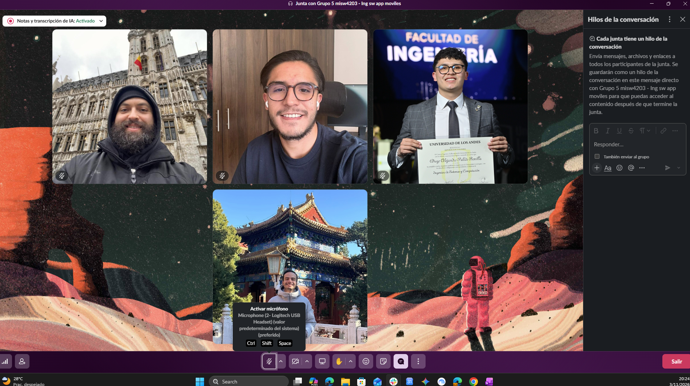

## Semana 5: Reunión de inicio del Sprint 2 y Sprint Planning

**Fecha:** 2026-11-03 · **Hora:** 8:00 p. m. a 9:00 p. m. (hora Colombia) · **Medio:** Google Meet  
**Facilitador:** Felipe Rojas

**Asistentes:** Manuel José Marín, Miguel Rincón, Felipe Rojas, Alejandro Pulido

### Evidencia

- Registro de la reunión de coordinación del equipo y Sprint Planning de la Iteración 2.

### Temas tratados

1. **Revisión del cierre del Sprint 1 y velocidad medida:** Se analizó el desempeño del Sprint 1 (8 Story Points entregados de 8 comprometidos). Se revisó el burndown chart, la retrospectiva y la necesidad de ajustar el registro de tareas en GitHub Projects cerrando los issues al momento de fusionar cada PR (`Closes #N`).

2. **Alcance y Sprint Planning de la Iteración 2:** Se definió el alcance del Sprint 2 seleccionando las historias de usuario **HU03** (*Consultar el listado de artistas*, 3 SP), **HU04** (*Consultar la información detallada de un artista*, 5 SP) y **HU05** (*Consultar listado de coleccionistas*, 2 SP). El compromiso total del Sprint sube a **10 Story Points**.

3. **Distribución de tareas y responsabilidades:**
   - **Manuel José Marín:**
     - `#43` Diseño arquitectónico del Sprint 2
     - `#39` Servicio REST de coleccionistas (`GET /collectors`)
     - `#35` Repo/VM del detalle de artista (depende del servicio `#34`)
   - **Miguel Rincón:**
     - `#111` Sprint planning de la iteración 2
     - `#112` Acta de semanas 5 y 6
     - `#44` Estrategia de pruebas del Sprint 2
     - `#28` Layout del listado de artistas
   - **Felipe Rojas:**
     - `#110` Burndown y reflexión del Sprint 1
     - `#29` Servicio REST de artistas (`GET /musicians`, `GET /bands`)
     - `#33` Layout del detalle de artista
   - **Alejandro Pulido:**
     - `#38` Layout del listado de coleccionistas
     - `#34` Servicio REST del detalle de artista (`GET /musicians/{id}`, `GET /bands/{id}`)
     - `#30` Repo/VM del listado de artistas (depende del servicio `#29`)
   - **Todos:**
     - Coevaluación individual en Coursera (4 formularios) antes del miércoles.

4. **Dependencias técnicas y documentación:**
   - Se identificó que el desarrollo del Repo/VM del listado de artistas (`#30`) depende de la disponibilidad del servicio REST de artistas (`#29`).
   - Se identificó que el desarrollo del Repo/VM del detalle de artista (`#35`) depende del servicio REST del detalle de artista (`#34`).
   - Se acordó completar la documentación del burndown chart y las reflexiones del Sprint 1 (`#110`).

---

## Sprint Goal

Implementar y validar las funcionalidades de consulta del listado de artistas (músicos y bandas), consulta detallada de la información de un artista y consulta del listado de coleccionistas, garantizando la extensión coherente de la arquitectura MVVM, integración con la API REST de BackVynils, navegación entre pantallas, ejecución de pruebas unitarias y E2E con Espresso, y la realización de análisis de desempeño y micro-optimizaciones durante la Iteración 2.

---

## Estimación y asignación de historias de usuario

| Historia de Usuario | Descripción | Story Points | Responsable Principal |
|----------|-------------|:-------------:|-------------|
| HU03 | Consultar el listado de artistas | 3 SP | Felipe Rojas / Alejandro Pulido / Miguel Rincón |
| HU04 | Consultar la información detallada de un artista | 5 SP | Felipe Rojas / Alejandro Pulido / Manuel José Marín |
| HU05 | Consultar listado de coleccionistas | 2 SP | Alejandro Pulido / Manuel José Marín |

### Asignación detallada de tareas e issues del Sprint 2

| Integrante | Tarea / Issue | Tipo | Dependencia |
|------------|---------------|:----:|:-----------:|
| **Manuel José Marín** | `#43` Diseño arquitectónico del Sprint 2 | Documentación | — |
| | `#39` Servicio REST de coleccionistas | Desarrollo | — |
| | `#35` Repo/VM del detalle de artista | Desarrollo | Requiere `#34` |
| **Miguel Rincón** | `#111` Sprint planning de la iteración 2 | Gestión | — |
| | `#112` Acta de semanas 5 y 6 | Gestión | — |
| | `#44` Estrategia de pruebas del Sprint 2 | Pruebas | — |
| | `#28` Layout del listado de artistas | Diseño UI | — |
| **Felipe Rojas** | `#110` Burndown y reflexión del Sprint 1 | Gestión | — |
| | `#29` Servicio REST de artistas | Desarrollo | — |
| | `#33` Layout del detalle de artista | Diseño UI | — |
| **Alejandro Pulido** | `#38` Layout del listado de coleccionistas | Diseño UI | — |
| | `#34` Servicio REST del detalle de artista | Desarrollo | — |
| | `#30` Repo/VM del listado de artistas | Desarrollo | Requiere `#29` |
| **Todos** | Coevaluación individual (4 formularios) | Coevaluación | Antes del miércoles |

### Capacidad del equipo

Se estableció una capacidad planificada de **10 Story Points** para la Iteración 2 (25% superior a la velocidad medida del Sprint 1). El equipo acordó realizar un seguimiento continuo del avance a mitad de sprint mediante el burndown chart y cerrar los issues de manera oportuna al fusionar cada Pull Request.

---

## Definition of Done (DoD)

Una historia de usuario se considerará terminada cuando cumpla con todos los siguientes criterios:

- La funcionalidad implementada satisface todos los criterios de aceptación definidos para la historia de usuario.
- El código fuente ha sido integrado correctamente en la rama `develop` mediante Pull Request con *squash and merge* y revisión por pares.
- La aplicación compila y ejecuta correctamente sin errores críticos en Android Lollipop (API 21) y Android 15 (API 35).
- Las pruebas unitarias y automatizadas E2E (Espresso) asociadas fueron ejecutadas satisfactoriamente.
- Se documentaron el análisis de desempeño y las micro-optimizaciones requeridas en la wiki.
- No existen defectos bloqueantes o críticos pendientes.
- La documentación técnica (arquitectura, estrategia e inventario de pruebas) fue actualizada en la wiki.
- Los issues asociados se encuentran actualizados y cerrados en GitHub Projects usando `Closes #N`.

---

## Decisiones

- Se aprueba la planeación del Sprint 2 con el desarrollo de las historias HU03, HU04 y HU05.
- Se aprueba un compromiso de 10 Story Points para la Iteración 2.
- Se adopta la regla de cerrar cada issue automáticamente al fusionar el PR correspondiente mediante la sintaxis `Closes #N`.
- Se aprueba la distribución de tareas técnicas, de diseño, de pruebas y de documentación acordada durante la sesión.
- Se aprueba el esquema de desarrollo en paralelo considerando las dependencias de `#30` sobre `#29` y de `#35` sobre `#34`.

---

## Compromisos

| Tarea / Issue | Responsable | Fecha límite |
|---|---|---|
| Completar los 4 formularios de coevaluación en Coursera | Todos | 2026-11-05 |
| `#111` Sprint planning de la iteración 2 | Miguel Rincón | 2026-11-05 |
| `#112` Acta de semanas 5 y 6 | Miguel Rincón | 2026-11-05 |
| `#43` Diseño arquitectónico del Sprint 2 | Manuel José Marín | 2026-11-08 |
| `#44` Estrategia de pruebas del Sprint 2 | Miguel Rincón | 2026-11-08 |
| `#28` Layout del listado de artistas | Miguel Rincón | 2026-11-08 |
| `#110` Burndown y reflexión del Sprint 1 | Felipe Rojas | 2026-11-08 |
| `#29` Servicio REST de artistas | Felipe Rojas | 2026-11-08 |
| `#33` Layout del detalle de artista | Felipe Rojas | 2026-11-08 |
| `#38` Layout del listado de coleccionistas | Alejandro Pulido | 2026-11-08 |
| `#34` Servicio REST del detalle de artista | Alejandro Pulido | 2026-11-08 |
| `#39` Servicio REST de coleccionistas | Manuel José Marín | 2026-11-08 |
| `#30` Repo/VM del listado de artistas (tras `#29`) | Alejandro Pulido | 2026-11-11 |
| `#35` Repo/VM del detalle de artista (tras `#34`) | Manuel José Marín | 2026-11-11 |

---

### Resultado del Sprint Planning

El equipo acordó desarrollar las historias de usuario HU03, HU04 y HU05 durante la Iteración 2, comprometiéndose con una capacidad total de 10 Story Points. Se asignaron los issues correspondientes a cada integrante con sus dependencias explícitas y se estableció el compromiso de realizar la coevaluación antes del miércoles.
