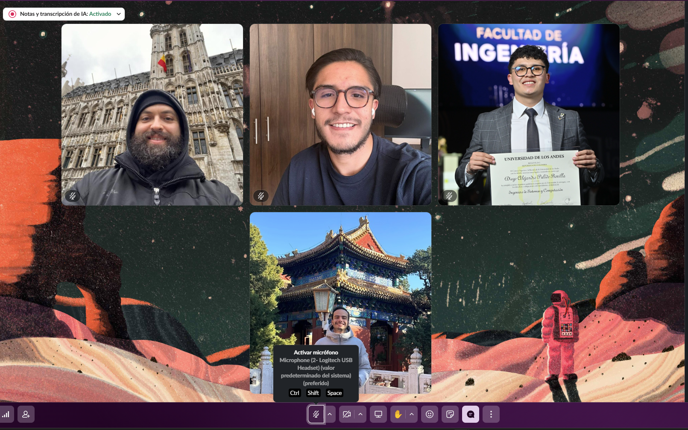

## Semana 7: Reunión de inicio del Sprint 3 y Sprint Planning

**Fecha:** 2026-11-17 · **Hora:** 8:00 p. m. a 9:00 p. m. (hora Colombia) · **Medio:** Google Meet  
**Facilitador:** Alejandro Pulido

**Asistentes:** Manuel José Marín, Miguel Rincón, Felipe Rojas, Alejandro Pulido

### Evidencia

- Registro de la reunión de coordinación del equipo y Sprint Planning de la Iteración 3.

### Temas tratados

1. **Revisión del cierre del Sprint 2 y velocidad medida:** Se analizó el desempeño del Sprint 2 (10 Story Points entregados de 10 comprometidos). Se revisaron las métricas del burndown chart, los reportes de desempeño de corrutinas/memoria y las recomendaciones de la retrospectiva para este sprint final.

2. **Alcance y Sprint Planning de la Iteración 3 (MVP final):** Se definió el alcance del Sprint 3 seleccionando las últimas tres historias de usuario del MVP: **HU06** (*Consultar la información detallada de coleccionista*, 3 SP), **HU07** (*Crear un álbum*, 5 SP) y **HU08** (*Asociar tracks con un álbum*, 5 SP). El compromiso total del Sprint sube a **13 Story Points**.

3. **Distribución de tareas y responsabilidades:**
   - **Manuel José Marín:**
     - `#51` Implementar repositorio y ViewModel del detalle de coleccionista
     - `#55` Implementar validación de campos del formulario de álbum
     - `#59` Diseñar formulario para agregar tracks desde el detalle del álbum
     - `#63` Pruebas E2E con Espresso de asociación de tracks
     - `#64` Documentar diseño arquitectónico del Sprint 3 en la wiki
     - `#67` Análisis de desempeño del Sprint 3
     - `#71` Retrospectiva del Sprint 3
   - **Miguel Rincón:**
     - `#52` Vista del detalle de coleccionista (`CollectorDetailFragment`) y navegación desde el listado
     - `#56` Servicio REST de creación de álbum (`POST /albums`)
     - `#60` Servicio REST para asociar tracks (`POST /albums/{id}/tracks`)
     - `#68` Pruebas de reconocimiento aleatorias (Monkey) y exploración sistemática
     - Actas de las semanas 7 y 8 / Sprint Planning
   - **Felipe Rojas:**
     - `#49` Diseñar layout del detalle de coleccionista
     - `#53` Pruebas E2E con Espresso del detalle de coleccionista
     - `#57` Implementar repositorio y ViewModel de creación de álbum con manejo de errores
     - `#61` Implementar repositorio y ViewModel para agregar tracks
     - `#65` Definir estrategia de pruebas del Sprint 3
     - `#69` Revisión de accesibilidad de la app
   - **Alejandro Pulido:**
     - `#50` Implementar servicio REST del detalle de coleccionista (`GET /collectors/{id}`)
     - `#54` Diseñar formulario de creación de álbum
     - `#58` Pruebas E2E con Espresso de creación de álbum
     - `#62` Mostrar tracks actualizados en el detalle del álbum
     - `#66` Inventario de pruebas y reporte de defectos del Sprint 3
   - **Todos:**
     - Coevaluación individual en Coursera antes del sábado.

4. **Dependencias técnicas y flujo de integración:**
   - Cadena HU06: `#49` / `#50` → `#51` → `#52` → `#53`.
   - Cadena HU07: `#54` → `#55` / `#56` → `#57` → `#58`.
   - Cadena HU08: `#59` → `#60` → `#61` → `#62` → `#63`.
   - Se acordó el uso de dobles de prueba (`fakes/`) para iniciar el desarrollo de ViewModels y pantallas en paralelo sin bloquearse por la disponibilidad de los servicios REST.

---

## Sprint Goal

Completar el MVP del producto implementando la consulta detallada de coleccionistas, la creación de nuevos álbumes con validación de formularios y la asociación de tracks desde el detalle del álbum, garantizando la arquitectura MVVM, la cobertura de pruebas unitarias y E2E con Espresso, pruebas no funcionales de accesibilidad, desempeño y reconocimiento aleatorio (Monkey), finalizando con la publicación del release oficial `v3.0.0`.

---

## Estimación y asignación de historias de usuario

| Historia de Usuario | Descripción | Story Points | Responsable Principal |
|----------|-------------|:-------------:|-------------|
| HU06 | Consultar la información detallada de coleccionista | 3 SP | Alejandro Pulido / Manuel José Marín / Miguel Rincón |
| HU07 | Crear un álbum | 5 SP | Alejandro Pulido / Manuel José Marín / Felipe Rojas |
| HU08 | Asociar tracks con un álbum | 5 SP | Manuel José Marín / Felipe Rojas / Alejandro Pulido |

### Asignación detallada de tareas e issues del Sprint 3

| Integrante | Tarea / Issue | Tipo |      Dependencia      |
|------------|---------------|:----:|:---------------------:|
| **Manuel José Marín** | `#51` Repo y ViewModel del detalle de coleccionista | Desarrollo |    Requiere `#50`     |
| | `#55` Validación de campos del formulario de álbum | Desarrollo |           —           |
| | `#59` Diseñar formulario para agregar tracks | Diseño UI |           —           |
| | `#63` Pruebas E2E con Espresso de asociación de tracks | Pruebas |    Requiere `#62`     |
| | `#64` Documentar diseño arquitectónico del Sprint 3 | Documentación |           —           |
| | `#67` Análisis de desempeño del Sprint 3 | Pruebas |    Al integrar HUs    |
| | `#71` Retrospectiva del Sprint 3 | Gestión |   Cierre del sprint   |
| **Miguel Rincón** | `#52` Vista del detalle de coleccionista y navegación | Desarrollo UI |    Requiere `#51`     |
| | `#56` Servicio REST de creación de álbum (`POST /albums`) | Desarrollo |           —           |
| | `#60` Servicio REST para asociar tracks (`POST /albums/{id}/tracks`) | Desarrollo |           —           |
| | `#68` Pruebas de reconocimiento aleatorias y exploración | Pruebas |           —           |
| | Actas de las semanas 7 y 8 / Sprint Planning | Gestión |           —           |
| **Felipe Rojas** | `#49` Diseñar layout del detalle de coleccionista | Diseño UI |           —           |
| | `#53` Pruebas E2E con Espresso del detalle de coleccionista | Pruebas |    Requiere `#52`     |
| | `#57` Repo y ViewModel de creación de álbum | Desarrollo | Requiere `#55`, `#56` |
| | `#61` Repo y ViewModel para agregar tracks | Desarrollo |    Requiere `#60`     |
| | `#65` Definir estrategia de pruebas del Sprint 3 | Pruebas |           —           |
| | `#69` Revisión de accesibilidad de la app | Pruebas |           —           |
| **Alejandro Pulido** | `#50` Servicio REST del detalle de coleccionista | Desarrollo |           —           |
| | `#54` Diseñar formulario de creación de álbum | Diseño UI |           —           |
| | `#58` Pruebas E2E con Espresso de creación de álbum | Pruebas |    Requiere `#57`     |
| | `#62` Mostrar tracks actualizados en el detalle del álbum | Desarrollo UI |    Requiere `#61`     |
| | `#66` Inventario de pruebas y reporte de defectos del Sprint 3 | Pruebas |   Cierre del sprint   |
| **Todos** | Coevaluación individual final en Coursera | Coevaluación |   Antes del sábado    |

### Capacidad del equipo

Se estableció un compromiso de **13 Story Points** para la Iteración 3 (promedio acumulado de 9.5 SP/sprint). Se acordó una revisión a mitad de sprint (miércoles 25 de noviembre) para verificar la curva del burndown chart y asegurar que la documentación no funcional quede lista el viernes 27 de noviembre.

---

## Definition of Done (DoD)

Una historia de usuario se considerará terminada cuando cumpla con todos los siguientes criterios:

- La funcionalidad implementada satisface el 100% de los criterios de aceptación definidos para la historia de usuario.
- El código fuente ha sido integrado correctamente en la rama `develop` mediante Pull Request con *squash and merge* y al menos una aprobación por pares.
- La aplicación compila y ejecuta correctamente sin errores ni cierres inesperados en Android 5.0 (API 21) y Android 15 (API 35).
- Las pruebas unitarias y automatizadas E2E (Espresso) asociadas se ejecutan de forma exitosa y reproducible.
- Se realizaron y documentaron las pruebas no funcionales de accesibilidad, desempeño y reconocimiento aleatorio (Monkey).
- No existen defectos de severidad alta abiertos.
- La documentación técnica (arquitectura, estrategia e inventario de pruebas) fue actualizada en la wiki.
- Los issues asociados se encuentran actualizados y cerrados en GitHub Projects con `Closes #N`.

---

## Decisiones

- Se aprueba el plan de trabajo del Sprint 3 con las historias HU06, HU07 y HU08.
- Se aprueba una capacidad planificada de 13 Story Points para culminar el MVP del proyecto.
- Se aprueba el uso de dobles de prueba (`fakes/`) en las tareas de ViewModels para permitir el desarrollo en paralelo sin bloquearse por la capa de red.
- Se fija el viernes 27 de noviembre como fecha límite interna para la entrega de pruebas no funcionales y documentación técnica.

---

## Compromisos

| Tarea / Issue | Responsable | Fecha límite |
|---|---|--------------|
| Completar los formularios de coevaluación en Coursera | Todos | 2026-11-21   |
| Actas de las semanas 7 y 8 / Sprint Planning | Miguel Rincón | 2026-11-21   |
| `#49` Diseñar layout del detalle de coleccionista | Felipe Rojas | 2026-11-22   |
| `#50` Servicio REST del detalle de coleccionista | Alejandro Pulido | 2026-11-22   |
| `#54` Diseñar formulario de creación de álbum | Alejandro Pulido | 2026-11-22   |
| `#55` Validación de campos del formulario de álbum | Manuel José Marín | 2026-11-22   |
| `#56` Servicio REST de creación de álbum | Miguel Rincón | 2026-11-22   |
| `#59` Diseñar formulario para agregar tracks | Manuel José Marín | 2026-11-22   |
| `#60` Servicio REST para asociar tracks | Miguel Rincón | 2026-11-22   |
| `#65` Definir estrategia de pruebas del Sprint 3 | Felipe Rojas | 2026-11-22   |
| `#51` Repo y ViewModel del detalle de coleccionista (tras `#50`) | Manuel José Marín | 2026-11-22   |
| `#52` Vista del detalle de coleccionista (tras `#51`) | Miguel Rincón | 2026-11-22   |
| `#57` Repo y ViewModel de creación de álbum (tras `#55`, `#56`) | Felipe Rojas | 2026-11-27   |
| `#61` Repo y ViewModel para agregar tracks (tras `#60`) | Felipe Rojas | 2026-11-27   |
| `#62` Mostrar tracks actualizados en el detalle (tras `#61`) | Alejandro Pulido | 2026-11-27   |
| `#64` Documentar diseño arquitectónico del Sprint 3 en la wiki | Manuel José Marín | 2026-11-22   |
| `#67` Análisis de desempeño del Sprint 3 | Manuel José Marín | 2026-11-27   |
| `#68` Pruebas de reconocimiento aleatorias y exploración | Miguel Rincón | 2026-11-27   |
| `#69` Revisión de accesibilidad de la app | Felipe Rojas | 2026-11-27   |
| `#53` Pruebas E2E del detalle de coleccionista | Felipe Rojas | 2026-11-27   |
| `#58` Pruebas E2E de creación de álbum | Alejandro Pulido | 2026-11-27   |
| `#63` Pruebas E2E de asociación de tracks | Manuel José Marín | 2026-11-27   |
| `#66` Inventario de pruebas, defectos y Release v3.0.0 | Alejandro Pulido | 2026-11-27   |
| `#71` Retrospectiva del Sprint 3 | Manuel José Marín | 2026-11-27   |

---

### Resultado del Sprint Planning

El equipo aprobó el plan de trabajo del Sprint 3 para completar las historias HU06, HU07 y HU08 con un compromiso de 13 Story Points. Se asignaron los issues correspondientes a cada integrante con sus dependencias explícitas y se estableció el compromiso de realizar la coevaluación antes del sábado.
