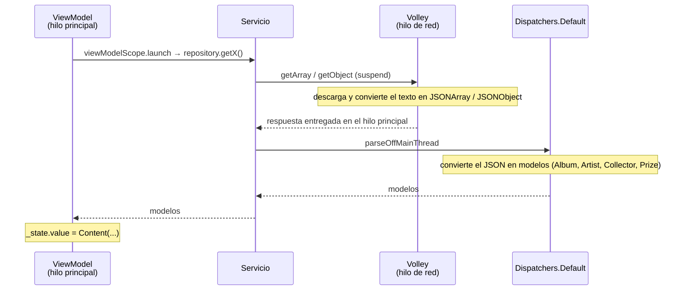

# Corrutinas y memoria · Sprint 2

Revisión de **HU01 a HU05** con dos objetivos ([#114](https://github.com/manuel-jose-marin/vinilos-mobile/issues/114)):

1. Que ninguna llamada de red ni procesamiento de datos corra en el hilo principal, para evitar ANR (_Application Not Responding_).
2. Aplicar buenas prácticas de consumo de memoria en imágenes, bindings y ciclo de vida.

Las mediciones de antes y después están en el [[Análisis de desempeño|Analisis-desempeno-Sprint-2]].

## En qué hilo corre cada paso de una petición

- El ViewModel lanza la carga en `viewModelScope`: si el usuario sale de la pantalla, la corrutina se cancela y `NetworkServiceAdapter` cancela la petición de Volley (`invokeOnCancellation`).
- La descarga ocurre en el hilo de red de Volley, pero Volley entrega la respuesta en el hilo principal. Antes de este cambio, recorrer el JSON para crear los modelos también ocurría ahí.

## Cambios aplicados

| # | Problema | Cambio | Dónde | HU |
|---|---|---|---|---|
| 1 | Convertir el JSON en modelos ocurría en el hilo principal, porque Volley entrega la respuesta allí. Con listas grandes (por ejemplo, álbumes con todos sus tracks y comentarios) bloquea la interfaz | `parseOffMainThread()` hace la conversión en `Dispatchers.Default` | `JsonParsing.kt` y los 8 métodos de `AlbumService`, `ArtistService`, `CollectorService` y `PrizeService` | HU01 a HU05 |
| 2 | Tocar "Reintentar" mientras cargaba lanzaba una segunda corrutina: dos peticiones a la vez, y la respuesta tardía de la primera podía reemplazar a la nueva | Cada ViewModel guarda la carga en curso (`loadJob`) y la cancela antes de empezar otra; al cancelarla también se cancela la petición de Volley | `AlbumListViewModel`, `AlbumDetailViewModel`, `ArtistListViewModel`, `ArtistDetailViewModel`, `CollectorListViewModel` | HU01 a HU05 |
| 3 | Cada `submitList()` podía volver a medir la pantalla completa | `setHasFixedSize(true)`: el tamaño de la lista no depende de su contenido | `rv_albums`, `rv_artists`, `rv_collectors` | HU01, HU03, HU05 |
| 4 | No había forma automática de detectar red o disco en el hilo principal | `StrictMode` en las compilaciones de depuración: registra en Logcat (etiqueta `StrictMode`) accesos a red o disco en el hilo principal, objetos que no se cierran y actividades retenidas | `MainActivity` | Todas |

Cada ViewModel tiene una prueba nueva, `retry_whileLoading_cancelsThePreviousRequest`: la primera petición responde tarde, después de un reintento, y la pantalla debe conservar el resultado del reintento.

### Probado y descartado

| Cambio | Resultado medido | Decisión |
|---|---|---|
| Liberar la imagen de cada fila reciclada con `Glide.with(view).clear(view)` en `onViewRecycled()` (`AlbumAdapter`, `ArtistAdapter` y carrusel de `ArtistDetailFragment`) | La memoria nativa subió 3,5 MB en el listado de artistas y 7 MB en el detalle de artista, en las 5 corridas, sin mejorar ninguna otra métrica. `clear()` devuelve el bitmap al _pool_ de Glide, que lo conserva para reutilizarlo, en vez de liberarlo | Se revirtió. Glide ya cancela la carga anterior cuando la fila se vuelve a enlazar con `into()`, y libera su caché cuando el sistema pide memoria (`onTrimMemory`) |

El detalle de la medición está en el [[Análisis de desempeño|Analisis-desempeno-Sprint-2]].

## Prácticas que ya cumplía cada historia

| HU | Hilo y corrutinas | Memoria |
|---|---|---|
| HU01 Listado de álbumes | `viewModelScope`; servicios `suspend` sobre Volley | `ListAdapter` + `DiffUtil` (solo redibuja las filas que cambian); Glide con `with(view)`, ligado al ciclo de vida de la vista y con la imagen reducida al tamaño del `ImageView`; `adapter = null` y binding en `null` en `onDestroyView` |
| HU02 Detalle de álbum | Álbum y coleccionistas (autor de cada comentario) se piden en paralelo con `async`; si fallan los coleccionistas, el detalle se muestra igual | Binding en `null` en `onDestroyView`; tracks y comentarios se inflan en un `LinearLayout` porque son listas cortas dentro de un `ScrollView` |
| HU03 Listado de artistas | Músicos y bandas en paralelo con `async`; el filtro se aplica en memoria, sin peticiones nuevas | `ListAdapter` + `DiffUtil`; Glide con `with(view)`; `adapter = null` en `onDestroyView` |
| HU04 Detalle de artista | Artista y premios en paralelo con `async`; si fallan los premios, el detalle se muestra igual | El `post {}` que decide si mostrar "Leer más" revisa que la vista siga viva; el adaptador del carrusel se libera en `onDestroyView` |
| HU05 Listado de coleccionistas | `viewModelScope`; servicio `suspend` | Sin imágenes (el avatar son iniciales); `ListAdapter` + `DiffUtil`; `adapter = null` en `onDestroyView` |

En todas las pantallas el repositorio se crea con `applicationContext` (`NetworkServiceAdapter.getInstance` guarda el contexto de la aplicación, no el de la actividad), así que el _singleton_ de red no retiene actividades.

## Riesgos que quedan

| Riesgo | Por qué no se corrige ahora |
|---|---|
| HU02 descarga todos los coleccionistas solo para mostrar el autor de los comentarios; el costo crece con el número de coleccionistas | BackVynils no devuelve el autor dentro del comentario. Es una decisión del [[diseño arquitectónico|Diseno-arquitectonico-Sprint-2]]; se puede cambiar si el backend lo agrega |
| Combinar datos en los repositorios (ordenar artistas, completar premios y autores) sigue en el hilo principal | Son listas de decenas de elementos. Moverlo a otro hilo haría que las pruebas de los ViewModels dependan de hilos reales |

## Verificación

| Verificación | Resultado |
|---|---|
| Pruebas unitarias (`./gradlew testDebugUnitTest`) | 85 de 85 pasan, 5 de ellas nuevas. Con el cambio 2 deshecho, la prueba nueva de `CollectorListViewModel` falla, así que la prueba detecta el problema |
| Pruebas E2E con Espresso (`./gradlew connectedDebugAndroidTest`) | 20 de 20 pasan en el emulador Android 15 (API 35) contra BackVynils local |
| Android Lint (`./gradlew lintDebug`) | Sin hallazgos nuevos |
| StrictMode | 0 avisos en 8 recorridos completos de HU01 a HU05 con esta versión: ninguna lectura de red ni de disco en el hilo principal |
| Medición antes y después | Arranque, CPU, memoria y tiempo del hilo principal por frame sin diferencias medibles frente a `develop` con los datos actuales (12 a 22 elementos por lista). Ver el [[Análisis de desempeño|Analisis-desempeno-Sprint-2]] |

Con respuestas de 12 a 22 elementos, el cambio 1 no produce una diferencia medible: es preventivo. Su efecto crece con el tamaño de las respuestas, por ejemplo cuando HU07 y HU08 agreguen álbumes y tracks. El cambio 2 corrige un comportamiento incorrecto (dos peticiones a la vez y una respuesta vieja que reemplaza a la nueva), que las pruebas unitarias verifican.
