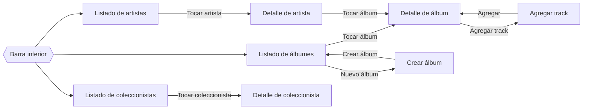

# Diseño UX/UI

Prototipo navegable compuesto de mockups (un nivel de detalle mayor a los wireframes) con las pantallas, componentes y transiciones de las 8 historias de usuario del MVP, construido en Google Stitch inicialmente y posteriormente refinado y mejorado en la herramienta de diseño open source Penpot.

### ▶️ [Abrir prototipo navegable Stitch](https://stitch.withgoogle.com/preview/8794366402634156219?node-id=826fc561b2514af3b1626060245f6f66)

### ▶️ [Abrir prototipo navegable Penpot](https://design.penpot.app/#/view?file-id=17193a1f-939a-80b5-8008-c515c098fe5d&page-id=17193a1f-939a-80b5-8008-c515c098fe5e&section=interactions&index=0&share-id=cd240047-b7fb-4186-98f1-b9598e3409a8)

---

## Sistema de diseño

Basado en **Material Design 3**, el estándar nativo de Android.

| Elemento | Definición |
|---|---|
| Color primario | Vino tinto `#7A1F35` |
| Color secundario | Ámbar `#C8892B` |
| Superficies | Tonos crema claros, tema claro |
| Tipografía | Roboto (escalas Headline y Body) |
| Formas | Tarjetas con esquinas de 16dp, botones tipo píldora |
| Navegación | Barra inferior con 3 destinos: Álbumes, Artistas, Coleccionistas |
| Accesibilidad | Áreas táctiles mínimas de 48dp, contraste de texto mínimo 4.5:1, íconos con etiqueta |

## Pantallas por historia de usuario

<table>
<tr>
<td align="center"><b>HU01</b> Listado de álbumes</td>
<td align="center"><b>HU02</b> Detalle de álbum</td>
<td align="center"><b>HU03</b> Listado de artistas</td>
<td align="center"><b>HU04</b> Detalle de artista</td>
</tr>
<tr>
<td></td>
<td></td>
<td></td>
<td></td>
</tr>
<tr>
<td align="center"><b>HU05</b> Listado de coleccionistas</td>
<td align="center"><b>HU06</b> Detalle de coleccionista</td>
<td align="center"><b>HU07</b> Crear álbum</td>
<td align="center"><b>HU08</b> Agregar track</td>
</tr>
<tr>
<td></td>
<td></td>
<td></td>
<td></td>
</tr>
</table>

## Componentes por pantalla

| HU | Pantalla | Componentes principales |
|---|---|---|
| HU01 | Listado de álbumes | Barra superior con búsqueda, chips de género, cuadrícula de tarjetas (portada, nombre, artista, año y género), botón flotante "Nuevo álbum" |
| HU02 | Detalle de álbum | Portada, chips de fecha, género y sello, descripción, lista de tracks con duración, comentarios de solo lectura, botón "Agregar track" |
| HU03 | Listado de artistas | Botón segmentado Todos / Músicos / Bandas, lista con avatar, nombre, tipo y número de álbumes |
| HU04 | Detalle de artista | Imagen, chip Músico o Banda, fecha, descripción, carrusel de álbumes, premios e integrantes (bandas) |
| HU05 | Listado de coleccionistas | Lista con iniciales, nombre, correo y número de álbumes |
| HU06 | Detalle de coleccionista | Datos de contacto, artistas favoritos, colección con precio y estado, comentarios |
| HU07 | Crear álbum | Formulario con nombre, URL y vista previa de portada, fecha, descripción, género y sello; validación de campos obligatorios |
| HU08 | Agregar track | Hoja inferior modal con nombre del track y duración (mm:ss) |

## Flujo de navegación

| Desde | Acción | Hacia |
|---|---|---|
| Cualquier pantalla principal | Barra inferior | Álbumes, Artistas o Coleccionistas |
| Listado de álbumes | Tocar una tarjeta | Detalle de álbum |
| Listado de álbumes | Botón "Nuevo álbum" | Crear álbum |
| Crear álbum | "Crear álbum" | Listado de álbumes con mensaje de confirmación |
| Detalle de álbum | "Agregar track" | Hoja inferior Agregar track |
| Agregar track | "Agregar" | Detalle de álbum con el track agregado |
| Listado de artistas | Tocar un artista | Detalle de artista |
| Detalle de artista | Tocar un álbum del carrusel | Detalle de álbum |
| Listado de coleccionistas | Tocar un coleccionista | Detalle de coleccionista |
| Pantallas de detalle y formularios | Flecha de regreso | Pantalla anterior |