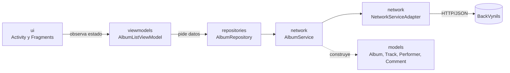
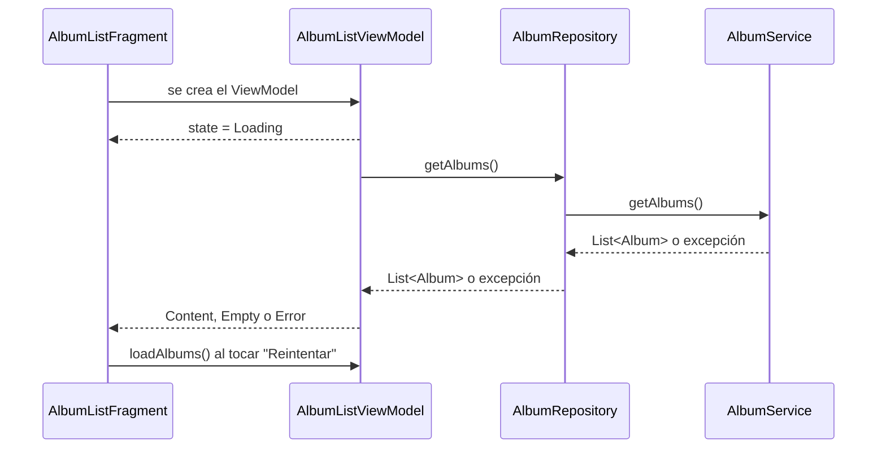

# Diseño arquitectónico · Sprint 1

Arquitectura de la app para **HU01 Consultar catálogo de álbumes** y **HU02 Consultar la información detallada de un álbum**. Las iteraciones siguientes la extienden con artistas y coleccionistas sin cambiar su estructura.

## Resumen

| Aspecto | Decisión |
|---|---|
| Plataforma | App nativa Android en Kotlin, `minSdk 21` (Android 5.0) y `targetSdk 35` |
| Patrón | **MVVM**: la vista muestra estado, el ViewModel lo calcula, el repositorio obtiene los datos |
| Backend | API REST de [BackVynils](https://github.com/TheSoftwareDesignLab/BackVynils) |
| Acceso a la red | **Service Adapter** sobre Volley, expuesto a los servicios como funciones `suspend` |
| Navegación | Navigation Component (un `NavHost` y un grafo) con barra inferior Material 3 |
| UI | Vistas XML con ViewBinding, `RecyclerView` y Material Components |
| Asincronía | Corrutinas de Kotlin (`viewModelScope`) y `LiveData` para exponer el estado |

## Capas y paquetes

Todo vive bajo `co.edu.uniandes.vinilos`.

| Paquete | Responsabilidad | Qué NO hace |
|---|---|---|
| `ui` | `MainActivity`, los fragmentos y sus adaptadores. Muestra el estado que emite el ViewModel y reenvía las acciones del usuario | No llama a la red ni decide qué estado mostrar |
| `viewmodels` | Convierte la respuesta del repositorio en un estado de pantalla (cargando, contenido, vacío o error) | No conoce vistas ni Android UI |
| `repositories` | Punto único para obtener y guardar datos de un recurso | No parsea JSON ni arma URLs |
| `network` | `NetworkServiceAdapter` (HTTP) y un servicio por recurso que traduce JSON a modelos | No maneja estado de pantalla |
| `models` | Clases de datos inmutables (`data class`) | No tienen lógica de red ni de UI |

## Acceso a la API: Service Adapter

`NetworkServiceAdapter` es el único punto de acceso a BackVynils:

- Es un singleton que crea una sola cola de Volley y una URL base configurable en `BuildConfig.BASE_URL`. Por defecto apunta a `http://10.0.2.2:3000/` (el `localhost` del equipo visto desde el emulador). Para otro backend: `./gradlew assembleDebug -Pvinilos.baseUrl=http://<host>:3000/`.
- Ofrece `getArray`, `getObject` y `post`, que suspenden hasta recibir la respuesta. Si la corrutina se cancela, cancela la petición.
- Los errores de red o del servidor llegan como `VolleyError`.

Cada recurso tiene un servicio con su interfaz (`AlbumService`) y una implementación que usa el adaptador (`NetworkAlbumService`). La interfaz permite probar el repositorio y el ViewModel con un servicio falso, sin red.

### Endpoints del Sprint 1

| Historia | Endpoint | Respuesta |
|---|---|---|
| HU01 | `GET /albums` | Lista de álbumes con `performers`, `tracks` y `comments` |
| HU02 | `GET /albums/{id}` | Un álbum con las mismas relaciones |

Campos de `Album`: `id`, `name`, `cover`, `releaseDate` (ISO 8601), `description`, `genre`, `recordLabel`, `performers`, `tracks` y `comments`. Si el servidor omite una lista, el servicio la entrega vacía.

## Flujo de datos de una pantalla

El ViewModel expone un único `LiveData<AlbumListState>` con cuatro estados: `Loading`, `Content(albums)`, `Empty` y `Error`. La vista muestra solo uno a la vez, como define el layout `fragment_album_list`. Cualquier excepción distinta de una cancelación se convierte en `Error`; el botón "Reintentar" vuelve a llamar a `loadAlbums()`.

## Navegación

- `MainActivity` aloja un `NavHostFragment` y una `BottomNavigationView` enlazada al grafo `nav_graph`.
- Las secciones principales son **Álbumes**, **Artistas** y **Coleccionistas**. Los ids del menú inferior son los mismos que los destinos del grafo, así que la barra navega sin código adicional.
- La barra inferior solo se ve en esas tres secciones; las pantallas de detalle la ocultan.
- Las pantallas de detalle se agregan al grafo como destinos de segundo nivel (por ejemplo, del listado de álbumes al detalle de un álbum).

## Tema y diseño

Los colores, la tipografía y las formas salen del tema Material 3 (`themes.xml`, `colors.xml`, `dimens.xml`), con la paleta definida en [Diseño UX/UI](Diseno-UX-UI). Los layouts usan atributos del tema (`?attr/colorSurface`, `?attr/textAppearanceTitleMedium`) y no valores fijos.

## Pruebas

| Nivel | Qué cubre | Herramienta |
|---|---|---|
| Unitarias | Parseo de JSON a modelos, construcción de URLs y estados del ViewModel (carga, contenido, vacío, error y reintento) con un servicio falso | JUnit, `kotlinx-coroutines-test`, `InstantTaskExecutorRule` |
| E2E | Recorridos de usuario sobre la app contra BackVynils | Espresso (ver [Inventario de pruebas](Inventario-pruebas-Sprint-1)) |

## Decisiones y alternativas

| Decisión | Alternativa descartada | Motivo |
|---|---|---|
| Volley detrás de un adaptador | Retrofit | Volley es la librería elegida para el proyecto; el adaptador permite cambiarla sin tocar repositorios ni ViewModels |
| Interfaz por servicio | Repositorio que usa el adaptador directamente | Permite probar con servicios falsos y separa el JSON del repositorio |
| Un estado sellado por pantalla | Varios `LiveData` sueltos (datos, cargando, error) | Evita combinaciones imposibles, como mostrar a la vez el error y el contenido |
| `minSdk 21` con versiones de AndroidX fijadas | Subir a `minSdk 23` | El proyecto define `minSdk 21` (Android 5.0); varias librerías recientes exigen 23 |
