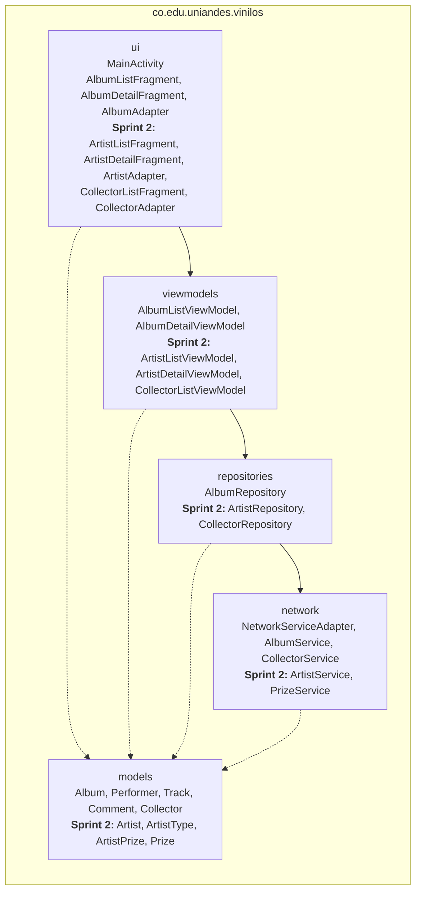
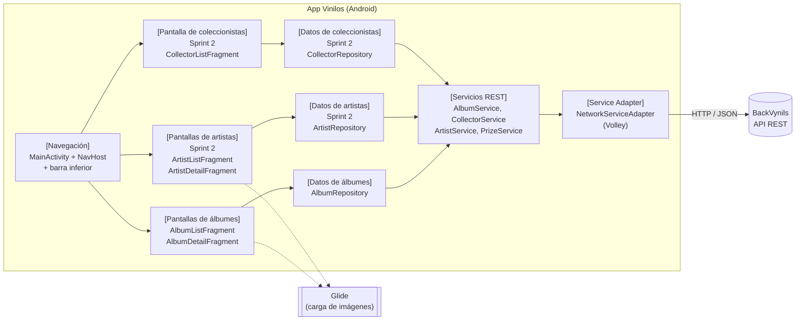
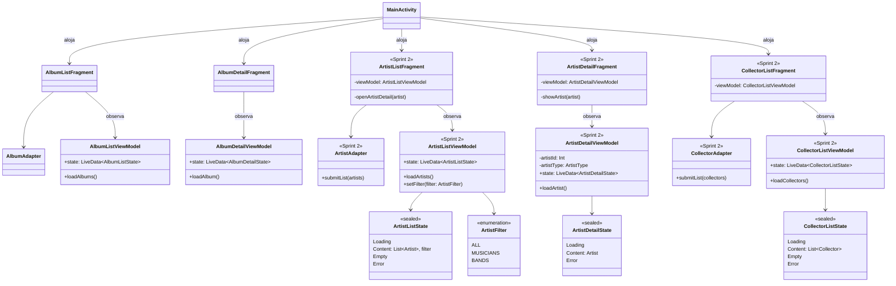
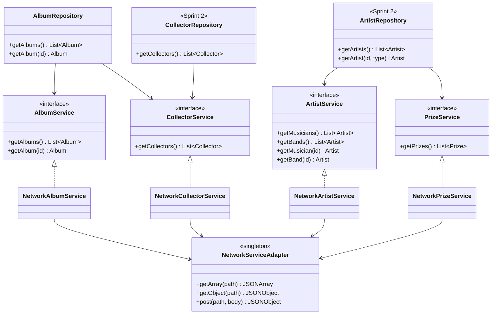
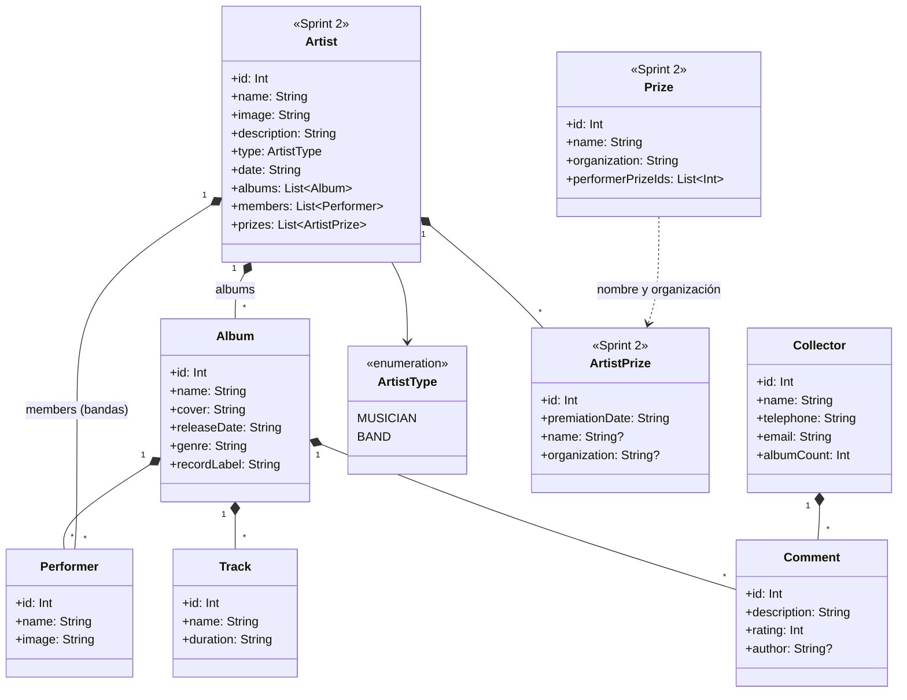
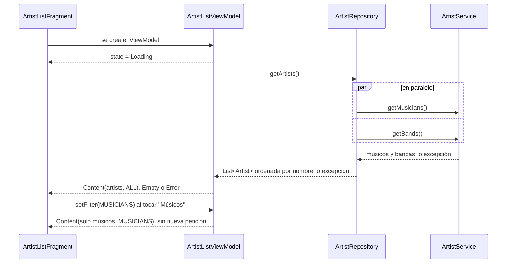
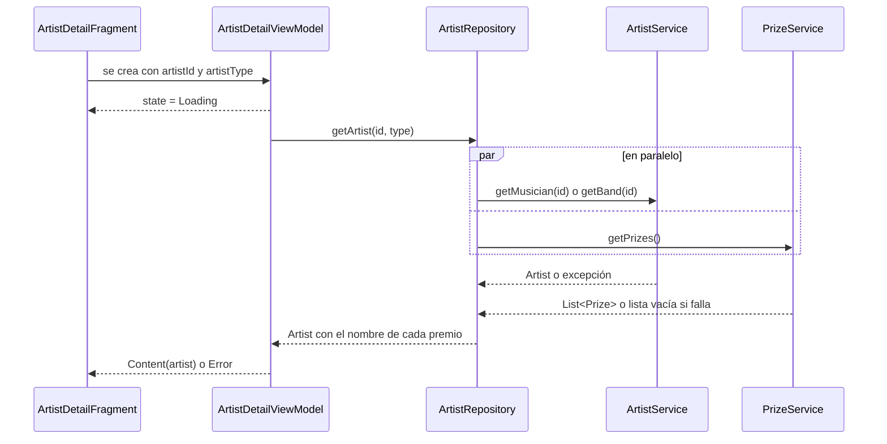
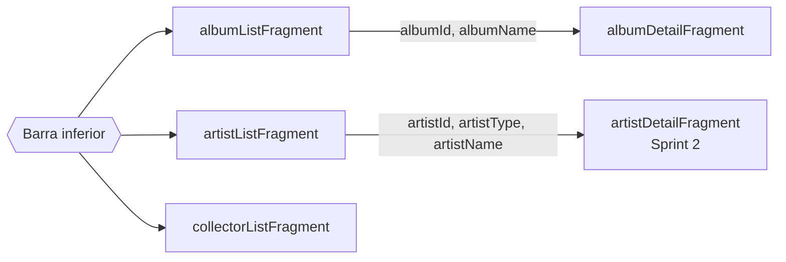

# Diseño arquitectónico · Sprint 2

Arquitectura de la app para las cinco historias acumuladas al cierre del Sprint 2:

| Historia | Sprint |
|---|---|
| HU01 Consultar catálogo de álbumes | 1 |
| HU02 Consultar la información detallada de un álbum | 1 |
| **HU03 Consultar el listado de artistas** | 2 |
| **HU04 Consultar la información detallada de un artista** | 2 |
| **HU05 Consultar listado de coleccionistas** | 2 |

El Sprint 2 extiende la arquitectura del [[Sprint 1|Diseno-arquitectonico-Sprint-1]] sin cambiar su estructura: cada recurso nuevo (artistas, premios y coleccionistas) sigue la misma cadena **vista → ViewModel → repositorio → servicio → Service Adapter**. En los diagramas, lo que se agrega en este sprint está marcado como _Sprint 2_.

## Resumen

| Aspecto | Decisión |
|---|---|
| Plataforma | App nativa Android en Kotlin, `minSdk 21` (Android 5.0) y `targetSdk 35` |
| Patrón | **MVVM**: la vista muestra estado, el ViewModel lo calcula, el repositorio obtiene los datos |
| Backend | API REST de [BackVynils](https://github.com/TheSoftwareDesignLab/BackVynils) |
| Acceso a la red | **Service Adapter** (`NetworkServiceAdapter`) sobre Volley, expuesto a los servicios como funciones `suspend` |
| Datos | **Repository** por recurso: `AlbumRepository`, `ArtistRepository` y `CollectorRepository` |
| Navegación | Navigation Component (un `NavHost` y un grafo) con barra inferior Material 3 |
| UI | Vistas XML con ViewBinding, `RecyclerView` con `ListAdapter` y Material Components; imágenes con Glide |
| Asincronía | Corrutinas de Kotlin (`viewModelScope`) y `LiveData` para exponer el estado |

## Diagrama de paquetes

Todo vive bajo `co.edu.uniandes.vinilos`. Las dependencias van en un solo sentido: `ui` → `viewmodels` → `repositories` → `network`, y todos usan `models`.

| Paquete | Responsabilidad | Qué NO hace |
|---|---|---|
| `ui` | `MainActivity`, los fragmentos y sus adaptadores. Muestra el estado que emite el ViewModel y reenvía las acciones del usuario | No llama a la red ni decide qué estado mostrar |
| `viewmodels` | Convierte la respuesta del repositorio en un estado de pantalla (cargando, contenido, vacío o error) y aplica filtros en memoria | No conoce vistas |
| `repositories` | Punto único para obtener los datos de un recurso; combina servicios cuando una pantalla necesita más de uno | No parsea JSON ni arma URLs |
| `network` | `NetworkServiceAdapter` (HTTP) y un servicio por recurso que traduce JSON a modelos | No maneja estado de pantalla |
| `models` | Clases de datos inmutables (`data class`) | No tienen lógica de red ni de UI |

## Diagrama de componentes

| Componente | Interfaz que ofrece | Usa |
|---|---|---|
| Navegación | Destinos del grafo `nav_graph`; argumentos `albumId` / `albumName` y `artistId` / `artistType` / `artistName` | Pantallas |
| Pantallas de álbumes | Catálogo en cuadrícula y detalle de un álbum (HU01, HU02) | Datos de álbumes, Glide |
| Pantallas de artistas | Listado con filtro Todos / Músicos / Bandas y detalle de un artista (HU03, HU04) | Datos de artistas, Glide |
| Pantalla de coleccionistas | Listado de coleccionistas (HU05) | Datos de coleccionistas |
| Datos de álbumes | `getAlbums()`, `getAlbum(id)` | `AlbumService`, `CollectorService` |
| Datos de artistas | `getArtists()`, `getArtist(id, type)` | `ArtistService`, `PrizeService` |
| Datos de coleccionistas | `getCollectors()` | `CollectorService` |
| Servicios REST | Un método por endpoint (ver [Endpoints](#endpoints)) | Service Adapter |
| Service Adapter | `getArray`, `getObject`, `post` | BackVynils |

## Diagrama de clases

### Vista y ViewModels

### Repositorios y servicios

`ArtistListViewModel`, `ArtistDetailViewModel` y `CollectorListViewModel` dependen de su repositorio, igual que los ViewModels de álbumes dependen de `AlbumRepository`.

### Modelos

## Endpoints

| Historia | Endpoint | Servicio | Uso |
|---|---|---|---|
| HU01 | `GET /albums` | `AlbumService.getAlbums()` | Catálogo |
| HU02 | `GET /albums/{id}` | `AlbumService.getAlbum(id)` | Detalle del álbum |
| HU02 | `GET /collectors` | `CollectorService.getCollectors()` | Autor de cada comentario |
| HU03 | `GET /musicians` | `ArtistService.getMusicians()` | Músicos del listado |
| HU03 | `GET /bands` | `ArtistService.getBands()` | Bandas del listado |
| HU04 | `GET /musicians/{id}` | `ArtistService.getMusician(id)` | Detalle de un músico |
| HU04 | `GET /bands/{id}` | `ArtistService.getBand(id)` | Detalle de una banda, con sus integrantes |
| HU04 | `GET /prizes` | `PrizeService.getPrizes()` | Nombre y organización de cada premio |
| HU05 | `GET /collectors` | `CollectorService.getCollectors()` | Listado de coleccionistas |

Datos que entrega BackVynils y cómo se usan:

- **Músicos y bandas** comparten los campos `id`, `name`, `image`, `description`, `albums` y `performerPrizes`. Los músicos traen `birthDate` y las bandas `creationDate` y `musicians`. `NetworkArtistService` convierte ambos en `Artist`, con `type` = `MUSICIAN` o `BAND`, `date` = la fecha que corresponda y `members` vacío para los músicos.
- Los ids de músicos y bandas no se repiten (BackVynils los guarda en una sola tabla de artistas), pero cada tipo tiene su propio endpoint. Por eso el detalle recibe `artistId` y `artistType`.
- **Premios:** `performerPrizes` solo trae `id` y `premiationDate`, no el premio. `GET /prizes` devuelve cada premio con sus `performerPrizes`. `ArtistRepository.getArtist(id, type)` pide el artista y `GET /prizes` en paralelo y completa `ArtistPrize.name` y `organization` cruzando por id. Si falla la consulta de premios, el detalle se muestra igual con la fecha del premio y sin su nombre. Es el mismo enfoque que `AlbumRepository` usa para el autor de los comentarios.
- **Coleccionistas:** `GET /collectors` trae `collectorAlbums`; `Collector.albumCount` guarda cuántos tiene, que es el dato que muestra el listado.
- Si el servidor omite una lista, el servicio la entrega vacía.

## Flujo de datos de las pantallas nuevas

### Listado de artistas (HU03)

- El repositorio pide músicos y bandas en paralelo con `async` y los une en una sola lista ordenada por nombre. Si falla cualquiera de las dos peticiones, lanza la excepción y la pantalla muestra el error con "Reintentar".
- El filtro Todos / Músicos / Bandas se aplica en el ViewModel sobre la lista ya cargada; cambiar de filtro no vuelve a llamar a la API.
- Al tocar un artista se navega al detalle con `artistId`, `artistType` y `artistName`.

### Detalle de artista (HU04)

La pantalla muestra imagen, chip Músico o Banda, fecha, descripción, álbumes, premios e integrantes (solo bandas). Una sección sin datos muestra su mensaje de lista vacía, como en el detalle de álbum.

### Listado de coleccionistas (HU05)

`CollectorListViewModel` sigue el mismo flujo del listado de álbumes: `Loading`, `Content(collectors)`, `Empty` o `Error`, y "Reintentar" vuelve a llamar a `loadCollectors()`. Cada fila muestra iniciales, nombre, correo y número de álbumes. La navegación al detalle de un coleccionista se agrega con HU06 en el Sprint 3.

## Navegación

- Las tres secciones de la barra inferior ya existen en el grafo desde el Sprint 1; en este sprint se reemplazan sus pantallas temporales.
- `artistDetailFragment` es un destino de segundo nivel, así que la barra inferior se oculta igual que en el detalle de álbum.

## Desempeño en la arquitectura

El Sprint 2 se enfoca en desempeño. Estas decisiones de diseño aplican a las cinco historias:

| Práctica | Dónde |
|---|---|
| Ninguna petición corre en el hilo principal: los servicios son `suspend` y Volley responde en su propio hilo | `NetworkServiceAdapter`, todos los servicios |
| Las corrutinas se lanzan en `viewModelScope`, así que se cancelan al destruir el ViewModel y cancelan la petición de Volley | Todos los ViewModels |
| Las peticiones independientes de una misma pantalla van en paralelo con `async` | `AlbumRepository.getAlbum`, `ArtistRepository.getArtists`, `ArtistRepository.getArtist` |
| Filtros en memoria, sin peticiones nuevas | `ArtistListViewModel.setFilter` |
| Listas con `ListAdapter` y `DiffUtil`, que solo redibujan las filas que cambian | `AlbumAdapter`, `ArtistAdapter`, `CollectorAdapter` |
| Imágenes con Glide (caché en memoria y disco, y redimensionadas al tamaño de la vista) | Portadas de álbumes e imágenes de artistas |
| El binding y el adaptador se liberan en `onDestroyView` para no retener vistas destruidas | Todos los fragmentos |
| Las raíces de los layouts no pintan fondo; el tema ya pinta el de la ventana | Todos los layouts (ver [[Micro-optimizaciones|Micro-optimizaciones-Sprint-2]]) |

## Implementación por tarea

| Historia | Pieza | Clases | Issue |
|---|---|---|---|
| HU03 | Layout del listado | `fragment_artist_list.xml`, `item_artist.xml` | [#28](https://github.com/manuel-jose-marin/vinilos-mobile/issues/28) |
| HU03 | Modelo y servicio | `Artist`, `ArtistType`, `ArtistService.getMusicians/getBands`, `NetworkArtistService` | [#29](https://github.com/manuel-jose-marin/vinilos-mobile/issues/29) |
| HU03 | Repositorio y ViewModel | `ArtistRepository.getArtists`, `ArtistListViewModel`, `ArtistListState`, `ArtistFilter` | [#30](https://github.com/manuel-jose-marin/vinilos-mobile/issues/30) |
| HU03 | Vista | `ArtistListFragment`, `ArtistAdapter`, acción al detalle en `nav_graph` | [#31](https://github.com/manuel-jose-marin/vinilos-mobile/issues/31) |
| HU04 | Layout del detalle | `fragment_artist_detail.xml` | [#33](https://github.com/manuel-jose-marin/vinilos-mobile/issues/33) |
| HU04 | Servicios del detalle | `ArtistService.getMusician/getBand`, `ArtistPrize`, `Prize`, `PrizeService`, `NetworkPrizeService` | [#34](https://github.com/manuel-jose-marin/vinilos-mobile/issues/34) |
| HU04 | Repositorio y ViewModel | `ArtistRepository.getArtist`, `ArtistDetailViewModel`, `ArtistDetailState` | [#35](https://github.com/manuel-jose-marin/vinilos-mobile/issues/35) |
| HU04 | Vista | `ArtistDetailFragment`, destino `artistDetailFragment` en `nav_graph` | [#36](https://github.com/manuel-jose-marin/vinilos-mobile/issues/36) |
| HU05 | Layout del listado | `fragment_collector_list.xml`, `item_collector.xml` | [#38](https://github.com/manuel-jose-marin/vinilos-mobile/issues/38) |
| HU05 | Modelo y servicio | `Collector.albumCount`, `CollectorService.getCollectors` | [#39](https://github.com/manuel-jose-marin/vinilos-mobile/issues/39) |
| HU05 | Repositorio y ViewModel | `CollectorRepository`, `CollectorListViewModel`, `CollectorListState` | [#40](https://github.com/manuel-jose-marin/vinilos-mobile/issues/40) |
| HU05 | Vista | `CollectorListFragment`, `CollectorAdapter` | [#41](https://github.com/manuel-jose-marin/vinilos-mobile/issues/41) |

## Pruebas

| Nivel | Qué cubre | Herramienta |
|---|---|---|
| Unitarias | Parseo de JSON a modelos, unión y orden de músicos y bandas, cruce de premios, filtro del listado de artistas y estados de cada ViewModel con servicios falsos | JUnit, `kotlinx-coroutines-test`, `InstantTaskExecutorRule` |
| E2E | Recorridos de usuario de HU01 a HU05 contra BackVynils | Espresso |

## Decisiones y alternativas

| Decisión | Alternativa descartada | Motivo |
|---|---|---|
| Un solo modelo `Artist` con `type` para músicos y bandas | Clases `Musician` y `Band` separadas | El listado y el detalle muestran casi los mismos campos; un modelo evita duplicar adaptador, estados y pantallas |
| Un solo `ArtistRepository` para músicos y bandas | Un repositorio por tipo | El listado necesita ambos tipos unidos y ordenados |
| `PrizeService` aparte para el nombre de los premios | Mostrar solo la fecha del premio | `GET /musicians/{id}` y `GET /bands/{id}` no traen el nombre del premio |
| Filtro de artistas en el ViewModel | Pedir `/musicians` o `/bands` según el filtro | Cambiar de filtro es inmediato y no gasta red |
| `CollectorRepository` aparte de `AlbumRepository` | Agregar `getCollectors()` a `AlbumRepository` | Cada recurso tiene su repositorio; `AlbumRepository` sigue usando `CollectorService` solo para el autor de los comentarios |
| Volley detrás de un adaptador | Retrofit | Volley es la librería elegida para el proyecto; el adaptador permite cambiarla sin tocar repositorios ni ViewModels |
| Un estado sellado por pantalla | Varios `LiveData` sueltos (datos, cargando, error) | Evita combinaciones imposibles, como mostrar a la vez el error y el contenido |
