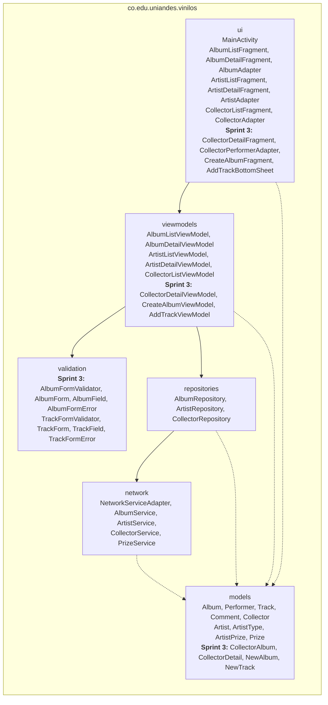
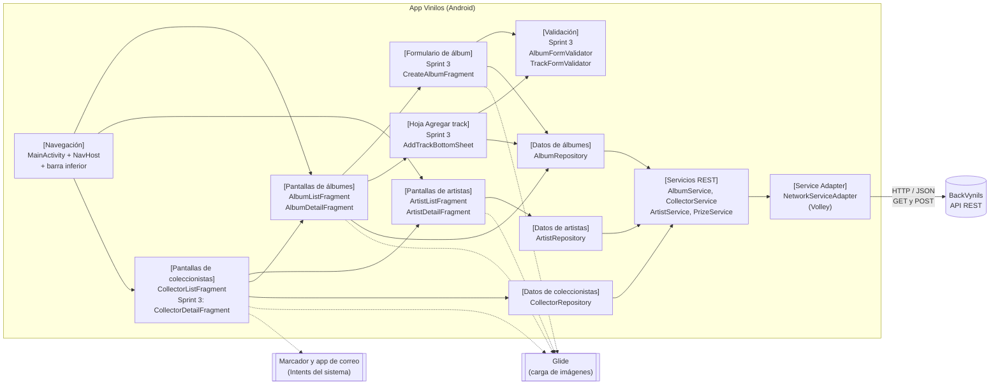
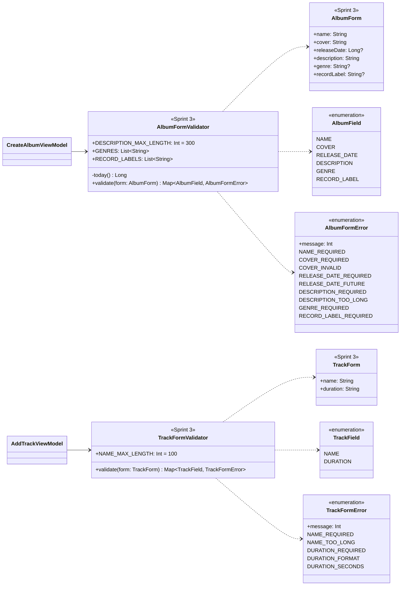
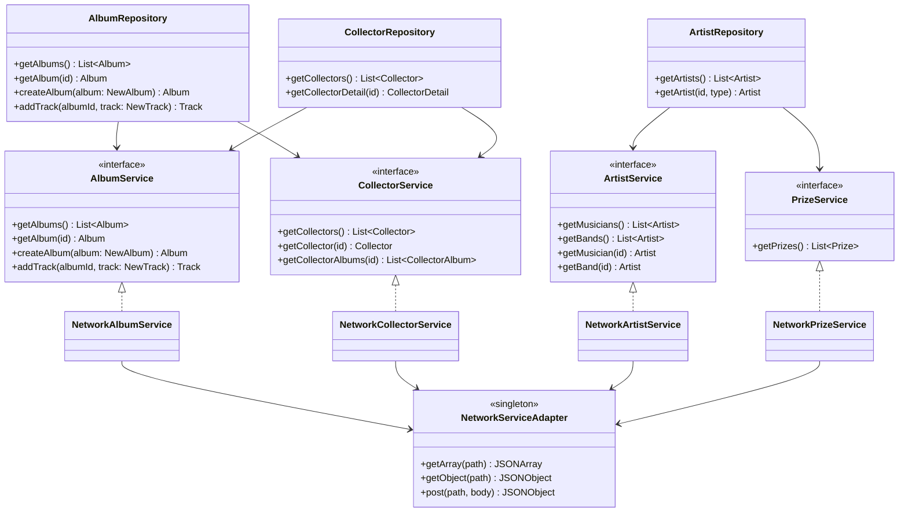
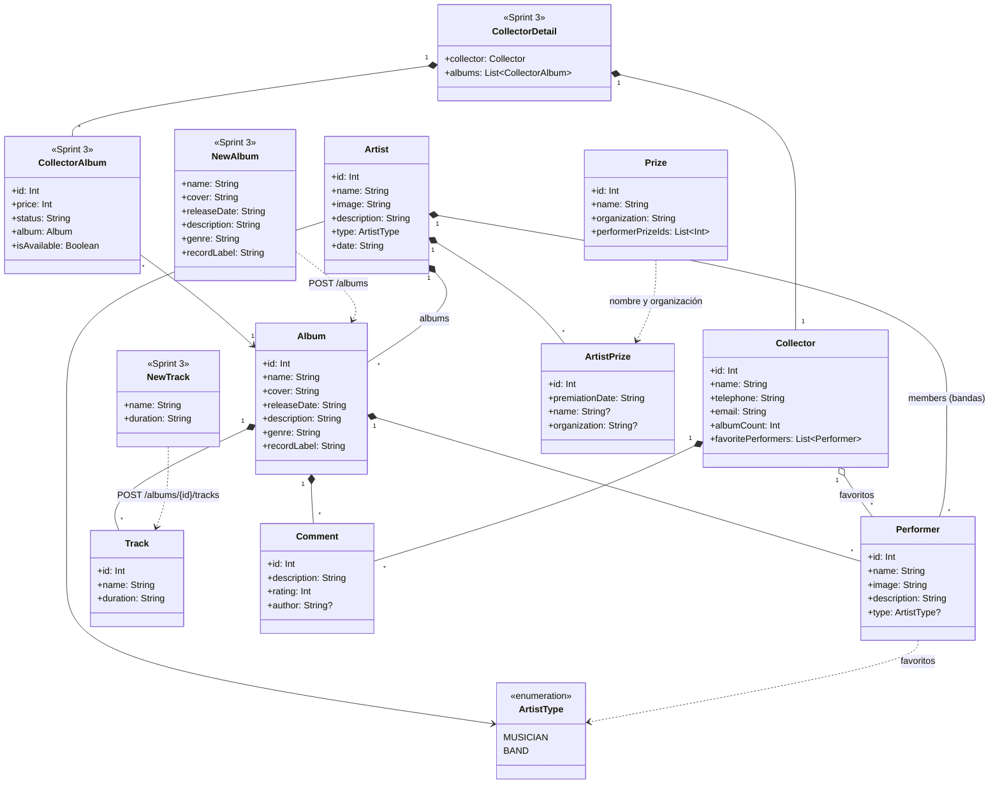
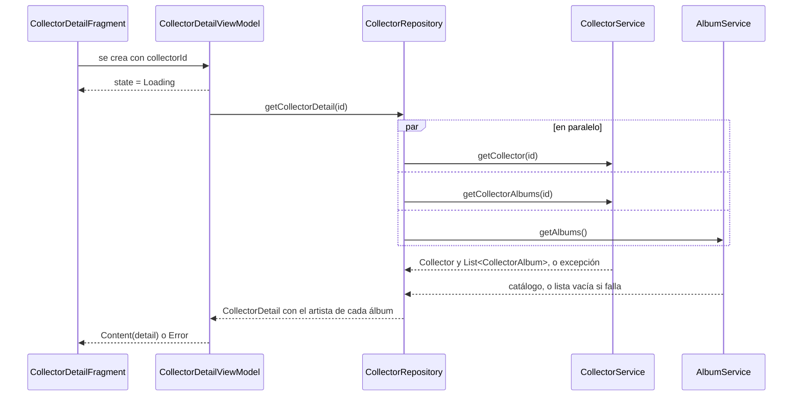
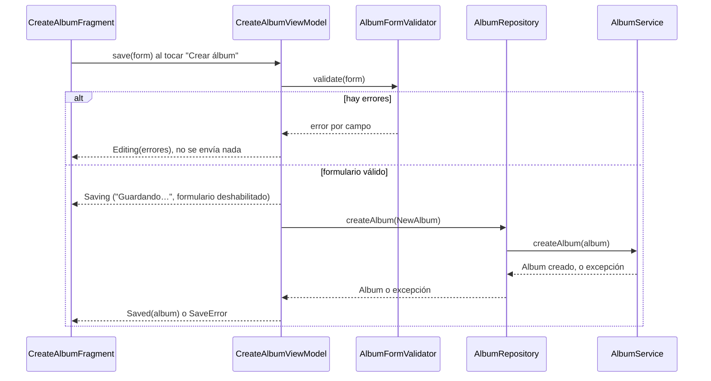
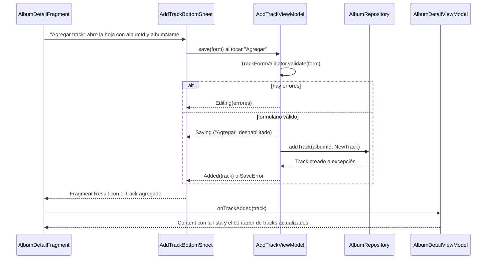
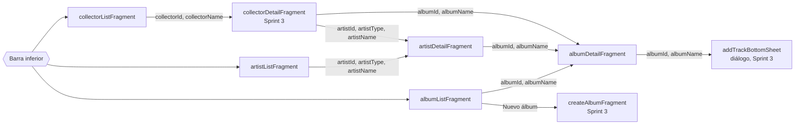

# Diseño arquitectónico · Sprint 3

Arquitectura de la app para las ocho historias del MVP:

| Historia | Sprint |
|---|---|
| HU01 Consultar catálogo de álbumes | 1 |
| HU02 Consultar la información detallada de un álbum | 1 |
| HU03 Consultar el listado de artistas | 2 |
| HU04 Consultar la información detallada de un artista | 2 |
| HU05 Consultar listado de coleccionistas | 2 |
| **HU06 Consultar la información detallada de coleccionista** | 3 |
| **HU07 Crear un álbum** | 3 |
| **HU08 Asociar tracks con un álbum** | 3 |

El Sprint 3 extiende la arquitectura del [[Sprint 2|Diseno-arquitectonico-Sprint-2]] sin cambiar su estructura: cada pantalla nueva sigue la cadena **vista → ViewModel → repositorio → servicio → Service Adapter**. Lo nuevo es que HU07 y HU08 **escriben** en BackVynils (`POST`), así que se agrega un paquete `validation` que revisa los formularios antes de enviarlos. En los diagramas, lo que se agrega en este sprint está marcado como _Sprint 3_.

## Resumen

| Aspecto | Decisión |
|---|---|
| Plataforma | App nativa Android en Kotlin, `minSdk 21` (Android 5.0) y `targetSdk 35` |
| Patrón | **MVVM**: la vista muestra estado, el ViewModel lo calcula, el repositorio obtiene o envía los datos |
| Backend | API REST de [BackVynils](https://github.com/TheSoftwareDesignLab/BackVynils), con `GET` para las consultas y `POST` para crear álbumes y agregar tracks |
| Acceso a la red | **Service Adapter** (`NetworkServiceAdapter`) sobre Volley, expuesto a los servicios como funciones `suspend` (`getArray`, `getObject` y `post`) |
| Datos | **Repository** por recurso: `AlbumRepository`, `ArtistRepository` y `CollectorRepository` |
| Validación | Validadores sin dependencias de la vista (`AlbumFormValidator`, `TrackFormValidator`) que devuelven un error por campo |
| Navegación | Navigation Component (un `NavHost` y un grafo) con barra inferior Material 3; la hoja "Agregar track" es un destino de tipo diálogo |
| UI | Vistas XML con ViewBinding, `RecyclerView` con `ListAdapter`, Material Components (`TextInputLayout`, `BottomSheetDialogFragment`) e imágenes con Glide |
| Asincronía | Corrutinas de Kotlin (`viewModelScope`) y `LiveData` para exponer el estado |

## Diagrama de paquetes

Todo vive bajo `co.edu.uniandes.vinilos`. Las dependencias van en un solo sentido: `ui` → `viewmodels` → `repositories` → `network`, y todos usan `models`. El paquete nuevo `validation` lo usan los ViewModels de los formularios.

| Paquete | Responsabilidad | Qué NO hace |
|---|---|---|
| `ui` | `MainActivity`, los fragmentos, la hoja inferior y sus adaptadores. Muestra el estado que emite el ViewModel, muestra cada error debajo de su campo y reenvía las acciones del usuario | No llama a la red, no valida ni decide qué estado mostrar |
| `viewmodels` | Convierte la respuesta del repositorio en un estado de pantalla (cargando, contenido, vacío, guardando, guardado o error). En los formularios, valida antes de enviar y bloquea el doble envío | No conoce vistas |
| `validation` | Reglas de cada formulario: campos obligatorios, formato y límites. Devuelve un error por campo con el id del mensaje | No conoce vistas ni la red |
| `repositories` | Punto único para obtener o enviar los datos de un recurso; combina servicios cuando una pantalla necesita más de uno | No parsea JSON ni arma URLs |
| `network` | `NetworkServiceAdapter` (HTTP) y un servicio por recurso que traduce JSON a modelos y modelos a JSON | No maneja estado de pantalla |
| `models` | Clases de datos inmutables (`data class`) | No tienen lógica de red ni de UI |

## Diagrama de componentes

| Componente | Interfaz que ofrece | Usa |
|---|---|---|
| Navegación | Destinos del grafo `nav_graph` y sus argumentos (ver [Navegación](#navegación)) | Pantallas |
| Pantallas de álbumes | Catálogo en cuadrícula con el botón "Nuevo álbum" y detalle de un álbum con el botón "Agregar track" (HU01, HU02) | Datos de álbumes, Formulario de álbum, Hoja Agregar track, Glide |
| Formulario de álbum | Crear un álbum con vista previa de la portada (HU07) | Validación, Datos de álbumes, Glide |
| Hoja Agregar track | Agregar un track sin salir del detalle del álbum (HU08) | Validación, Datos de álbumes |
| Pantallas de artistas | Listado con filtro Todos / Músicos / Bandas y detalle de un artista (HU03, HU04) | Datos de artistas, Glide |
| Pantallas de coleccionistas | Listado (HU05) y detalle con contacto, favoritos, colección y comentarios (HU06) | Datos de coleccionistas, Glide, Intents del sistema |
| Validación | `validate(form)`: un error por campo, o ninguno si el formulario es válido | Ninguno |
| Datos de álbumes | `getAlbums()`, `getAlbum(id)`, `createAlbum(album)`, `addTrack(albumId, track)` | `AlbumService`, `CollectorService` |
| Datos de artistas | `getArtists()`, `getArtist(id, type)` | `ArtistService`, `PrizeService` |
| Datos de coleccionistas | `getCollectors()`, `getCollectorDetail(id)` | `CollectorService`, `AlbumService` |
| Servicios REST | Un método por endpoint (ver [Endpoints](#endpoints)) | Service Adapter |
| Service Adapter | `getArray`, `getObject`, `post` | BackVynils |

## Diagrama de clases

### Vista y ViewModels

```mermaid
classDiagram
    direction TB

    class MainActivity
    class AlbumListFragment
    class AlbumDetailFragment {
        -openAddTrack()
        -onTrackAdded(track)
    }
    class AlbumAdapter
    class ArtistListFragment
    class ArtistDetailFragment
    class ArtistAdapter
    class CollectorListFragment {
        -openCollectorDetail(collector)
    }
    class CollectorAdapter
    class CollectorDetailFragment {
        <<Sprint 3>>
        -viewModel: CollectorDetailViewModel
        -showDetail(detail)
        -dial(telephone)
        -sendEmail(email)
    }
    class CollectorPerformerAdapter {
        <<Sprint 3>>
        +submitList(performers)
    }
    class CreateAlbumFragment {
        <<Sprint 3>>
        -viewModel: CreateAlbumViewModel
        -readForm() AlbumForm
        -showErrors(errors)
    }
    class AddTrackBottomSheet {
        <<Sprint 3>>
        -viewModel: AddTrackViewModel
        -readForm() TrackForm
        -showErrors(errors)
    }

    class AlbumListViewModel {
        +state: LiveData~AlbumListState~
        +loadAlbums()
    }
    class AlbumDetailViewModel {
        +state: LiveData~AlbumDetailState~
        +loadAlbum()
        +onTrackAdded(track: Track)
    }
    class ArtistListViewModel {
        +state: LiveData~ArtistListState~
        +loadArtists()
        +setFilter(filter: ArtistFilter)
    }
    class ArtistDetailViewModel {
        +state: LiveData~ArtistDetailState~
        +loadArtist()
    }
    class CollectorListViewModel {
        +state: LiveData~CollectorListState~
        +loadCollectors()
    }
    class CollectorDetailViewModel {
        <<Sprint 3>>
        -collectorId: Int
        +state: LiveData~CollectorDetailState~
        +loadCollector()
    }
    class CollectorDetailState {
        <<sealed>>
        Loading
        Content: CollectorDetail
        Error
    }
    class CreateAlbumViewModel {
        <<Sprint 3>>
        +state: LiveData~CreateAlbumState~
        +save(form: AlbumForm)
    }
    class CreateAlbumState {
        <<sealed>>
        Editing: errores por campo
        Saving
        Saved: Album
        SaveError
    }
    class AddTrackViewModel {
        <<Sprint 3>>
        -albumId: Int
        +state: LiveData~AddTrackState~
        +save(form: TrackForm)
    }
    class AddTrackState {
        <<sealed>>
        Editing: errores por campo
        Saving
        Added: Track
        SaveError
    }

    MainActivity --> AlbumListFragment : aloja
    MainActivity --> AlbumDetailFragment : aloja
    MainActivity --> ArtistListFragment : aloja
    MainActivity --> ArtistDetailFragment : aloja
    MainActivity --> CollectorListFragment : aloja
    MainActivity --> CollectorDetailFragment : aloja
    MainActivity --> CreateAlbumFragment : aloja
    AlbumListFragment --> AlbumAdapter
    AlbumListFragment --> AlbumListViewModel : observa
    AlbumDetailFragment --> AlbumDetailViewModel : observa
    AlbumDetailFragment --> AddTrackBottomSheet : abre
    ArtistListFragment --> ArtistAdapter
    ArtistListFragment --> ArtistListViewModel : observa
    ArtistDetailFragment --> ArtistDetailViewModel : observa
    CollectorListFragment --> CollectorAdapter
    CollectorListFragment --> CollectorListViewModel : observa
    CollectorDetailFragment --> CollectorPerformerAdapter
    CollectorDetailFragment --> CollectorDetailViewModel : observa
    CreateAlbumFragment --> CreateAlbumViewModel : observa
    AddTrackBottomSheet --> AddTrackViewModel : observa
    CollectorDetailViewModel --> CollectorDetailState
    CreateAlbumViewModel --> CreateAlbumState
    AddTrackViewModel --> AddTrackState
```

Los estados de las pantallas de los sprints 1 y 2 (`AlbumListState`, `AlbumDetailState`, `ArtistListState`, `ArtistDetailState` y `CollectorListState`) no cambian; están en el [[diseño del Sprint 2|Diseno-arquitectonico-Sprint-2]].

### Validación

- Cada error trae el id del mensaje (`message`, un `@StringRes`) que la vista muestra debajo del campo, por ejemplo "Ingresa una URL válida (https://…)" o "Los segundos deben estar entre 00 y 59".
- `AlbumForm.releaseDate` es la fecha que entrega `MaterialDatePicker`: milisegundos a la medianoche UTC del día elegido. `today` se inyecta para probar la regla de fecha no futura sin depender del reloj.
- `GENRES` y `RECORD_LABELS` son los valores que acepta BackVynils. Los usan el validador, los desplegables del formulario y el servicio.

### Repositorios y servicios

Métodos nuevos en el Sprint 3: `AlbumRepository.createAlbum` y `addTrack`, `CollectorRepository.getCollectorDetail`, `AlbumService.createAlbum` y `addTrack`, y `CollectorService.getCollector` y `getCollectorAlbums`. `CollectorRepository` ahora también usa `AlbumService`, para completar el artista de cada álbum de la colección. Cada ViewModel depende de su repositorio: `CollectorDetailViewModel` de `CollectorRepository`, y `CreateAlbumViewModel` y `AddTrackViewModel` de `AlbumRepository`.

### Modelos

- `Collector.favoritePerformers` es nuevo; el listado de HU05 no lo usa.
- `Performer.type` es nuevo: el servicio del detalle del coleccionista lo llena en cada favorito para poder abrir su detalle. En los artistas de un álbum y en los integrantes de una banda queda en `null`.
- `CollectorAlbum.status` es `Active` o `Inactive`; `isAvailable` es `true` con `Active` y la vista muestra "Disponible" o "No disponible".
- `NewAlbum` y `NewTrack` son lo que se envía en el cuerpo del `POST`; la respuesta del servidor se convierte en `Album` o `Track` con su `id`.

## Endpoints

| Historia | Método y endpoint | Servicio | Uso |
|---|---|---|---|
| HU01 | `GET /albums` | `AlbumService.getAlbums()` | Catálogo |
| HU02 | `GET /albums/{id}` | `AlbumService.getAlbum(id)` | Detalle del álbum |
| HU02 | `GET /collectors` | `CollectorService.getCollectors()` | Autor de cada comentario |
| HU03 | `GET /musicians` | `ArtistService.getMusicians()` | Músicos del listado |
| HU03 | `GET /bands` | `ArtistService.getBands()` | Bandas del listado |
| HU04 | `GET /musicians/{id}` | `ArtistService.getMusician(id)` | Detalle de un músico |
| HU04 | `GET /bands/{id}` | `ArtistService.getBand(id)` | Detalle de una banda, con sus integrantes |
| HU04 | `GET /prizes` | `PrizeService.getPrizes()` | Nombre y organización de cada premio |
| HU05 | `GET /collectors` | `CollectorService.getCollectors()` | Listado de coleccionistas |
| HU06 | `GET /collectors/{id}` | `CollectorService.getCollector(id)` | Contacto, artistas favoritos y comentarios |
| HU06 | `GET /collectors/{id}/albums` | `CollectorService.getCollectorAlbums(id)` | Colección con precio y estado |
| HU06 | `GET /albums` | `AlbumService.getAlbums()` | Artista de cada álbum de la colección |
| HU07 | `POST /albums` | `AlbumService.createAlbum(album)` | Crear un álbum |
| HU08 | `POST /albums/{id}/tracks` | `AlbumService.addTrack(albumId, track)` | Agregar un track a un álbum |

Datos que entrega o recibe BackVynils en el Sprint 3 y cómo se usan:

- **Detalle del coleccionista:** `GET /collectors/{id}` trae `telephone`, `email`, `comments` y `favoritePerformers`. Los favoritos pueden ser músicos o bandas; el servicio los guarda como `Performer` con su `type`.
- **Colección:** `GET /collectors/{id}/albums` devuelve cada álbum de la colección con `price`, `status` y el álbum (nombre, portada y fecha), pero sin sus artistas. `CollectorRepository.getCollectorDetail(id)` pide el coleccionista, su colección y `GET /albums` en paralelo, y completa los artistas de cada álbum cruzando por id. Si solo falla `GET /albums`, el detalle se muestra igual y cada álbum aparece como "Artista desconocido". Es el mismo enfoque que ya usan los premios del detalle de artista y los autores de los comentarios.
- **Crear un álbum:** el cuerpo de `POST /albums` lleva `name`, `cover`, `releaseDate` (fecha ISO 8601), `description`, `genre` y `recordLabel`. Los géneros que acepta el API son `Classical`, `Salsa`, `Rock` y `Folk`, y los sellos, `Sony Music`, `EMI`, `Discos Fuentes`, `Elektra` y `Fania Records`.
- **Agregar un track:** el cuerpo de `POST /albums/{id}/tracks` lleva `name` y `duration` con formato `mm:ss`.
- Si el servidor omite una lista, el servicio la entrega vacía. Un error de red o del servidor llega al ViewModel como excepción.

## Flujo de datos de las pantallas nuevas

### Detalle de coleccionista (HU06)

- La pantalla muestra iniciales, nombre, número de álbumes, botones de teléfono y correo, el carrusel de favoritos, la colección (portada, artista, año, precio en COP y estado) y los comentarios de solo lectura. Una sección sin datos muestra su mensaje de lista vacía.
- Tocar el teléfono abre el marcador con un `Intent` `ACTION_DIAL` y tocar el correo abre la app de correo con `ACTION_SENDTO`. La app no necesita el permiso de llamadas.
- Tocar un favorito abre el detalle del artista y tocar un álbum de la colección abre el detalle del álbum.
- Si falla el coleccionista o su colección, se muestra el error con "Reintentar", que vuelve a llamar a `loadCollector()` y cancela la carga anterior.

### Crear un álbum (HU07)

- La validación ocurre en memoria antes de enviar: un formulario inválido nunca llega a la red.
- Mientras el estado es `Saving`, `save()` no hace nada. Así un doble toque no crea dos álbumes.
- Con `Saved`, el formulario devuelve el nombre del álbum al catálogo con la Fragment Result API y se cierra. El catálogo muestra "Álbum «X» creado" y vuelve a cargar la lista para que aparezca el álbum nuevo.
- Con `SaveError`, el formulario muestra el mensaje de error y conserva lo que escribió el usuario, que puede volver a intentarlo.
- La vista previa de la portada la carga Glide a partir de la URL. Si la imagen no carga, se muestra "No se pudo cargar la imagen".
- "Cancelar" o la flecha de la barra vuelven al catálogo sin crear nada.

### Agregar un track (HU08)

- La hoja muestra a qué álbum se agrega el track, sin salir del detalle. El contenido se puede desplazar y la hoja usa `adjustResize`, así que "Cancelar" y "Agregar" siguen visibles con el teclado abierto.
- Con `Added`, la hoja se cierra, devuelve el track al detalle y se muestra "Track «X» agregado". `AlbumDetailViewModel.onTrackAdded` agrega el track a la lista que ya tiene, sin volver a pedir el álbum.
- Con `SaveError`, la hoja sigue abierta con los datos y muestra el mensaje de error.
- "Cancelar" o tocar fuera de la hoja la cierran sin agregar nada.

## Navegación

- `collectorDetailFragment` y `createAlbumFragment` son destinos de segundo nivel, así que la barra inferior se oculta, igual que en los demás detalles.
- `addTrackBottomSheet` es un destino `<dialog>`: se muestra sobre el detalle del álbum, que sigue debajo con su estado.
- Los resultados de vuelta (el álbum creado y el track agregado) usan la Fragment Result API, que sobrevive a la rotación y no obliga a compartir ViewModels entre pantallas.
- Para abrir el detalle de un favorito se necesita `artistType`. El servicio del detalle del coleccionista lo obtiene de cada favorito: los músicos traen `birthDate` y las bandas `creationDate`.

## Accesibilidad en la arquitectura

El Sprint 3 se enfoca en accesibilidad. Estas reglas de diseño aplican a las ocho pantallas y se verifican con Accessibility Scanner y TalkBack en la [[revisión de accesibilidad|Estrategia-pruebas-Sprint-3]] (#69):

| Regla | Dónde |
|---|---|
| Toda imagen con información tiene `contentDescription` (portada, foto del artista); las decorativas usan `importantForAccessibility="no"` | Todas las pantallas con imágenes |
| Los botones de solo ícono tienen una descripción que dice la acción, por ejemplo "Llamar a Manolo Bellon" | Detalle de coleccionista |
| Áreas táctiles de al menos 48 dp | Botones, chips, filas de las listas y botones de la hoja "Agregar track" |
| Cada campo usa el hint de `TextInputLayout` como etiqueta, y los errores se muestran con `setError`, que TalkBack anuncia | Formulario de álbum y hoja "Agregar track" |
| Al fallar la validación, el foco pasa al primer campo con error | Formulario de álbum y hoja "Agregar track" |
| Los textos se definen en `sp` y los colores del tema mantienen un contraste mínimo de 4.5:1 | Tema `Theme.Vinilos` y todos los layouts |
| Los mensajes de confirmación y de error usan `Snackbar`, que TalkBack lee | Catálogo, detalle del álbum y formularios |
| Ningún dato depende solo del color: el estado de un álbum de la colección lleva ícono y texto | Detalle de coleccionista |

## Desempeño en la arquitectura

Las prácticas del Sprint 2 se mantienen y se aplican a las pantallas nuevas:

| Práctica | Dónde |
|---|---|
| Ninguna petición corre en el hilo principal: los servicios son `suspend`, Volley responde en su propio hilo y el JSON se convierte en `Dispatchers.Default` | `NetworkServiceAdapter`, todos los servicios |
| Las corrutinas se lanzan en `viewModelScope`, así que se cancelan al destruir el ViewModel y cancelan la petición de Volley. "Reintentar" cancela la carga anterior | Todos los ViewModels |
| Las peticiones independientes de una misma pantalla van en paralelo con `async` | `AlbumRepository.getAlbum`, `ArtistRepository`, `CollectorRepository.getCollectorDetail` |
| La validación ocurre en memoria y un formulario inválido no hace peticiones | `CreateAlbumViewModel`, `AddTrackViewModel` |
| Un track agregado se suma a la lista que ya está en memoria, sin volver a pedir el álbum | `AlbumDetailViewModel.onTrackAdded` |
| Listas con `ListAdapter` y `DiffUtil`, que solo redibujan las filas que cambian | Todos los adaptadores, incluido `CollectorPerformerAdapter` |
| Imágenes con Glide (caché en memoria y disco, y redimensionadas al tamaño de la vista) | Portadas, imágenes de artistas y vista previa de la portada |
| El binding y el adaptador se liberan en `onDestroyView` para no retener vistas destruidas | Todos los fragmentos y la hoja inferior |

## Implementación por tarea

| Historia | Pieza | Clases | Issue |
|---|---|---|---|
| HU06 | Layout del detalle | `fragment_collector_detail.xml`, `item_collector_album.xml`, `item_collector_performer.xml` | [#49](https://github.com/manuel-jose-marin/vinilos-mobile/issues/49) |
| HU06 | Servicio del detalle | `CollectorService.getCollector`, `getCollectorAlbums` y su parseo en `NetworkCollectorService`, `Performer.type` de los favoritos | [#50](https://github.com/manuel-jose-marin/vinilos-mobile/issues/50) |
| HU06 | Repositorio y ViewModel | `CollectorRepository.getCollectorDetail`, `CollectorDetailViewModel`, `CollectorDetailState`, `CollectorAlbum`, `CollectorDetail` | [#51](https://github.com/manuel-jose-marin/vinilos-mobile/issues/51) |
| HU06 | Vista | `CollectorDetailFragment`, `CollectorPerformerAdapter`, destino `collectorDetailFragment` y acción desde el listado en `nav_graph` | [#52](https://github.com/manuel-jose-marin/vinilos-mobile/issues/52) |
| HU07 | Diseño del formulario | `fragment_create_album.xml` | [#54](https://github.com/manuel-jose-marin/vinilos-mobile/issues/54) |
| HU07 | Validación | `AlbumFormValidator`, `AlbumForm`, `AlbumField`, `AlbumFormError` | [#55](https://github.com/manuel-jose-marin/vinilos-mobile/issues/55) |
| HU07 | Servicio | `NewAlbum`, `AlbumService.createAlbum` | [#56](https://github.com/manuel-jose-marin/vinilos-mobile/issues/56) |
| HU07 | Repositorio, ViewModel y vista | `AlbumRepository.createAlbum`, `CreateAlbumViewModel`, `CreateAlbumState`, `CreateAlbumFragment`, destino `createAlbumFragment` en `nav_graph` | [#57](https://github.com/manuel-jose-marin/vinilos-mobile/issues/57) |
| HU08 | Diseño del formulario | `bottom_sheet_add_track.xml`, botón "Agregar track" en `fragment_album_detail.xml` | [#59](https://github.com/manuel-jose-marin/vinilos-mobile/issues/59) |
| HU08 | Servicio | `NewTrack`, `AlbumService.addTrack` | [#60](https://github.com/manuel-jose-marin/vinilos-mobile/issues/60) |
| HU08 | Repositorio y ViewModel | `AlbumRepository.addTrack`, `AddTrackViewModel`, `AddTrackState`, `TrackFormValidator` y sus clases | [#61](https://github.com/manuel-jose-marin/vinilos-mobile/issues/61) |
| HU08 | Hoja y tracks actualizados | `AddTrackBottomSheet`, destino `addTrackBottomSheet` en `nav_graph`, `AlbumDetailViewModel.onTrackAdded` | [#62](https://github.com/manuel-jose-marin/vinilos-mobile/issues/62) |

## Pruebas

| Nivel | Qué cubre | Herramienta |
|---|---|---|
| Unitarias | Parseo de JSON a modelos y de modelos al cuerpo de los `POST`, cruce de la colección con el catálogo, reglas de validación con valores límite y estados de cada ViewModel (incluido el bloqueo del doble envío) con servicios falsos | JUnit, `kotlinx-coroutines-test`, `InstantTaskExecutorRule` |
| E2E | Recorridos de usuario de HU01 a HU08 contra BackVynils; las pruebas que crean álbumes o tracks borran sus datos al terminar | Espresso |

El detalle de los casos por criterio de aceptación está en la [[estrategia de pruebas del Sprint 3|Estrategia-pruebas-Sprint-3]].

## Decisiones y alternativas

| Decisión | Alternativa descartada | Motivo |
|---|---|---|
| Completar el artista de la colección con un solo `GET /albums` | Un `GET /albums/{id}` por cada álbum de la colección | Una petición en paralelo en lugar de una por álbum; el catálogo ya se usa en HU01 |
| Si falla el catálogo, mostrar la colección sin artistas | Mostrar error en toda la pantalla | El artista es un dato secundario; el coleccionista y su colección siguen siendo útiles |
| Validadores en un paquete aparte, sin dependencias de Android salvo los ids de los mensajes | Validar en el fragmento o en el ViewModel | Las reglas se prueban con valores límite en pruebas unitarias rápidas, y el ViewModel solo decide si envía |
| Un error por campo en un `Map` | Un solo mensaje para todo el formulario | Los criterios piden el error debajo de cada campo |
| La fecha como milisegundos a la medianoche UTC | Texto escrito por el usuario | Es el valor que entrega `MaterialDatePicker` y evita errores de formato y de zona horaria |
| Agregar track en una hoja inferior | Una pantalla aparte | El criterio pide agregar el track sin salir del detalle; la hoja deja ver el álbum debajo |
| Sumar el track nuevo a la lista en memoria | Volver a pedir `GET /albums/{id}` | La respuesta del `POST` ya trae el track con su `id`; evita una petición y un estado de carga |
| Fragment Result API para devolver el álbum creado y el track agregado | Un ViewModel compartido entre pantallas | Mantiene cada pantalla con su propio ViewModel y sobrevive a la rotación |
| Intents del sistema para teléfono y correo | Llamar desde la app | No requiere el permiso `CALL_PHONE` y deja al usuario confirmar |
