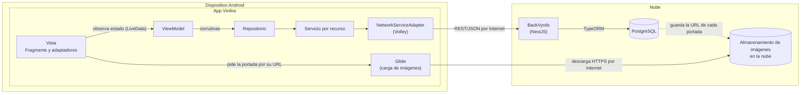
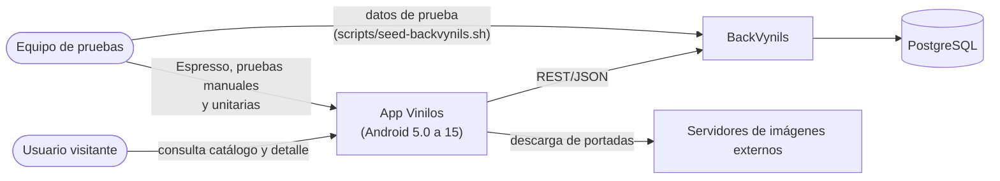
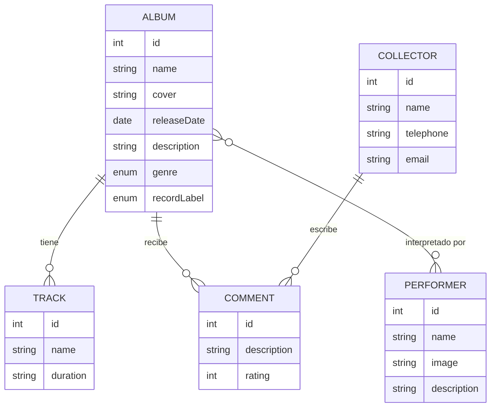
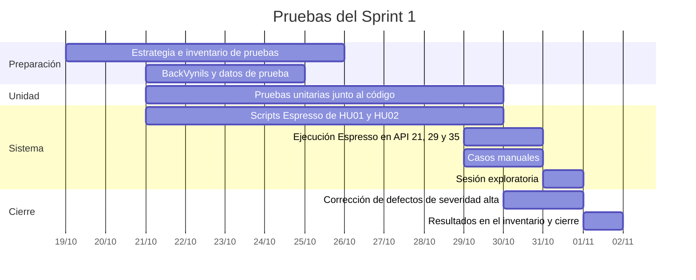

# Estrategia de pruebas · Sprint 1

Estrategia para probar **HU01 Consultar catálogo de álbumes** y **HU02 Consultar la información detallada de un álbum** durante el Sprint 1. La sección [2.6](#26-pruebas-por-historia-de-usuario) relaciona cada criterio de aceptación con las pruebas que ya están escritas y con las que faltan. Los casos concretos están en el [Inventario de pruebas](Inventario-pruebas-Sprint-1).

## 1. Aplicación bajo pruebas

### 1.1. Nombre de la aplicación
Vinilos Mobile

### 1.2. Versión
1.0, release del Sprint 1.

### 1.3. Descripción
Vinilos es una app nativa Android en Kotlin para coleccionistas de música en vinilo. Permite consultar el catálogo de álbumes con sus tracks y comentarios, los artistas (músicos y bandas) y los coleccionistas, además de crear álbumes y agregarles tracks. Consume la API REST de [BackVynils](https://github.com/TheSoftwareDesignLab/BackVynils) y funciona desde Android 5.0 (API 21) hasta Android 15 (API 35).

### 1.4. Funcionalidades core

| Funcionalidad | Descripción | Endpoint |
|---|---|---|
| Consultar catálogo de álbumes (HU01) | Cuadrícula de 2 columnas con portada, nombre, artista, año y género, con estados de carga, vacío y error | `GET /albums` |
| Consultar el detalle de un álbum (HU02) | Ficha del álbum (portada, fecha, género, sello y descripción), tracks y comentarios de solo lectura | `GET /albums/{id}` |

Las historias HU03 a HU08 se prueban en los sprints 2 y 3, con su propia estrategia.

### 1.5. Diagrama de arquitectura

La app sigue MVVM, con un Service Adapter para el acceso a la red. El detalle de cada capa está en [Diseño arquitectónico](Diseno-arquitectonico-Sprint-1).

**Componentes**

| Componente | Responsabilidad | Tecnología | Cómo se prueba |
|---|---|---|---|
| Vista | Muestra el estado de cada pantalla y reenvía las acciones del usuario | Fragments, ViewBinding, RecyclerView, Material 3 | Espresso y pruebas manuales |
| ViewModel | Convierte las respuestas en un estado de pantalla (cargando, contenido, vacío o error) | AndroidX ViewModel, LiveData, corrutinas | Pruebas unitarias con un servicio mockeado |
| Repositorio | Punto único para obtener los datos de un recurso | Kotlin | Pruebas unitarias con un servicio mockeado |
| Servicio | Traduce el JSON de cada endpoint a modelos | Kotlin, `org.json` | Pruebas unitarias de parseo |
| NetworkServiceAdapter | Único punto de acceso a la API; una sola cola de peticiones | Volley | Pruebas unitarias de URLs; Espresso contra BackVynils |
| BackVynils | API REST con la lógica de negocio y la persistencia | NestJS, TypeORM | No se prueba: es un sistema externo; se usa como dependencia real en las E2E |
| Base de datos | Persistencia de álbumes, artistas, coleccionistas, tracks y comentarios | PostgreSQL | Se recrea con datos de prueba antes de cada ejecución completa |

**Conectores**

| Conector | Entre | Descripción |
|---|---|---|
| LiveData | Vista y ViewModel | La vista observa un único estado sellado por pantalla |
| Funciones `suspend` | ViewModel, repositorio, servicio y adaptador | Llamadas asíncronas que se cancelan con la pantalla |
| REST/JSON sobre HTTP | Adaptador y BackVynils | `GET /albums` y `GET /albums/{id}`; los errores llegan como `VolleyError` |
| HTTP (imágenes) | Vista y servidores externos | Glide descarga las portadas desde la URL de cada álbum, con imagen genérica si falla |
| ORM | BackVynils y PostgreSQL | TypeORM traduce las operaciones a SQL |

### 1.6. Diagrama de contexto

### 1.7. Modelo de datos

Entidades de BackVynils que usan HU01 y HU02:

`genre` toma los valores Classical, Salsa, Rock o Folk, y `recordLabel` Sony Music, EMI, Discos Fuentes, Elektra o Fania Records. `GET /albums/{id}` devuelve los comentarios sin el `COLLECTOR` que los escribió (ver la sección 2.10).

### 1.8. Modelo de GUI

El prototipo navegable está en [Diseño UX/UI](Diseno-UX-UI) ([Penpot](https://design.penpot.app/#/view?file-id=17193a1f-939a-80b5-8008-c515c098fe5d&page-id=17193a1f-939a-80b5-8008-c515c098fe5e&section=interactions&index=0&share-id=cd240047-b7fb-4186-98f1-b9598e3409a8)). Pantallas del Sprint 1:

| Pantalla | HU | Estados y elementos que se prueban |
|---|---|---|
| Listado de álbumes | HU01 | Tarjetas de carga, cuadrícula de 2 columnas, catálogo vacío, error con "Reintentar", portada genérica, botón "Nuevo álbum" |
| Detalle de álbum | HU02 | Ficha, "Tracks · N", comentarios de solo lectura, listas vacías, error con "Reintentar", flecha de regreso |

## 2. Contexto de la estrategia de pruebas

### 2.1. Objetivos

| ID | Objetivo |
|---|---|
| OBJ-01 | **Cubrir el 100 % de los criterios de aceptación de HU01 y HU02 que están en el alcance del Sprint 1.** Cada uno de los 13 criterios en alcance tiene al menos un caso en el inventario y todos se ejecutan antes del 2026-11-01, con su resultado registrado. Los 3 criterios que dependen de HU07 y HU08 se prueban en el Sprint 3. |
| OBJ-02 | **Automatizar con Espresso los 7 recorridos E2E estables del inventario** (`AlbumListTest` y `AlbumDetailTest`) y lograr que pasen al 100 % en la ejecución final en Android 5.0 (API 21), 10 (API 29) y 15 (API 35), sin reintentos. |
| OBJ-03 | **Probar con pruebas unitarias toda la lógica de las capas `viewmodels`, `repositories` y `network`.** Cada clase nueva llega con sus pruebas en el mismo pull request, y cada estado de pantalla (carga, contenido, vacío, error y reintento) de las dos pantallas tiene al menos una prueba. El 100 % de las pruebas unitarias pasan antes de integrar a `develop`. |
| OBJ-04 | **Revisar por pares el 100 % del código y de los scripts de prueba.** Ningún pull request llega a `develop` sin la aprobación de un integrante distinto del autor, que verifica que las pruebas pasan, que se respetan las capas MVVM y que las pruebas Espresso usan esperas explícitas y no pausas fijas. |
| OBJ-05 | **Cerrar el sprint sin defectos de severidad alta abiertos** y con todos los defectos encontrados reportados como issues en el formato de la sección 2.7. |

### 2.2. Duración de la iteración de pruebas

- **Inicio del sprint:** 2026-10-19
- **Fin del sprint:** 2026-11-01 (domingo, 11:59 p. m.)
- **Duración:** 2 semanas. Las pruebas unitarias se escriben durante todo el sprint junto al código; la ejecución E2E, manual y exploratoria se concentra en la segunda semana, cuando HU01 y HU02 están integradas en `develop`.
- **Disponibilidad:** 12 horas semanales por integrante; 48 horas semanales del equipo y 96 horas en el sprint.

### 2.3. Presupuesto de pruebas

#### 2.3.1. Recursos humanos

| Integrante | Tareas de pruebas del Sprint 1 | Tiempo disponible semanal |
|---|---|---|
| Alejandro Pulido | Estrategia de pruebas ([#24](https://github.com/manuel-jose-marin/vinilos-mobile/issues/24)), pruebas funcionales y ejecución de Espresso; unitarias del listado (#16) y del detalle (#20) | 12 h |
| Manuel José Marín | Espresso del listado ([#17](https://github.com/manuel-jose-marin/vinilos-mobile/issues/17)), inventario y reporte de defectos ([#25](https://github.com/manuel-jose-marin/vinilos-mobile/issues/25)) | 12 h |
| Miguel Rincón | Espresso del detalle ([#22](https://github.com/manuel-jose-marin/vinilos-mobile/issues/22)) | 12 h |
| Felipe Rojas | Unitarias del servicio de álbumes y del ViewModel del listado (#15, #19) | 12 h |

Además, cada integrante escribe las pruebas unitarias del código que implementa y revisa pull requests de los demás.

#### 2.3.2. Recursos computacionales

| Recurso | Restricciones |
|---|---|
| MacBook Air (Apple M4, 10 núcleos, 16 GB de RAM, 256 GB SSD), macOS 27 · Alejandro Pulido | Emuladores con imágenes arm64-v8a, disponibles para API 21, 29 y 35. Docker Desktop para BackVynils |

Software común: JDK 17, Android SDK (plataforma 35), Gradle 8, Docker y BackVynils local según [Backend BackVynils](Backend-BackVynils).

### 2.4. TNT (técnicas, niveles y tipos) de pruebas

| Nivel | Tipo | Técnica | Descripción | Objetivos |
|---|---|---|---|---|
| Unidad | Funcional (caja blanca) | Pruebas unitarias con dobles de prueba (JUnit, `kotlinx-coroutines-test`) | Probamos el parseo de JSON, la construcción de URLs, los textos de las tarjetas y los estados de `AlbumListViewModel` y `AlbumDetailViewModel` con un `AlbumService` mockeado, sin red | OBJ-03 |
| Unidad | Calidad de código | Revisión por pares y análisis estático (lint de Android) | Cada pull request lo aprueba otro integrante; se revisa la separación de capas, el manejo de errores y las esperas en Espresso | OBJ-04 |
| Sistema | Funcional (caja negra) | E2E automatizadas con Espresso basadas en criterios de aceptación | Recorremos la app contra BackVynils como lo haría un usuario: catálogo en 2 columnas, abrir el detalle, último álbum sobre "Nuevo álbum", ficha, tracks, comentarios y regreso | OBJ-01, OBJ-02 |
| Sistema | Funcional (caja negra) | E2E manuales guiadas por casos de prueba, con partición de estados y valores límite | Ejecutamos los casos que dependen de la red o de los datos: carga lenta, sin conexión y reintento, catálogo vacío, portada inválida y secciones sin tracks o comentarios | OBJ-01, OBJ-05 |
| Sistema | Compatibilidad | Ejecución de la suite en varias versiones de Android | Corremos las pruebas Espresso en API 21, 29 y 35 antes de pasar a `main` | OBJ-02 |
| Sistema | Exploratoria | Sesión exploratoria con charters | Sesión de 2 horas sobre rotación de pantalla, textos largos, toques rápidos repetidos y navegación atrás; registramos evidencia de lo anómalo | OBJ-05 |
| Aceptación | Funcional | Validación de criterios de aceptación en la revisión del sprint | El equipo recorre HU01 y HU02 en la demo y confirma la Definition of Done | OBJ-01 |

**Fuera del Sprint 1:** pruebas de reconocimiento aleatorias (Monkey), de desempeño y de accesibilidad, que el [backlog](Backlog) ubica en los sprints 2 y 3.

### 2.5. Distribución de esfuerzo

Adoptamos la **pirámide de pruebas**: la mayor parte del esfuerzo en pruebas unitarias, una capa media de pruebas E2E automatizadas y una capa delgada de pruebas manuales y exploratorias. A diferencia de un proyecto que prueba una aplicación de terceros, aquí desarrollamos la app y controlamos su código:

- La arquitectura MVVM separa la lógica en ViewModels, repositorios y servicios que se prueban sin emulador ni red. Estas pruebas corren en segundos y se ejecutan en cada pull request.
- Las pruebas Espresso son más lentas y dependen del estado de BackVynils, por eso solo automatizamos los 7 recorridos estables del inventario.
- Los casos que dependen de condiciones de red o de datos especiales (sin conexión, catálogo vacío, portada inválida) se prueban manualmente, porque automatizarlos contra el backend real no sería confiable en el tiempo del sprint.

Las horas salen de la disponibilidad del equipo en el sprint: 4 integrantes × 12 horas semanales × 2 semanas = 96 horas.

| Actividad | Porcentaje del esfuerzo | Horas |
|---|---|---|
| Configuración y preparación del ambiente (BackVynils, datos de prueba, emuladores) | 10 % | 9,6 h |
| Pruebas unitarias | 35 % | 33,6 h |
| Pruebas E2E automatizadas con Espresso | 30 % | 28,8 h |
| Pruebas E2E manuales y de compatibilidad | 10 % | 9,6 h |
| Sesión exploratoria | 5 % | 4,8 h |
| Reporte de defectos y resultados | 10 % | 9,6 h |
| **Total** | **100 %** | **96 h** |

### 2.6. Pruebas por historia de usuario

Relación entre cada criterio de aceptación y sus pruebas.

#### Resumen

| HU | Criterios | En alcance | Pruebas unitarias | Pruebas Espresso | Casos manuales |
|---|---|---|---|---|---|
| HU01 | 9 | 7 | 14: `AlbumServiceTest` (4), `NetworkServiceAdapterTest` (1), `AlbumListViewModelTest` (5), `AlbumCardTextTest` (4) | 3: `AlbumListTest` | 4 |
| HU02 | 7 | 6 | 5: `AlbumDetailViewModelTest` (5), además del parseo de `AlbumServiceTest` | 4: `AlbumDetailTest` | 2 |
| **Total** | **16** | **13** | **19** | **7** | **6** |

#### HU01 · Consultar catálogo de álbumes

| # | Criterio | Unitarias | E2E Espresso | Manual |
|---|---|---|---|---|
| 1 | Cuadrícula de 2 columnas con portada, nombre, artista, año y género | `parseAlbum_readsAllFieldsAndRelations`, `parseAlbums_keepsServerOrder`, `AlbumCardTextTest` (4) | `catalogShowsAlbumCardsInTwoColumns` (HU01-01) | |
| 2 | Tarjetas de carga mientras responde el servidor | `init_showsLoadingUntilTheRepositoryResponds` | | HU01-02 |
| 3 | Error sin conexión y "Reintentar" | `loadAlbums_whenTheRequestFails_exposesError`, `retry_afterAnError_loadsTheAlbumsAgain` | | HU01-03 |
| 4 | Mensaje de catálogo vacío | `loadAlbums_withNoAlbums_exposesEmpty`, `parseAlbums_emptyArray_returnsEmptyList` | | HU01-04 |
| 5 | Imagen genérica si la portada no carga | | | HU01-05 |
| 6 | Tocar una tarjeta abre su detalle | | `tappingAlbumOpensItsDetail` (HU01-06) | |
| 7 | "Nuevo álbum" abre el formulario | Fuera del Sprint 1: se prueba con HU07 | | |
| 8 | Último álbum visible sobre "Nuevo álbum" | | `lastAlbumIsVisibleAboveNewAlbumButton` (HU01-08) | |
| 9 | El álbum creado aparece en el catálogo | Fuera del Sprint 1: se prueba con HU07 | | |

`buildUrl_joinsBaseAndPathWithSingleSlash` cubre la construcción de las URLs de ambos endpoints.

#### HU02 · Consultar la información detallada de un álbum

| # | Criterio | Unitarias | E2E Espresso | Manual |
|---|---|---|---|---|
| 1 | Portada, nombre, artista, fecha, género, sello y descripción | `parseAlbum_readsAllFieldsAndRelations`, `loadAlbum_requestsTheGivenAlbumAndExposesIt` | `AlbumDetailTest` (HU02-01) | |
| 2 | "Tracks · N" con número, nombre y duración; nombres largos en dos líneas | `parseAlbum_readsAllFieldsAndRelations` (tracks y duración) | `AlbumDetailTest` (HU02-02) | |
| 3 | Comentarios con autor, calificación y texto, sin opción para escribir | `parseAlbum_readsAllFieldsAndRelations` (calificación) | `AlbumDetailTest` (HU02-03); el autor no viene en `GET /albums/{id}` (ver la sección 2.10) | |
| 4 | Mensaje de lista vacía sin tracks o comentarios | `parseAlbum_withoutTracksOrComments_returnsEmptyLists`, `loadAlbum_withoutTracksOrComments_exposesContentWithEmptyLists` | | HU02-04 |
| 5 | Error sin conexión y "Reintentar" | `init_showsLoadingUntilTheRepositoryResponds`, `loadAlbum_whenTheRequestFails_exposesError`, `retry_afterAnError_loadsTheAlbumAgain` | | HU02-05 |
| 6 | "Agregar track" abre el formulario | Fuera del Sprint 1: se prueba con HU08 | | |
| 7 | Flecha de regreso y botón atrás vuelven a la pantalla anterior | | `AlbumDetailTest` (HU02-07) | |

### 2.7. Gestión de defectos

Cada defecto se reporta como issue en GitHub con la etiqueta `bug`, la etiqueta de la historia (`HU01` o `HU02`) y el milestone del sprint. El issue incluye:

- Caso del inventario (por ejemplo `HU01-03`) o "exploratoria"
- Pasos para reproducirlo, resultado esperado y resultado obtenido
- Versión de Android y dispositivo o emulador
- Severidad y evidencia (captura o video)

| Severidad | Significado | Tratamiento |
|---|---|---|
| Alta | La app se cierra, o un criterio de aceptación no se cumple | Bloquea el cierre del sprint; se corrige antes de la entrega |
| Media | El criterio se cumple con errores visibles (texto cortado, un estado incorrecto por un momento) | Se corrige en el sprint si hay capacidad; si no, pasa al backlog |
| Baja | Detalle visual o de textos que no afecta el uso | Pasa al backlog |

Quien corrige el defecto lo enlaza en el pull request (`Closes #N`) y el responsable de pruebas vuelve a ejecutar el caso antes de cerrarlo.

### 2.8. Criterios de entrada y salida

| | Criterio |
|---|---|
| Entrada a un pull request | Compila, pasan las pruebas unitarias locales y las clases nuevas de `viewmodels`, `repositories` y `network` traen sus pruebas |
| Entrada a la ejecución E2E | HU01 y HU02 integradas en `develop`; BackVynils corriendo con los datos de prueba |
| Salida del sprint | Objetivos OBJ-01 a OBJ-05 cumplidos y resultados registrados en el inventario |

### 2.9. Cronograma

### 2.10. Riesgos

| Riesgo | Mitigación |
|---|---|
| Espresso no sincroniza las peticiones de Volley y las pruebas fallan de forma intermitente | Esperas explícitas con tiempo máximo (`waitUntilDisplayed`, de [#17](https://github.com/manuel-jose-marin/vinilos-mobile/issues/17)) en lugar de pausas fijas |
| Los datos del backend cambian entre ejecuciones | Recrear la base y cargar `scripts/seed-backvynils.sh` antes de cada ejecución completa |
| Librerías recientes que no soportan Android 5.0 | Versiones fijadas en `libs.versions.toml` y ejecución en el emulador de API 21 |
| `GET /albums/{id}` no trae el autor de los comentarios que pide HU02 (criterio 3) | Se resuelve en la implementación del detalle ([#19](https://github.com/manuel-jose-marin/vinilos-mobile/issues/19), [#21](https://github.com/manuel-jose-marin/vinilos-mobile/issues/21)), por ejemplo consultando `GET /collectors`, y se valida en HU02-03 |
| `AlbumDetailTest` no se puede escribir hasta que exista la vista del detalle | Priorizar [#21](https://github.com/manuel-jose-marin/vinilos-mobile/issues/21) en la segunda semana del sprint |
| En Android 15 la app se dibuja de borde a borde y el título de la pantalla queda bajo la barra de estado | Se reporta como defecto y se verifica en el emulador de API 35 |
