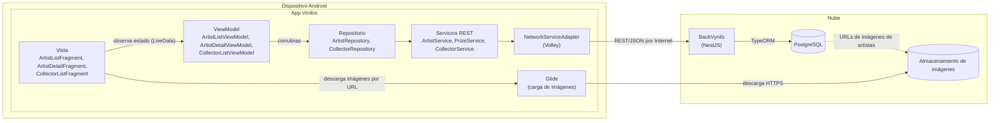
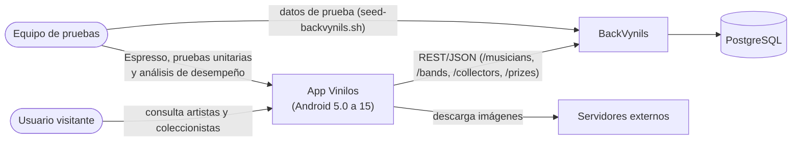
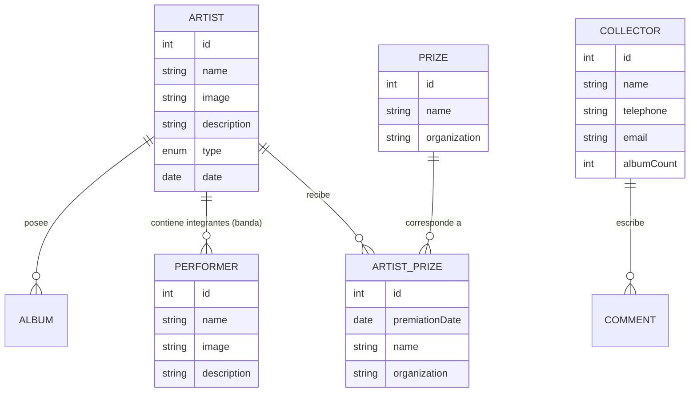
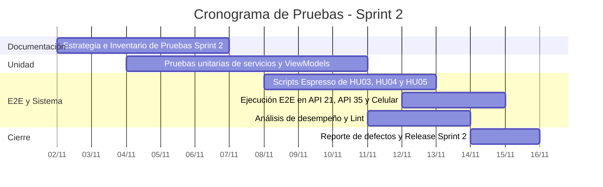

# Estrategia de pruebas · Sprint 2

Estrategia para probar **HU03 Consultar el listado de artistas**, **HU04 Consultar la información detallada de un artista** y **HU05 Consultar listado de coleccionistas** durante el Sprint 2 (2026-11-02 a 2026-11-15). Los casos concretos se detallan en el [Inventario de pruebas](Inventario-pruebas-Sprint-2).

## 1. Aplicación bajo pruebas

### 1.1. Nombre de la aplicación
Vinilos Mobile

### 1.2. Versión
1.0, release del Sprint 2.

### 1.3. Descripción
Vinilos es una app nativa Android en Kotlin para coleccionistas de música en vinilo. Permite consultar el catálogo de álbumes con sus detalles, el listado y detalle de artistas (músicos y bandas) y la lista de coleccionistas, además de crear álbumes y asociar tracks. Consume la API REST de [BackVynils](https://github.com/TheSoftwareDesignLab/BackVynils) y funciona desde Android 5.0 (API 21) hasta Android 15 (API 35).

### 1.4. Funcionalidades core del Sprint 2

| Funcionalidad | Descripción | Endpoint |
|---|---|---|
| Consultar el listado de artistas (HU03) | Listado unificado de músicos y bandas con filtro (Todos / Músicos / Bandas), mostrando avatar, nombre, tipo y número de álbumes. | `GET /musicians` `GET /bands` |
| Consultar el detalle de un artista (HU04) | Ficha detallada del artista (músico o banda) con imagen, fecha, biografía, carrusel de álbumes, premios obtenidos e integrantes (para bandas). | `GET /musicians/{id}` `GET /bands/{id}` `GET /prizes` |
| Consultar listado de coleccionistas (HU05) | Lista de coleccionistas registrados con sus iniciales/avatar, nombre, correo electrónico y número de álbumes en su colección. | `GET /collectors` |

Las historias HU01 y HU02 (álbumes) corresponden al Sprint 1, y HU06 a HU08 se prueban en el Sprint 3.

### 1.5. Diagrama de arquitectura

La app extiende el patrón MVVM del Sprint 1, incorporando repositorios y servicios para artistas, premios y coleccionistas. El detalle se encuentra en [Diseño arquitectónico del Sprint 2](Diseno-arquitectonico-Sprint-2).

**Componentes incorporados o extendidos en el Sprint 2**

| Componente | Responsabilidad | Tecnología | Cómo se prueba |
|---|---|---|---|
| Vistas | Pantallas de listado y detalle de artistas (`ArtistListFragment`, `ArtistDetailFragment`) y listado de coleccionistas (`CollectorListFragment`) | Fragments, ViewBinding, RecyclerView, Material 3, ListAdapter | Espresso y pruebas manuales |
| ViewModels | Calculan el estado de pantalla (`Loading`, `Content`, `Empty`, `Error`) y aplican el filtro de artistas en memoria | AndroidX ViewModel, LiveData, Corrutinas | Pruebas unitarias con servicios mockeados |
| Repositorios | `ArtistRepository` une músicos y bandas en paralelo con `async`, y cruza premios con `PrizeService`. `CollectorRepository` gestiona coleccionistas | Kotlin Corrutinas | Pruebas unitarias con servicios mockeados |
| Servicios REST | `ArtistService`, `PrizeService` y `CollectorService` traducen JSON a modelos inmutables | Kotlin, `org.json` | Pruebas unitarias de parseo |
| NetworkServiceAdapter | Punto único de acceso a la API REST sobre Volley | Volley | Pruebas unitarias de URLs y Espresso E2E |

### 1.6. Diagrama de contexto del Sprint 2

### 1.7. Modelo de datos del Sprint 2

Entidades de BackVynils utilizadas en HU03, HU04 y HU05:

### 1.8. Modelo de GUI

El prototipo navegable está documentado en [Diseño UX/UI](Diseno-UX-UI). Pantallas del Sprint 2:

| Pantalla | HU | Estados y elementos que se prueban |
|---|---|---|
| Listado de artistas | HU03 | Selector de filtro (Todos / Músicos / Bandas), tarjetas con avatar, nombre, tipo y número de álbumes; estados de carga, vacío y error con "Reintentar" |
| Detalle de artista | HU04 | Ficha (imagen, badge Músico/Banda, fecha, biografía), carrusel de álbumes, lista de premios, integrantes (solo bandas), listas vacías, error con "Reintentar" |
| Listado de coleccionistas | HU05 | Lista con avatar/iniciales, nombre, correo y contador de álbumes; estados de carga, contenido, vacío y error con "Reintentar" |

## 2. Contexto de la estrategia de pruebas

### 2.1. Objetivos

| ID | Objetivo |
|---|---|
| OBJ-01 | **Cubrir el 100 % de los criterios de aceptación de HU03, HU04 y HU05.** Todos los criterios definidos tienen su correspondiente caso en el inventario y son ejecutados y registrados antes del 2026-11-15. |
| OBJ-02 | **Automatizar con Espresso los escenarios E2E principales de HU03, HU04 y HU05** (`ArtistListTest`, `ArtistDetailTest` y `CollectorListTest`) logrando una tasa de éxito del 100 % en ejecuciones continuas sobre Android 5.0 (API 21) y Android 15 (API 35). |
| OBJ-03 | **Asegurar la cobertura unitaria de las capas `viewmodels`, `repositories` y `network` para los nuevos recursos.** Probar el parseo unificado de músicos y bandas, la unión en paralelo de `ArtistRepository`, el cruce de premios de `PrizeService` y los estados de pantalla de cada ViewModel. |
| OBJ-04 | **Ejecutar el análisis de desempeño con Android Profiler y aplicar micro-optimizaciones.** Identificar y corregir hallazgos de Android Lint y uso de memoria/CPU, documentando los resultados en la wiki. |
| OBJ-05 | **Mantener la revisión por pares del 100 % del código** mediante Pull Requests con la regla `Closes #N` y cerrar el sprint sin defectos de severidad alta abiertos. |

### 2.2. Duración de la iteración de pruebas

- **Inicio del sprint:** 2026-11-02
- **Fin del sprint:** 2026-11-15 (domingo, 11:59 p. m.)
- **Duración:** 2 semanas. Las pruebas unitarias se desarrollan junto a la implementación de cada issue; las pruebas E2E, de compatibilidad y el análisis de desempeño se ejecutan en la segunda semana.
- **Disponibilidad:** 12 horas semanales por integrante (48 h/semana equipo, 96 h totales).

### 2.3. Presupuesto de pruebas

#### 2.3.1. Recursos humanos

| Integrante | Tareas de pruebas del Sprint 2 | Tiempo disponible semanal |
|---|---|---|
| Miguel Rincón | Estrategia de pruebas (`#44`), Pruebas E2E con Espresso del listado de artistas (HU03) y revisión por pares de PRs | 12 h |
| Manuel José Marín | Pruebas unitarias del servicio de coleccionistas (`#39`) y del repositorio/ViewModel de detalle de artista (`#35`), e inventario y reporte de defectos del Sprint 2 | 12 h |
| Felipe Rojas | Pruebas unitarias del servicio de artistas (`#29`), Pruebas E2E con Espresso del detalle de artista (HU04) y revisión por pares de PRs | 12 h |
| Alejandro Pulido | Pruebas E2E con Espresso del listado de coleccionistas (HU05), Pruebas unitarias del repositorio/ViewModel del listado de artistas (`#30`) y Análisis de desempeño con Android Profiler (`#45`) | 12 h |

#### 2.3.2. Recursos computacionales

| Recurso | Restricciones / Uso |
|---|---|
| ASUS ROG Zephyrus M16 (Intel Core i7-11800H @ 2.30 GHz, 8 núcleos / 16 procesadores lógicos, 40 GB RAM, Windows 11 Pro x64) · Miguel Rincón | Emuladores Android Studio (x86_64, API 21 minSdk y API 35 targetSdk), Docker Desktop para BackVynils local y Android Profiler |
| MacBook Air (Apple M4, 10 núcleos, 16 GB RAM, 256 GB SSD, macOS) · Alejandro Pulido | Emuladores con imágenes arm64-v8a (API 21 y API 35), Docker Desktop para BackVynils y Android Profiler |

Software común: JDK 17, Android SDK (plataforma 35), Gradle 8, Docker y BackVynils local según [Backend BackVynils](Backend-BackVynils).

### 2.4. TNT (técnicas, niveles y tipos) de pruebas

| Nivel | Tipo | Técnica | Descripción | Objetivos |
|---|---|---|---|---|
| Unidad | Funcional (caja blanca) | Pruebas unitarias con JUnit, Coroutines Test e InstantTaskExecutorRule | Verificación del parseo de `ArtistService`, `PrizeService` y `CollectorService`, ordenamiento de músicos/bandas y emisión de LiveData en ViewModels | OBJ-03 |
| Unidad | Calidad de código | Revisión por pares y Android Lint | Verificación de separación MVVM, ausencia de fugas de memoria en ViewBinding y corrección de advertencias de Lint | OBJ-04, OBJ-05 |
| Sistema | Funcional (caja negra) | E2E automatizadas con Espresso | Flujos de usuario completos: navegación a la pestaña Artistas, cambio de filtro (Todos/Músicos/Bandas), apertura del detalle, carrusel de álbumes y retorno | OBJ-01, OBJ-02 |
| Sistema | Funcional (caja negra) | E2E manuales guiadas por casos de prueba | Verificación de estados de red lenta, reintento sin conexión, imágenes no cargadas y secciones sin premios e integrantes | OBJ-01 |
| Sistema | Compatibilidad | Suite en múltiples versiones de Android | Ejecución de pruebas en emuladores con API 21 y API 35 | OBJ-02 |
| Sistema | Desempeño | Perfilado con Android Profiler | Inspección del consumo de memoria, CPU y peticiones de red durante el scroll en RecyclerViews y carga de imágenes con Glide | OBJ-04 |

### 2.5. Distribución de esfuerzo

| Actividad | Porcentaje del esfuerzo | Horas |
|---|---|---|
| Configuración de ambiente y datos de prueba | 10 % | 9,6 h |
| Pruebas unitarias (Servicios, Repositorios, ViewModels) | 30 % | 28,8 h |
| Pruebas E2E automatizadas con Espresso | 25 % | 24,0 h |
| Pruebas manuales y de compatibilidad (API 21 / API 35) | 15 % | 14,4 h |
| Análisis de desempeño (Profiler) y micro-optimizaciones | 10 % | 9,6 h |
| Reporte de defectos, inventario y cierre | 10 % | 9,6 h |
| **Total** | **100 %** | **96 h** |

### 2.6. Pruebas por historia de usuario

#### HU03 · Consultar el listado de artistas

| # | Criterio de Aceptación | Pruebas Unitarias | E2E Espresso | Manual |
|---|---|---|---|---|
| 1 | Listado con músicos y bandas unificados (avatar, nombre, tipo y número de álbumes) | `ArtistServiceTest.parseMusicians`, `ArtistServiceTest.parseBands` | `ArtistListTest.listShowsMusiciansAndBands` | |
| 2 | Botón de filtro Todos / Músicos / Bandas aplica en memoria sin peticiones extra | `ArtistListViewModelTest.setFilter_filtersInMemory` | `ArtistListTest.filteringByMusiciansOrBands` | |
| 3 | Estado de carga mientras llega la respuesta | `ArtistListViewModelTest.init_showsLoading` | | HU03-02 |
| 4 | Manejo de error de red y botón "Reintentar" | `ArtistListViewModelTest.loadArtists_error` | | HU03-03 |
| 5 | Mensaje cuando no hay artistas | `ArtistListViewModelTest.loadArtists_empty` | | HU03-04 |
| 6 | Tocar un artista abre su pantalla de detalle | | `ArtistListTest.tappingArtistOpensDetail` | |

#### HU04 · Consultar la información detallada de un artista

| # | Criterio de Aceptación | Pruebas Unitarias | E2E Espresso | Manual |
|---|---|---|---|---|
| 1 | Ficha técnica (imagen, badge Músico/Banda, fecha, biografía) | `ArtistServiceTest.parseMusicianDetail`, `ArtistServiceTest.parseBandDetail` | `ArtistDetailTest.detailShowsArtistDataSheet` | |
| 2 | Carrusel de álbumes del artista | `ArtistDetailViewModelTest.loadArtist_includesAlbums` | `ArtistDetailTest.detailShowsAlbumsCarousel` | |
| 3 | Lista de premios obtenidos (cruce con `PrizeService`) | `PrizeServiceTest.parsePrizes`, `ArtistRepositoryTest.joinsPrizes` | `ArtistDetailTest.detailShowsPrizes` | |
| 4 | Lista de integrantes (solo bandas) | `ArtistServiceTest.parseBandMembers` | `ArtistDetailTest.bandDetailShowsMembers` | |
| 5 | Secciones vacías cuando no hay álbumes, premios o integrantes | `ArtistDetailViewModelTest.emptySections` | | HU04-05 |
| 6 | Error de red y "Reintentar" | `ArtistDetailViewModelTest.loadArtist_error` | | HU04-06 |
| 7 | Flecha de regreso vuelve al listado de artistas | | `ArtistDetailTest.backNavigationReturnsToList` | |

#### HU05 · Consultar listado de coleccionistas

| # | Criterio de Aceptación | Pruebas Unitarias | E2E Espresso | Manual |
|---|---|---|---|---|
| 1 | Lista con iniciales/avatar, nombre, correo y número de álbumes | `CollectorServiceTest.parseCollectors` | `CollectorListTest.listShowsCollectors` | |
| 2 | Estado de carga mientras responde la API | `CollectorListViewModelTest.init_showsLoading` | | HU05-02 |
| 3 | Error de red y botón "Reintentar" | `CollectorListViewModelTest.loadCollectors_error` | | HU05-03 |
| 4 | Mensaje de lista vacía | `CollectorListViewModelTest.loadCollectors_empty` | | HU05-04 |

### 2.7. Gestión de defectos

Los defectos se registran en GitHub Projects con la etiqueta `bug`, la etiqueta de la historia (`HU03`, `HU04` o `HU05`) y el milestone **Sprint 2**.

- **Severidad Alta:** Bloquea la entrega del sprint; debe ser corregido antes de publicar el release.
- **Severidad Media / Baja:** Se evalúa capacidad en el sprint o se agenda para el backlog.
- Cada solución debe ser integrada mediante un PR con la sintaxis `Closes #N`.

### 2.8. Criterios de entrada y salida

| Etapa | Criterio de Entrada | Criterio de Salida |
|---|---|---|
| Pruebas Unitarias | Código de la historia implementado | 100 % de pruebas unitarias ejecutadas con éxito |
| Pruebas E2E | Vistas y servicios integrados en `develop` | Pruebas Espresso pasando en API 21 y API 35 sin fallas |
| Cierre del Sprint 2 | Pruebas y análisis de desempeño completados | Sin defectos de severidad alta abiertos y release publicado con APK |

### 2.9. Cronograma del Sprint 2

### 2.10. Riesgos y mitigaciones

| Riesgo | Mitigación |
|---|---|
| Dependencia de servicios REST (`#29` para `#30` y `#34` para `#35`) | Desarrollo inicial con dobles de prueba (Mocks/Fakes) para avanzar en ViewModels y layouts |
| `GET /musicians` y `GET /bands` son peticiones separadas | `ArtistRepository` ejecuta ambas en paralelo con `async/await` en corrutinas |
| `performerPrizes` no incluye el nombre del premio | `ArtistRepository` consulta `GET /prizes` en paralelo para enriquecer la información |
| Indisponibilidad de la API de prueba | Soporte dual para backend local en Docker y servidor en Render |
