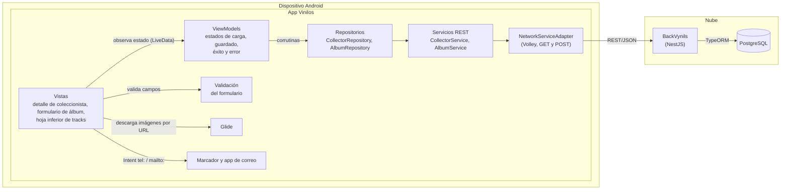
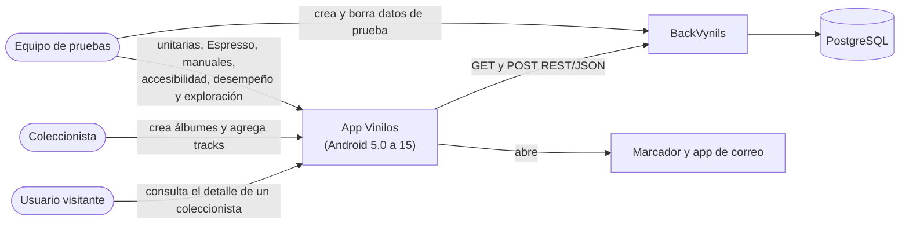
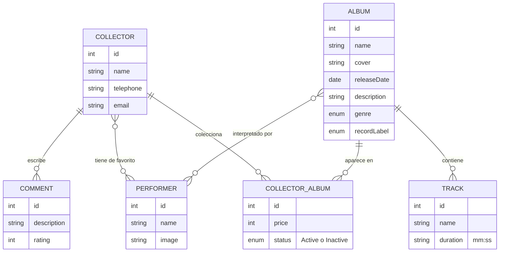
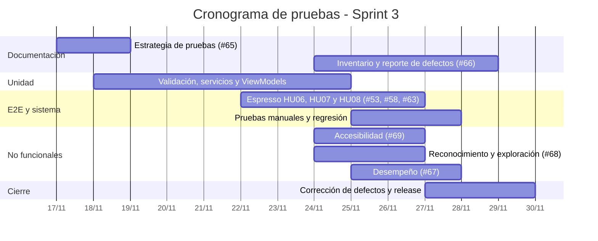

# Estrategia de pruebas · Sprint 3

Estrategia para probar **HU06 Consultar la información detallada de coleccionista**, **HU07 Crear un álbum** y **HU08 Asociar tracks con un álbum** durante el Sprint 3 (2026-11-16 a 2026-11-29). Es el primer sprint con historias que **escriben** en BackVynils, así que la estrategia añade pruebas de formularios, validación y datos de prueba que se crean y se borran. Los casos concretos se registran en el Inventario de pruebas del Sprint 3 (`#66`).

## 1. Aplicación bajo pruebas

### 1.1. Nombre de la aplicación
Vinilos Mobile

### 1.2. Versión
Release del Sprint 3 (sigue a `v2.0.0`, publicada al cierre del Sprint 2).

### 1.3. Descripción
Vinilos es una app nativa Android en Kotlin para coleccionistas de música en vinilo. Permite consultar álbumes, artistas y coleccionistas, y desde este sprint ver el detalle de un coleccionista, crear álbumes y asociarles tracks. Consume la API REST de [BackVynils](https://github.com/TheSoftwareDesignLab/BackVynils) y funciona desde Android 5.0 (API 21) hasta Android 15 (API 35), su `targetSdk`.

### 1.4. Funcionalidades core del Sprint 3

| Funcionalidad | Descripción | Endpoint |
|---|---|---|
| Consultar el detalle de un coleccionista (HU06) | Encabezado con iniciales, nombre, número de álbumes, teléfono y correo (que abren el marcador y la app de correo); artistas favoritos; colección con portada, artista, año, precio en COP y estado; comentarios de solo lectura. | `GET /collectors/{id}` `GET /collectors/{id}/albums` `GET /albums` (artista de cada álbum) |
| Crear un álbum (HU07) | Formulario con nombre, URL y vista previa de la portada, fecha, descripción con contador, género y sello en listas desplegables; validación por campo, estado "Guardando…" y regreso al listado con confirmación. | `POST /albums` |
| Asociar tracks con un álbum (HU08) | Hoja inferior en el detalle del álbum con nombre y duración `mm:ss`; validación por campo y actualización de la lista de tracks sin salir del detalle. | `POST /albums/{id}/tracks` |

`GET /collectors/{id}/albums` trae nombre, portada y fecha de cada álbum, pero no su artista: por eso HU06 también consulta `GET /albums`. Los valores que acepta el API para el género son `Classical`, `Salsa`, `Rock` y `Folk`. Para el sello son `Sony Music`, `EMI`, `Discos Fuentes`, `Elektra` y `Fania Records`. El estado de un álbum en la colección es `Active` o `Inactive`.

HU01 a HU05 se probaron en los sprints 1 y 2 y en este sprint entran como **regresión**. El caso HU05-07 (tocar un coleccionista abre su detalle) quedó pendiente en el Sprint 2 y se cubre con HU06.

### 1.5. Diagrama de arquitectura

La app mantiene el patrón MVVM de los sprints anteriores. Los nombres definitivos de las clases nuevas quedan en el Diseño arquitectónico del Sprint 3 (`#64`).

**Componentes incorporados o extendidos en el Sprint 3**

| Componente | Responsabilidad | Cómo se prueba |
|---|---|---|
| Vistas | Detalle de coleccionista, formulario de creación de álbum y hoja inferior para agregar tracks | Espresso y pruebas manuales |
| Validación | Campos obligatorios, URL `https://`, fecha no futura, longitud de la descripción y del nombre del track, formato `mm:ss` | Pruebas unitarias con valores límite |
| ViewModels | Estados de pantalla, bloqueo del doble envío y conservación de los datos cuando falla el guardado | Pruebas unitarias con servicios falsos (`fakes/`) |
| Repositorios | Unen el detalle del coleccionista con su colección y el artista de cada álbum; envían álbumes y tracks | Pruebas unitarias con servicios falsos |
| Servicios REST | Parsean el detalle del coleccionista y arman el JSON de `POST /albums` y `POST /albums/{id}/tracks` | Pruebas unitarias de parseo y de cuerpo de la petición |
| NetworkServiceAdapter | Agrega las peticiones POST con cuerpo JSON | Pruebas unitarias de URL y método, y Espresso E2E |

### 1.6. Diagrama de contexto del Sprint 3

### 1.7. Modelo de datos del Sprint 3

Entidades de BackVynils que usan HU06, HU07 y HU08:

### 1.8. Modelo de GUI

El prototipo navegable está en [Diseño UX/UI](Diseno-UX-UI). Pantallas del Sprint 3:

| Pantalla | HU | Estados y elementos que se prueban |
|---|---|---|
| Detalle de coleccionista | HU06 | Encabezado con iniciales, nombre, chip de álbumes, botones de teléfono y correo; carrusel de favoritos; colección con estado Disponible / No disponible (ícono y texto); comentarios; listas vacías; carga y error con "Reintentar" |
| Crear álbum | HU07 | Campos obligatorios con "*", vista previa de la portada, desplegables de género y sello, contador de la descripción, errores por campo, botón "Guardando…", mensaje de confirmación, "Cancelar" |
| Agregar track | HU08 | Hoja inferior con el nombre del álbum, campos nombre y duración con ayuda, errores por campo, botón deshabilitado al guardar, mensaje de confirmación, lista y contador de tracks actualizados |

## 2. Contexto de la estrategia de pruebas

### 2.1. Objetivos

| ID | Objetivo |
|---|---|
| OBJ-01 | **Cubrir el 100 % de los criterios de aceptación de HU06 (9), HU07 (12) y HU08 (11)**: cada criterio tiene al menos un caso en el inventario (`#66`), ejecutado y registrado antes del 2026-11-29. |
| OBJ-02 | **Automatizar con Espresso los flujos principales de las tres historias** (`#53`, `#58` y `#63`), incluidas las validaciones del formulario, con 100 % de éxito en la suite completa (Sprint 1 a 3). |
| OBJ-03 | **Probar con pruebas unitarias la validación, el armado de las peticiones POST y los estados de cada ViewModel nuevo**, con valores límite para cada regla de validación. |
| OBJ-04 | **Mantener la regresión de HU01 a HU05 en verde**: las 21 pruebas Espresso y las pruebas unitarias existentes pasan en cada PR que se fusiona a `develop`. |
| OBJ-05 | **Hacer las pruebas no funcionales del sprint**: accesibilidad (`#69`), desempeño (`#67`) y pruebas de reconocimiento y exploración sistemática (`#68`), con sus resultados en la wiki. |
| OBJ-06 | **Cerrar el sprint sin defectos de severidad alta abiertos**, con revisión por pares del 100 % del código y `Closes #N` en cada PR. |

### 2.2. Duración de la iteración de pruebas

- **Inicio del sprint:** 2026-11-16
- **Fin del sprint:** 2026-11-29 (domingo, 11:59 p. m.)
- **Duración:** 2 semanas. Las pruebas unitarias se escriben con cada issue de implementación. Las pruebas E2E, las manuales y las no funcionales se ejecutan en la segunda semana, cuando las vistas estén en `develop`.
- **Disponibilidad:** 12 horas semanales por integrante (48 h por semana para el equipo, 96 h en total).

### 2.3. Presupuesto de pruebas

#### 2.3.1. Recursos humanos

| Integrante | Tareas de pruebas del Sprint 3 | Tiempo disponible semanal |
|---|---|---|
| Felipe Rojas | Estrategia de pruebas (`#65`), E2E del detalle de coleccionista (`#53`), revisión de accesibilidad (`#69`) y pruebas unitarias de `#57` y `#61` | 12 h |
| Alejandro Pulido | E2E de creación de álbum (`#58`), inventario y reporte de defectos (`#66`) y pruebas unitarias de `#50` | 12 h |
| Manuel José Marín | E2E de asociación de tracks (`#63`), análisis de desempeño (`#67`) y pruebas unitarias de `#51` y `#55` | 12 h |
| Miguel Rincón | Pruebas de reconocimiento aleatorias y exploración sistemática (`#68`) y pruebas unitarias de `#56` y `#60` | 12 h |

Todos revisan PRs de sus compañeros.

#### 2.3.2. Recursos computacionales

| Recurso | Uso |
|---|---|
| ASUS ROG Zephyrus M16 (Intel Core i7-11800H, 40 GB RAM, Windows 11 Pro) · Miguel Rincón | Emuladores x86_64 con API 21 y API 35, Docker Desktop para BackVynils local, Android Profiler |
| MacBook Air (Apple M4, 16 GB RAM, macOS) · Alejandro Pulido | Emuladores arm64-v8a con API 21 y API 35, Docker Desktop, Android Profiler |
| Mac con Apple M4 (10 núcleos, 24 GB RAM, macOS 26) · Felipe Rojas | Emulador arm64-v8a `Medium_Phone_API_37.0` (Android 17, 1080 × 2400) y Accessibility Scanner |
| BackVynils en Render (`https://backvynils-grupo5.onrender.com/`) | Backend compartido para Espresso y pruebas manuales. Tarda unos 40 s en despertar, así que se despierta con `curl` antes de cada ejecución |

Software común: JDK 17, Android SDK 35, Gradle 8, Docker y el script `scripts/seed-backvynils.sh` para los datos base (ver [Backend BackVynils](Backend-BackVynils)).

### 2.4. TNT (técnicas, niveles y tipos) de pruebas

| Nivel | Tipo | Técnica | Descripción | Objetivos |
|---|---|---|---|---|
| Unidad | Funcional (caja blanca) | JUnit, Coroutines Test e `InstantTaskExecutorRule` con servicios falsos | Validación con particiones de equivalencia y valores límite; parseo del detalle de coleccionista; cuerpo JSON de los POST; estados de los ViewModels | OBJ-03 |
| Unidad | Calidad de código | Revisión por pares y Android Lint | Separación MVVM, sin fugas de ViewBinding, sin advertencias nuevas de Lint | OBJ-06 |
| Sistema | Funcional (caja negra) | E2E automatizadas con Espresso | Flujos completos de HU06, HU07 y HU08 contra BackVynils, con datos que la prueba crea y borra | OBJ-01, OBJ-02 |
| Sistema | Funcional (caja negra) | E2E manuales guiadas por casos | Intents al marcador y al correo, vista previa de portada que no carga, errores del servidor, teclado abierto | OBJ-01 |
| Sistema | Regresión | Suite Espresso y unitaria completa | HU01 a HU05 en cada PR que se fusiona a `develop` | OBJ-04 |
| Sistema | Accesibilidad | Accessibility Scanner, TalkBack y revisión de contraste | Etiquetas de contenido, áreas táctiles de 48 dp, contraste mínimo 4.5:1 y orden de lectura en las 8 pantallas | OBJ-05 |
| Sistema | Reconocimiento | Android Monkey con semilla fija y exploración sistemática | Eventos aleatorios para buscar crashes; recorrido de todas las pantallas y transiciones | OBJ-05 |
| Sistema | Desempeño | `scripts/perf/measure.py` (las mismas fuentes que Android Profiler), Android Profiler y Lint | Arranque, fluidez, CPU y memoria de las pantallas de HU01 a HU08 (ver [Análisis de desempeño por historia](#análisis-de-desempeño-por-historia)) | OBJ-05 |
| Sistema | Compatibilidad | Suite en varias versiones de Android | API 21 (`minSdk`), API 35 (`targetSdk`) y API 37 | OBJ-02 |

### 2.5. Distribución de esfuerzo

| Actividad | Porcentaje del esfuerzo | Horas |
|---|---|---|
| Ambiente y datos de prueba (Render, creación y borrado de datos) | 8 % | 7,7 h |
| Pruebas unitarias (validación, servicios, repositorios y ViewModels) | 27 % | 25,9 h |
| Pruebas E2E con Espresso | 25 % | 24,0 h |
| Pruebas manuales, de regresión y de compatibilidad | 12 % | 11,5 h |
| Accesibilidad | 8 % | 7,7 h |
| Reconocimiento y exploración sistemática | 7 % | 6,7 h |
| Análisis de desempeño | 5 % | 4,8 h |
| Inventario, reporte de defectos y cierre | 8 % | 7,7 h |
| **Total** | **100 %** | **96 h** |

### 2.6. Pruebas por historia de usuario

Los nombres de las clases de prueba nuevas son propuestos: cada PR puede ajustarlos y el inventario (`#66`) registra los definitivos. Las pruebas unitarias van en `app/src/test/` y las de Espresso en `app/src/androidTest/`.

#### HU06 · Consultar la información detallada de coleccionista

| # | Criterio de aceptación | Pruebas unitarias | E2E Espresso (`#53`) | Manual |
|---|---|---|---|---|
| 1 | Avatar, nombre, número de álbumes, teléfono y correo | `CollectorServiceTest` (detalle) | `CollectorDetailTest`: datos de Manolo Bellon | |
| 2 | Tocar el teléfono abre el marcador | | | Se abre el marcador con `3502457896` |
| 3 | Tocar el correo abre la app de correo | | | Se abre la app de correo con la dirección |
| 4 | Artistas favoritos con foto y nombre | `CollectorServiceTest` (favoritos) | `CollectorDetailTest`: Rubén Blades en favoritos | |
| 5 | Tocar un favorito abre su detalle | | `CollectorDetailTest`: abre el detalle del artista | |
| 6 | Colección con portada, artista, año, precio en COP y estado | `CollectorRepositoryTest` (cruce con el artista) | `CollectorDetailTest`: Buscando América, $35 COP, Disponible | |
| 7 | Tocar un álbum de la colección abre su detalle | | `CollectorDetailTest`: abre el detalle del álbum | |
| 8 | Comentarios sin opción de escribir | `CollectorServiceTest` (comentarios) | `CollectorDetailTest`: comentarios visibles | |
| 9 | Error de conexión con "Reintentar" | `CollectorDetailViewModelTest` (error y reintento) | | Modo avión y "Reintentar" |
| — | Listado → detalle (HU05-07, pendiente del Sprint 2) | | `CollectorListTest`: tocar un coleccionista abre su detalle | |

Los criterios 2 y 3 se pueden automatizar con Espresso-Intents (`intended(hasAction(ACTION_DIAL))`) si `#53` agrega esa dependencia.

#### HU07 · Crear un álbum

| # | Criterio de aceptación | Pruebas unitarias | E2E Espresso (`#58`) | Manual |
|---|---|---|---|---|
| 1 | "Nuevo álbum" abre el formulario con los campos obligatorios marcados | | `AlbumCreateTest`: abre el formulario | |
| 2 | Género y sello con los valores del API | `AlbumServiceTest` (valores en el JSON) | `AlbumCreateTest`: opciones del desplegable | |
| 3 | Vista previa de una URL válida | | | Pegar la URL de la portada de Buscando América |
| 4 | "No se pudo cargar la imagen" si la URL no carga | | | URL `https://example.invalid/x.jpg` |
| 5 | Error bajo cada campo obligatorio vacío y no se envía | `AlbumFormValidatorTest` (cada campo vacío o con solo espacios) | `AlbumCreateTest`: formulario vacío | |
| 6 | URL que no empieza por `https://` | `AlbumFormValidatorTest` (`http://`, sin esquema, `https://`) | `AlbumCreateTest`: URL inválida | |
| 7 | Fecha futura | `AlbumFormValidatorTest` (ayer, hoy, mañana) | | Elegir mañana en el selector |
| 8 | Contador de la descripción sin superar el límite | `AlbumFormValidatorTest` (límite − 1, límite, límite + 1) | | Pegar un texto más largo que el límite |
| 9 | "Guardando…" y formulario deshabilitado, sin doble envío | `CreateAlbumViewModelTest` (doble envío) | | Red lenta con el servidor de prueba local |
| 10 | Al confirmar: vuelve al listado, mensaje "Álbum «X» creado" y el álbum aparece | `CreateAlbumViewModelTest` (éxito) | `AlbumCreateTest`: crea un álbum y lo ve en el listado | |
| 11 | Error del servidor: mensaje, conserva los datos y se puede reintentar | `CreateAlbumViewModelTest` (error conserva los datos) | | Modo avión al tocar "Crear álbum" |
| 12 | "Cancelar" o la flecha vuelven sin crear | | `AlbumCreateTest`: cancelar no crea | |

#### HU08 · Asociar tracks con un álbum

| # | Criterio de aceptación | Pruebas unitarias | E2E Espresso (`#63`) | Manual |
|---|---|---|---|---|
| 1 | "Agregar track" abre la hoja inferior con el nombre del álbum | | `AddTrackTest`: abre la hoja | |
| 2 | Campos obligatorios con texto de ayuda | | `AddTrackTest`: campos y ayuda visibles | |
| 3 | Nombre o duración vacíos muestran error y no se envía | `TrackFormValidatorTest` (vacío y solo espacios) | `AddTrackTest`: formulario vacío | |
| 4 | Nombre de más de 100 caracteres | `TrackFormValidatorTest` (99, 100 y 101) | | |
| 5 | Formato inválido como "6.31" | `TrackFormValidatorTest` (`6.31`, `abc`, `4:5`, `04:15`) | `AddTrackTest`: duración `6.31` | |
| 6 | Segundos mayores a 59 como "06:75" | `TrackFormValidatorTest` (`06:59`, `06:60`, `06:75`) | | |
| 7 | Botón deshabilitado mientras se guarda | `AddTrackViewModelTest` (estado guardando) | | Red lenta con el servidor de prueba local |
| 8 | Al confirmar: se cierra, mensaje "Track «X» agregado", lista y contador actualizados | `AddTrackViewModelTest` (éxito) | `AddTrackTest`: agrega un track y aumenta el contador | |
| 9 | Error del servidor: la hoja sigue abierta con los datos | `AddTrackViewModelTest` (error conserva los datos) | | Modo avión al tocar "Agregar" |
| 10 | Con el teclado abierto se ven "Cancelar" y "Agregar" | | | Teclado abierto en API 21 y API 35 |
| 11 | "Cancelar" o tocar fuera cierra sin agregar | | `AddTrackTest`: cancelar no agrega | |

#### Análisis de desempeño por historia

El análisis de desempeño (`#67`) mide las ocho historias con `scripts/perf/measure.py`, que recorre la app con `adb` y lee las mismas fuentes que Android Profiler: `am start -W` (arranque), `dumpsys gfxinfo` (frames y tiempo del hilo principal por frame), `/proc/<pid>/stat` (CPU) y `dumpsys meminfo` (memoria y vistas vivas). Cada corrida parte de la app sin datos, y el resultado es la mediana de 5 corridas contra BackVynils con los datos de `scripts/seed-backvynils.sh` y `scripts/perf/seed-perf-data.sh`.

| Historia | Recorrido que se mide | Qué se busca |
|---|---|---|
| HU01 Catálogo de álbumes | Arranque en frío y 4 deslizamientos hacia abajo y 4 hacia arriba | Tiempo de arranque, frames lentos al hacer scroll con las portadas cargando |
| HU02 Detalle de álbum | 5 idas y vueltas entre el catálogo y el detalle | Tiempo del hilo principal al abrir el detalle y vistas que no se liberan al volver |
| HU03 Listado de artistas | 4 deslizamientos hacia abajo y 4 hacia arriba | Frames lentos y CPU al hacer scroll |
| HU04 Detalle de artista | 5 idas y vueltas entre el listado y el detalle | Tiempo del hilo principal al abrir el detalle (en el Sprint 2 era el punto más lento) |
| HU05 Listado de coleccionistas | 4 deslizamientos hacia abajo y 4 hacia arriba | Frames lentos y CPU al hacer scroll |
| HU06 Detalle de coleccionista | 5 idas y vueltas entre el listado y el detalle | Tiempo del hilo principal con las tres peticiones en paralelo y vistas que no se liberan |
| HU07 Crear un álbum | 5 veces: abrir el formulario, escribir la URL de la portada (carga la vista previa) y cancelar | CPU y memoria de la vista previa, y que el formulario cerrado no quede retenido |
| HU08 Asociar tracks | 5 veces: abrir y cancelar la hoja "Agregar track" desde el detalle de un álbum | Tiempo del hilo principal al abrir la hoja y que las hojas cerradas no queden retenidas |

Los recorridos de HU07 y HU08 no guardan datos, para que las corridas no cambien el catálogo. Los umbrales de referencia son los del Sprint 2: un frame a 60 Hz dura 16,7 ms, y la memoria y las vistas vivas no deben crecer después de las idas y vueltas.

### 2.7. Datos de prueba

Desde este sprint las pruebas escriben en el backend compartido, así que siguen estas reglas:

- **Datos base:** `scripts/seed-backvynils.sh` deja los álbumes, artistas y coleccionistas que esperan las pruebas de lectura (Manolo Bellon, Rubén Blades, Queen con Freddie Mercury). Las pruebas no modifican estos datos.
- **Datos creados por las pruebas:** los álbumes y tracks que crean las pruebas usan nombres con el prefijo `E2E ` y una marca de tiempo (por ejemplo `E2E 1732300000`), así no chocan entre ejecuciones ni con los datos base.
- **Limpieza:** cada prueba que crea un álbum lo borra al terminar con `DELETE /albums/{id}`. `AddTrackTest` agrega sus tracks a un álbum creado para la prueba y lo borra al final, de modo que los tracks del seed no cambian. BackVynils no borra un álbum que tiene tracks: responde 500. Por eso primero se borra cada track con `DELETE /albums/{id}/tracks/{trackId}` y después el álbum.
- **Errores y lentitud:** los errores de conexión se prueban con `adb shell cmd connectivity airplane-mode enable`. La red lenta y las respuestas vacías se prueban con un servidor de prueba local en el puerto 8000, compilando con `-Pvinilos.baseUrl=http://10.0.2.2:8000/`.

### 2.8. Gestión de defectos

Los defectos se registran como issues con la etiqueta `bug`, la etiqueta de la historia (`HU06`, `HU07` o `HU08`) y el milestone **Sprint 3**. Cada issue incluye los pasos para reproducirlo, el resultado esperado, el obtenido y una captura.

- **Severidad alta:** bloquea un criterio de aceptación o produce un crash. Se corrige antes del release.
- **Severidad media o baja:** se corrige en el sprint si hay capacidad; si no, pasa al backlog.
- Cada corrección llega por un PR con `Closes #N` y una prueba que antes fallaba y ahora pasa.

### 2.9. Criterios de entrada y salida

| Etapa | Criterio de entrada | Criterio de salida |
|---|---|---|
| Pruebas unitarias | Issue de implementación en desarrollo | Las pruebas unitarias del issue pasan y entran en el mismo PR |
| Pruebas E2E | Vista, repositorio y servicio de la historia integrados en `develop` | Espresso pasa en API 21 y API 35 sin fallas intermitentes |
| Regresión | PR listo para fusionar a `develop` | Suite completa (Sprint 1 a 3) en verde |
| Accesibilidad, desempeño y reconocimiento | Las tres historias en `develop` | Resultados documentados en la wiki y defectos reportados |
| Cierre del Sprint 3 | Inventario ejecutado | Sin defectos de severidad alta abiertos y release publicado con APK |

### 2.10. Cronograma del Sprint 3

### 2.11. Riesgos y mitigaciones

| Riesgo | Mitigación |
|---|---|
| Cadenas de dependencias: `#50` → `#51` → `#52` → `#53`, `#56` → `#57` → `#58` y `#60` → `#61` → `#62` → `#63` | Los repositorios y ViewModels se prueban con servicios falsos (`fakes/`) antes de que exista el servicio real; los layouts definen los ids desde temprano (`#49`) para escribir las pruebas E2E en paralelo |
| Las pruebas que crean datos ensucian el backend compartido | Prefijo `E2E `, marca de tiempo y borrado con `DELETE /albums/{id}` al final de cada prueba |
| `GET /collectors/{id}/albums` no trae el artista de cada álbum | El repositorio lo cruza con `GET /albums`; una prueba unitaria cubre el cruce y el caso sin artista |
| Render tarda unos 40 s en despertar y la primera prueba falla por tiempo de espera | Despertar el backend con `curl` antes de ejecutar Espresso; usar Docker local como alternativa |
| El selector de fecha y la hoja inferior se comportan distinto en API 21 | Ejecutar `#58` y `#63` también en API 21 y registrar las diferencias en el inventario |
| Pruebas Espresso intermitentes con teclado abierto o animaciones | Animaciones en 0, `closeSoftKeyboard()` antes de tocar botones y las esperas de `utils/ViewWaits.kt` en lugar de `sleep` |
| Las URL de imágenes de Queen y Rubén Blades no cargan (observado en el Sprint 2) | Las pruebas verifican el placeholder y el texto, no la imagen descargada |
