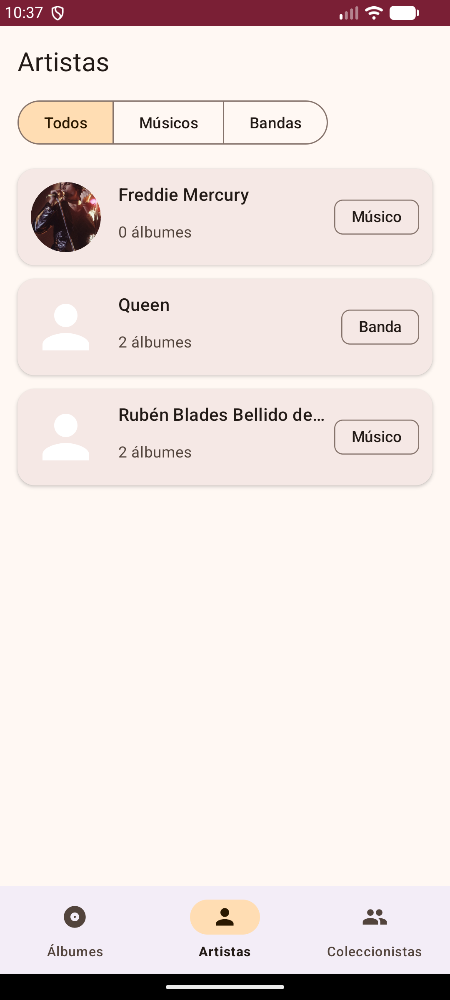
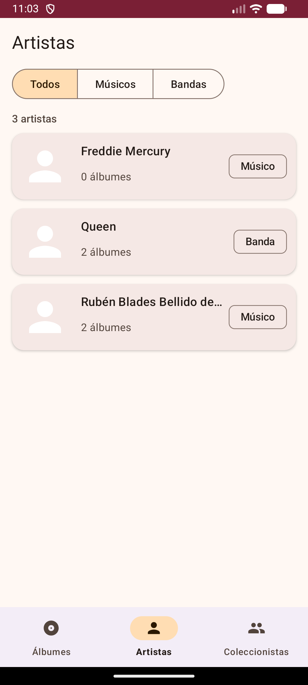

# Inventario de pruebas · Sprint 2

Casos de prueba de **HU03 Consultar el listado de artistas**, **HU04 Consultar la información detallada de un artista** y **HU05 Consultar listado de coleccionistas**, derivados de los criterios de aceptación de [#3](https://github.com/manuel-jose-marin/vinilos-mobile/issues/3), [#4](https://github.com/manuel-jose-marin/vinilos-mobile/issues/4) y [#5](https://github.com/manuel-jose-marin/vinilos-mobile/issues/5). Cada caso indica el criterio que cubre y si se ejecuta como prueba E2E automatizada con Espresso o manual. Los casos con criterio "—" no salen de un criterio de la historia, sino de los estados que la [Estrategia de pruebas](Estrategia-pruebas-Sprint-2) pide verificar en todas las pantallas (carga, lista vacía y navegación de regreso). Los resultados de la ejecución están en la sección [Resultados](#resultados).

**Entorno:** emulador o dispositivo con Android 5.0 (API 21) o superior, animaciones del sistema desactivadas para Espresso, y BackVynils corriendo localmente o en Render (`https://backvynils-grupo5.onrender.com/`) con los datos de `scripts/seed-backvynils.sh`.

**Datos de prueba que usan los casos:**

| Dato | Origen | Casos |
|---|---|---|
| "Rubén Blades Bellido de Luna": músico, nacido el 16 de julio de 1948, 2 álbumes y 1 premio (Grammy Award, 1978) | Base inicial | HU04-01, HU04-02, HU04-03, HU04-09 |
| "Queen": banda fundada el 1 de enero de 1970, descripción de 421 caracteres, 2 álbumes y 1 premio | Base inicial | HU04-04, HU04-06, HU04-08 |
| "Freddie Mercury": músico sin álbumes ni premios, integrante de Queen | Script (paso de integrantes de Queen) | HU04-04, HU04-05 |
| "Manolo Bellon" (manollo@caracol.com.co, 1 álbum) y "Jaime Monsalve" | Base inicial | HU05-01, HU05-06 |
| Listas vacías y respuestas lentas | Servidor local temporal (ver [Resultados](#resultados)) | HU03-03, HU03-05, HU05-02, HU05-04 |

## Resumen

| HU | Casos | Espresso | Manuales | No aplica | Fuera del Sprint 2 |
|---|---|---|---|---|---|
| HU03 Consultar listado de artistas | 6 | 3 | 3 | 0 | 0 |
| HU04 Consultar detalle de artista | 9 | 7 | 2 | 0 | 0 |
| HU05 Consultar listado de coleccionistas | 7 | 2 | 3 | 1 | 1 |
| **Total** | **22** | **12** | **8** | **1** | **1** |

## HU03 · Consultar el listado de artistas

| ID | Criterio | Caso | Precondición | Pasos | Resultado esperado | Tipo |
|---|---|---|---|---|---|---|
| HU03-01 | 1 | Ver el listado unificado de artistas | El backend tiene músicos y bandas | 1. Abrir la app en la sección Artistas | Se ve una sola lista de músicos y bandas en orden alfabético; cada tarjeta muestra foto, nombre, tipo ("Músico" o "Banda") y número de álbumes, y se ve el total de artistas mostrados | Espresso (el orden se verifica manualmente) |
| HU03-02 | 2, 3 y 4 | Filtrar artistas por categoría | Pantalla de Artistas cargada | 1. Tocar "Músicos" 2. Tocar "Bandas" 3. Tocar "Todos" | Se ven solo músicos, solo bandas y de nuevo todos, con el filtro tocado marcado como seleccionado, sin nuevas peticiones al servidor | Espresso (la ausencia de peticiones se verifica manualmente) |
| HU03-03 | — | Ver el estado de carga | Respuesta lenta del backend | 1. Abrir la sección Artistas | Mientras llega la respuesta se ve el indicador "Cargando artistas"; al llegar los datos se reemplaza por los artistas | Manual |
| HU03-04 | 5 | Error sin conexión y reintento | Modo avión activado | 1. Abrir la sección Artistas 2. Desactivar el modo avión 3. Tocar "Reintentar" | Paso 1: se ve el mensaje de error y el botón "Reintentar". Paso 3: se carga el listado de artistas | Manual |
| HU03-05 | — | Listado de artistas vacío | El backend no tiene músicos ni bandas | 1. Abrir la sección Artistas | Se ve el mensaje indicando que no hay artistas | Manual |
| HU03-06 | 6 | Abrir el detalle desde el listado | El backend tiene artistas | 1. Abrir la sección Artistas 2. Tocar una tarjeta de artista | Se abre la pantalla de detalle de ese artista | Espresso |

## HU04 · Consultar la información detallada de un artista

| ID | Criterio | Caso | Precondición | Pasos | Resultado esperado | Tipo |
|---|---|---|---|---|---|---|
| HU04-01 | 1 | Ver la ficha de un músico | Músico con datos completos ("Rubén Blades Bellido de Luna") | 1. En el listado, tocar el músico | Se ven foto, nombre, tipo "Músico" y fecha de nacimiento; no se ve la sección Integrantes | Espresso |
| HU04-02 | 4 | Ver el carrusel de álbumes | Artista con álbumes ("Rubén Blades Bellido de Luna") | 1. Abrir el detalle del artista | Se ve el carrusel horizontal con la portada, el título, el año y el sello de cada álbum | Espresso |
| HU04-03 | 6 | Ver la lista de premios | Artista con premios ("Rubén Blades Bellido de Luna") | 1. Abrir el detalle del artista | Cada premio muestra nombre, organización y año, sin cortar el texto | Espresso |
| HU04-04 | 2 | Ver la ficha de una banda | Banda con integrantes ("Queen") | 1. Abrir el detalle de la banda | Se ven foto, nombre, tipo "Banda", fecha de fundación y la sección Integrantes con sus músicos | Espresso |
| HU04-05 | 7 | Secciones vacías | Artista sin álbumes ni premios ("Freddie Mercury") | 1. Abrir el detalle del artista | Las secciones Álbumes y Premios muestran el mensaje de lista vacía | Manual |
| HU04-06 | 8 | Error sin conexión y reintento | Listado cargado; luego modo avión activado | 1. Tocar un artista 2. Desactivar el modo avión 3. Tocar "Reintentar" | Paso 1: se ve el mensaje de error con "Reintentar". Paso 3: se carga el detalle del artista | Manual |
| HU04-07 | — | Volver al listado de artistas | Detalle de un artista abierto | 1. Tocar el botón atrás del sistema 2. Abrir otro detalle y tocar la flecha de la barra | En ambos casos se regresa al listado de artistas | Espresso |
| HU04-08 | 3 | Desplegar la descripción larga | Artista con descripción larga ("Queen") | 1. Abrir el detalle del artista 2. Tocar "Leer más" | La descripción se despliega completa y el botón "Leer más" desaparece | Espresso |
| HU04-09 | 5 | Abrir un álbum desde el carrusel | Artista con álbumes ("Rubén Blades Bellido de Luna") | 1. Abrir el detalle del artista 2. Tocar un álbum del carrusel | Se abre el detalle de ese álbum | Espresso |

## HU05 · Consultar listado de coleccionistas

| ID | Criterio | Caso | Precondición | Pasos | Resultado esperado | Tipo |
|---|---|---|---|---|---|---|
| HU05-01 | 1 | Ver el listado de coleccionistas | El backend tiene coleccionistas | 1. Abrir la app en la sección Coleccionistas | Cada fila muestra avatar, nombre, correo y número de álbumes, y se ve el total de coleccionistas | Espresso |
| HU05-02 | — | Ver el estado de carga | Respuesta lenta del backend | 1. Abrir la sección Coleccionistas | Mientras llega la respuesta se ve el indicador "Cargando coleccionistas"; al llegar los datos se reemplaza por la lista | Manual |
| HU05-03 | 4 | Error sin conexión y reintento | Modo avión activado | 1. Abrir la sección Coleccionistas 2. Desactivar el modo avión 3. Tocar "Reintentar" | Paso 1: mensaje de error con el botón "Reintentar". Paso 3: se carga la lista | Manual |
| HU05-04 | — | Lista de coleccionistas vacía | El backend no tiene coleccionistas | 1. Abrir la sección Coleccionistas | Se ve el mensaje indicando que no hay coleccionistas registrados | Manual |
| HU05-05 | 2 | Avatar con la foto del coleccionista | Un coleccionista con foto | 1. Abrir la sección Coleccionistas | El avatar de ese coleccionista es su foto | No aplica: BackVynils no guarda fotos de coleccionistas (`GET /collectors` no tiene campo de imagen) |
| HU05-06 | 3 | Avatar con las iniciales | Coleccionista sin foto ("Manolo Bellon") | 1. Abrir la sección Coleccionistas | El avatar muestra las iniciales del nombre ("MB") | Espresso |
| HU05-07 | 5 | Abrir el detalle desde el listado | Requiere HU06 | 1. Tocar un coleccionista | Se abre el detalle del coleccionista | Fuera del Sprint 2 (se valida con HU06 en el Sprint 3, [#52](https://github.com/manuel-jose-marin/vinilos-mobile/issues/52)) |

## Automatización

| Clase Espresso | Casos | Issue | Estado |
|---|---|---|---|
| `ArtistListTest` | HU03-01, HU03-02, HU03-06 | [#32](https://github.com/manuel-jose-marin/vinilos-mobile/issues/32) | ✅ En `develop` |
| `ArtistDetailTest` | HU04-01, HU04-02, HU04-03, HU04-04, HU04-07, HU04-08, HU04-09 | [#37](https://github.com/manuel-jose-marin/vinilos-mobile/issues/37) | ✅ En `develop` |
| `CollectorListTest` | HU05-01, HU05-06 | [#42](https://github.com/manuel-jose-marin/vinilos-mobile/issues/42) | ✅ En `develop` |

Los casos de carga, error de red y lista vacía quedan como manuales porque dependen de condiciones de red o de datos del backend que las pruebas E2E contra BackVynils no controlan. La lógica detrás de esos estados sí está cubierta por pruebas unitarias (ver la tabla siguiente). HU04-05 también es manual porque necesita un artista sin álbumes ni premios, y en la base inicial no hay ninguno; "Freddie Mercury" solo existe si se corrió el script de datos.

## Pruebas que respaldan cada caso

Todas las pruebas de la tabla están en `develop`.

| Caso | Prueba Espresso | Pruebas unitarias |
|---|---|---|
| HU03-01 | `ArtistListTest.listShowsMusiciansAndBands`, `ArtistListTest.listShowsTheTotalNumberOfArtists` | `ArtistServiceTest.parseMusicians_assignsMusicianTypeAndKeepsServerOrder`, `ArtistServiceTest.parseBands_assignsBandTypeAndKeepsServerOrder`, `ArtistRepositoryTest.getArtists_joinsMusiciansAndBandsSortedByName`, `ArtistRepositoryTest.sortByName_ignoresCaseAndAccents`, `ArtistRepositoryTest.getArtists_requestsMusiciansAndBandsInParallel`, `ArtistListViewModelTest.loadArtists_showsMusiciansAndBandsSortedWithAllFilter` |
| HU03-02 | `ArtistListTest.filteringByMusiciansOrBands` | `ArtistListViewModelTest.setFilter_filtersInMemory`, `ArtistListViewModelTest.setFilter_withNoArtistsOfThatType_showsEmptyContentNotEmptyState`, `ArtistListViewModelTest.setFilter_whileLoading_isAppliedWhenTheArtistsArrive` |
| HU03-03 | | `ArtistListViewModelTest.init_showsLoadingUntilTheRepositoryResponds` |
| HU03-04 | | `ArtistListViewModelTest.loadArtists_error_whenARequestFails`, `ArtistListViewModelTest.retry_loadsAgainAfterAnError`, `ArtistListViewModelTest.retry_keepsTheSelectedFilter`, `ArtistRepositoryTest.getArtists_whenBandsFail_throws` |
| HU03-05 | | `ArtistListViewModelTest.loadArtists_empty_whenTheServerHasNoArtists`, `ArtistRepositoryTest.getArtists_withNoArtists_returnsEmptyList`, `ArtistServiceTest.parseMusicians_emptyArray_returnsEmptyList` |
| HU03-06 | `ArtistListTest.tappingArtistOpensDetail` | |
| HU04-01 | `ArtistDetailTest.detailShowsArtistDataSheet` | `ArtistServiceTest.parseMusician_readsAllFieldsAndHasNoMembers`, `ArtistRepositoryTest.getArtist_musician_requestsMusicianEndpoint`, `ArtistDetailViewModelTest.loadArtist_musician_requestsTheGivenMusicianAndExposesIt` |
| HU04-02 | `ArtistDetailTest.detailShowsAlbumsCarousel` | `ArtistServiceTest.parseMusician_readsAllFieldsAndHasNoMembers` (álbumes) |
| HU04-03 | `ArtistDetailTest.detailShowsPrizes` | `PrizeServiceTest.parsePrizes_readsNameOrganizationAndPerformerPrizeIds`, `ArtistServiceTest.parseMusicianDetail_readsPrizesWithIdAndDateOnly`, `ArtistRepositoryTest.getArtist_completesPrizeNameAndOrganization`, `ArtistRepositoryTest.getArtist_requestsArtistAndPrizesInParallel`, `ArtistRepositoryTest.getArtist_whenPrizesFail_returnsArtistWithPrizesWithoutName`, `ArtistRepositoryTest.withPrizeNames_leavesUnknownPrizeWithoutName` |
| HU04-04 | `ArtistDetailTest.bandDetailShowsMembers` | `ArtistServiceTest.parseBand_readsCreationDateAndMembers`, `ArtistServiceTest.parseBandMembers_readsEachMusicianOfTheBand`, `ArtistRepositoryTest.getArtist_band_requestsBandEndpoint`, `ArtistDetailViewModelTest.loadArtist_band_requestsTheGivenBandAndExposesIt` |
| HU04-05 | | `ArtistServiceTest.parseMusician_withoutAlbums_returnsEmptyList`, `ArtistServiceTest.parseMusicianDetail_withoutPrizes_returnsEmptyList`, `ArtistServiceTest.parseBand_withoutAlbumsOrMembers_returnsEmptyLists`, `ArtistServiceTest.parseBandDetail_readsTheBandWithItsAlbumsAndNoPrizes`, `ArtistDetailViewModelTest.loadArtist_withoutAlbumsPrizesOrMembers_exposesContentWithEmptyLists` |
| HU04-06 | | `ArtistDetailViewModelTest.init_showsLoadingUntilTheRepositoryResponds`, `ArtistDetailViewModelTest.loadArtist_whenTheRequestFails_exposesError`, `ArtistDetailViewModelTest.retry_afterAnError_loadsTheArtistAgain`, `ArtistRepositoryTest.getArtist_whenArtistFails_throws` |
| HU04-07 | `ArtistDetailTest.backNavigationReturnsToList` | |
| HU04-08 | `ArtistDetailTest.readMoreExpandsTheDescription` | |
| HU04-09 | `ArtistDetailTest.tappingAnAlbumOpensItsDetail` | |
| HU05-01 | `CollectorListTest.listShowsCollectors`, `CollectorListTest.collectorRowShowsTheServerData`, `CollectorListTest.listShowsTheTotalNumberOfCollectors` | `CollectorServiceTest.parseCollector_readsAllFieldsAndAlbumCount`, `CollectorServiceTest.parseCollectors_keepsServerOrder`, `CollectorRepositoryTest.getCollectors_returnsTheListFromService`, `CollectorListViewModelTest.loadCollectors_withCollectors_exposesContent` |
| HU05-02 | | `CollectorListViewModelTest.init_showsLoadingUntilTheRepositoryResponds` |
| HU05-03 | | `CollectorListViewModelTest.loadCollectors_whenTheRequestFails_exposesError`, `CollectorListViewModelTest.retry_afterAnError_loadsTheCollectorsAgain`, `CollectorRepositoryTest.getCollectors_propagatesExceptionsFromTheService` |
| HU05-04 | | `CollectorListViewModelTest.loadCollectors_withNoCollectors_exposesEmpty`, `CollectorServiceTest.parseCollectors_emptyArray_returnsEmptyList`, `CollectorServiceTest.parseCollector_withoutCommentsOrAlbums_returnsEmptyListAndZero` |
| HU05-06 | `CollectorListTest.collectorRowShowsTheServerData` | `CollectorTextTest` (4) |

| Tipo | Del Sprint 2 | Total en `develop` |
|---|---|---|
| Unitarias | 56 (`ArtistServiceTest`, `PrizeServiceTest`, `CollectorServiceTest`, `ArtistRepositoryTest`, `CollectorRepositoryTest`, `ArtistListViewModelTest`, `ArtistDetailViewModelTest`, `CollectorListViewModelTest` y `CollectorTextTest`) | 80 |
| Espresso | 14 (`ArtistListTest`, `ArtistDetailTest` y `CollectorListTest`) | 21 (incluye las 7 del Sprint 1 como regresión) |

## Resultados

**Fecha de ejecución:** 15 de noviembre de 2026 (America/Bogota, UTC−05:00).

**Versión evaluada:** `develop`, commit `3e74031b2a7a01f9dc50d73b5157262fb81944be` (merge del PR [#132](https://github.com/manuel-jose-marin/vinilos-mobile/pull/132)), compilación debug.

**Dispositivo:** emulador `Medium_Phone_API_37.0`, Android 17 (API 37), arm64-v8a, orientación vertical, 1080 × 2400 px, densidad 420 dpi; las tres escalas de animación del sistema en 0.

**Backend:** BackVynils en Render (`https://backvynils-grupo5.onrender.com/`) con los datos de `scripts/seed-backvynils.sh`: 4 álbumes, 2 músicos (Rubén Blades y Freddie Mercury), 1 banda (Queen, con Freddie Mercury como integrante) y 2 coleccionistas. La app se instaló con `-Pvinilos.baseUrl=https://backvynils-grupo5.onrender.com/`. No se modificaron datos durante la ejecución.

**Condiciones controladas:** para HU03-04, HU04-06 y HU05-03 se usaron `adb shell cmd connectivity airplane-mode enable` y `disable`. Para HU03-03 y HU05-02, el perfil de red lento del emulador (`network delay gprs`) no alcanzó a mantener visible el estado de carga, así que se sirvieron copias de las respuestas reales desde un servidor HTTP local con 8 s de demora, instalando la app con `-Pvinilos.baseUrl=http://10.0.2.2:8000/`. Para HU03-05 y HU05-04 el mismo servidor respondió `[]` a todas las rutas. Para verificar que los filtros de HU03-02 no hacen peticiones, el servidor local registró cada petición recibida. Al terminar se cerró el servidor y se reinstaló la app contra Render.

**Evidencia:** capturas PNG (`adb exec-out screencap -p`), dumps XML de la pantalla (`uiautomator dump`), el registro de peticiones de HU03-02, los reportes de Espresso y de las pruebas unitarias, y la revisión de logcat, en `pr-verification-sprint2/`, carpeta hermana del clon y fuera del repositorio. Cada captura se nombra con el ID del caso.

| ID | Resultado | Evidencia: observación | Issue del defecto |
|---|---|---|---|
| HU03-01 | Pasa (tras corregir #134) | Primera ejecución: **falla**. `ArtistListTest.listShowsMusiciansAndBands` pasó y la lista une músicos y bandas en orden alfabético (Freddie Mercury, Queen, Rubén Blades Bellido de Luna) con foto, nombre, tipo y número de álbumes, pero no se mostraba el total de artistas que pide el criterio 1 (`HU03-01-listado.png`). Re-ejecutado el 2026-11-15 tras la corrección: se ve «3 artistas», y con los filtros «2 artistas» (Músicos) y «1 artista» (Bandas) (`HU03-01-corregido.png`, `HU03-01-corregido-musicos.png`, `HU03-01-corregido-bandas.png`); la nueva prueba `ArtistListTest.listShowsTheTotalNumberOfArtists` pasó. Queen y Rubén Blades muestran la imagen genérica porque sus URLs de imagen en la base inicial ya no responden; la app se comporta como se espera ante una imagen que no carga. | [#134](https://github.com/manuel-jose-marin/vinilos-mobile/issues/134), severidad baja, corregido en [PR #135](https://github.com/manuel-jose-marin/vinilos-mobile/pull/135) |
| HU03-02 | Pasa | `ArtistListTest.filteringByMusiciansOrBands` pasó. "Músicos" dejó a Freddie Mercury y Rubén Blades, "Bandas" dejó a Queen y "Todos" volvió a mostrar los tres; en cada paso solo el botón tocado quedó con `checked=true` (`HU03-02-musicos`, `HU03-02-bandas`, `HU03-02-todos`). El servidor local registró un solo `GET /musicians` y un solo `GET /bands` al abrir la sección, y ninguna petición al cambiar de filtro (`HU03-02-peticiones.log`). | — |
| HU03-03 | Pasa | Con la respuesta demorada se vio "Cargando artistas" con el indicador circular, y después la lista (`HU03-03-cargando.png`, `HU03-03-cargado.png`). | — |
| HU03-04 | Pasa | Con modo avión apareció «No pudimos cargar los artistas» y «Reintentar»; al restablecer la red y tocarlo se cargó la lista (`HU03-04-sin-conexion.png`, `HU03-04-reintento.png`). | — |
| HU03-05 | Pasa | Con la respuesta `[]` se vio «Aún no hay artistas registrados» (`HU03-05-vacio.png`). | — |
| HU03-06 | Pasa | `ArtistListTest.tappingArtistOpensDetail` pasó. Manualmente, tocar Rubén Blades abrió su detalle (`HU04-01-musico.png`). | — |
| HU04-01 | Pasa | `ArtistDetailTest.detailShowsArtistDataSheet` pasó. Rubén Blades muestra «Músico» y «Nacido el 16 de julio de 1948», sin sección Integrantes (`HU04-01-musico.png`). | — |
| HU04-02 | Pasa | `ArtistDetailTest.detailShowsAlbumsCarousel` pasó. El carrusel muestra «Buscando América» y «Poeta del pueblo» con portada, año y sello (`HU04-01-musico.png`). | — |
| HU04-03 | Pasa | `ArtistDetailTest.detailShowsPrizes` pasó. «Grammy Award», «National Academy of Recording Arts & Sciences» y «1978»; la organización ocupa dos líneas sin cortarse (`HU04-01-musico.png`). | — |
| HU04-04 | Pasa | `ArtistDetailTest.bandDetailShowsMembers` pasó. Queen muestra «Banda», «Fundada el 1 de enero de 1970» y la sección Integrantes con «Freddie Mercury» (`HU04-02-banda.png`, `HU04-02-banda-2.png`). | — |
| HU04-05 | Pasa | Freddie Mercury muestra «Este artista aún no tiene álbumes» y «Este artista aún no tiene premios» (`HU04-05-sin-albumes-ni-premios.png`). | — |
| HU04-06 | Pasa | Con el listado cargado y modo avión, tocar Queen mostró «No pudimos cargar el artista» y «Reintentar»; al restablecer la red y tocarlo se cargó el detalle (`HU04-06-sin-conexion.png`, `HU04-06-reintento.png`). | — |
| HU04-07 | Pasa | `ArtistDetailTest.backNavigationReturnsToList` pasó. Manualmente, la flecha de la barra regresó al listado (`HU04-07-flecha.png`). | — |
| HU04-08 | Pasa | `ArtistDetailTest.readMoreExpandsTheDescription` pasó. En Queen, la descripción pasó de 246 px a 561 px de alto al tocar «Leer más», y el botón desapareció (`HU04-08-leer-mas-antes`, `HU04-08-leer-mas-despues`). | — |
| HU04-09 | Pasa | `ArtistDetailTest.tappingAnAlbumOpensItsDetail` pasó. Tocar «Buscando América» en el carrusel abrió su detalle, y Atrás volvió al artista (`HU04-09-album-desde-carrusel.png`, `HU04-09-vuelve-al-artista.png`). | — |
| HU05-01 | Pasa | Las 3 pruebas de `CollectorListTest` pasaron. Se ven «2 coleccionistas» y cada fila con avatar, nombre, correo y «1 álbum» (`HU05-01-listado.png`). | — |
| HU05-02 | Pasa | Con la respuesta demorada se vio "Cargando coleccionistas" con el indicador circular, y después la lista (`HU05-02-cargando.png`, `HU05-02-cargado.png`). | — |
| HU05-03 | Pasa | Con modo avión apareció «No pudimos cargar los coleccionistas» y «Reintentar»; al restablecer la red y tocarlo se cargó la lista (`HU05-03-sin-conexion.png`, `HU05-03-reintento.png`). | — |
| HU05-04 | Pasa | Con la respuesta `[]` se vio «Aún no hay coleccionistas registrados» (`HU05-04-vacio.png`). | — |
| HU05-05 | No aplica | No ejecutado: BackVynils no guarda fotos de coleccionistas, así que el avatar siempre muestra las iniciales (HU05-06). | — |
| HU05-06 | Pasa | `CollectorListTest.collectorRowShowsTheServerData` pasó. Los avatares muestran «MB» y «JM» (`HU05-01-listado.png`). | — |
| HU05-07 | No aplica (Sprint 3) | No ejecutado: el detalle del coleccionista llega con HU06. Hoy tocar una fila no hace nada (`HU05-07-toque-coleccionista.png`); la flecha de la fila anticipa esa navegación. | — |

**Resumen:** 22 casos registrados: **20 pasan, 0 fallan y 2 no aplican** (HU05-05 por limitación del API y HU05-07 porque depende de HU06 del Sprint 3). Se ejecutaron los 20 casos aplicables: 12 con Espresso, que además se revisaron en pantalla, y 8 manualmente. HU03-01 falló en la primera ejecución y pasa después de corregir [#134](https://github.com/manuel-jose-marin/vinilos-mobile/issues/134).

**Espresso:** `./gradlew connectedDebugAndroidTest -Pvinilos.baseUrl=https://backvynils-grupo5.onrender.com/` terminó con `BUILD SUCCESSFUL`: **21 pruebas, 0 fallos, 0 errores y 0 omisiones**, ya con la corrección de #134. Son las 14 de `ArtistListTest`, `ArtistDetailTest` y `CollectorListTest`, más las 7 de `AlbumListTest` y `AlbumDetailTest` del Sprint 1, que pasaron como regresión. En la primera ejecución, antes de la corrección, fueron 20 de 20, porque aún no existía la prueba del total. El reporte está en `Espresso-report/index.html` y el XML en `Espresso-results/`.

**Pruebas unitarias:** `./gradlew testDebugUnitTest` terminó con **80 pruebas, 0 fallos y 0 errores** (`unit-results/`).

**Logcat:** no hubo crashes de la app ni `FATAL EXCEPTION` durante la ejecución (`logcat-crashes.txt` vacío). Glide registró advertencias de carga de imágenes, que corresponden a las URLs rotas descritas en HU03-01.

**Defecto reportado y corregido:** [#134 — HU03-01 el listado de artistas no muestra el total](https://github.com/manuel-jose-marin/vinilos-mobile/issues/134), severidad baja, etiquetas `bug` y `HU03` y milestone **Sprint 2**. Se corrigió en el mismo [PR #135](https://github.com/manuel-jose-marin/vinilos-mobile/pull/135): `fragment_artist_list.xml` agrega `tv_artists_count` debajo de los filtros y `ArtistListFragment` muestra el total de los artistas visibles con el filtro activo, con el plural `artists_count`.

| Antes | Después de la corrección |
|---|---|
|  |  |

**Observaciones que no se reportaron como defectos:**

- **Imágenes de la base inicial:** la URL de la imagen de Queen no responde y la de Rubén Blades devuelve HTTP 400. Es un problema de los datos de BackVynils; la app muestra la imagen genérica como corresponde.
- **Arranque en frío de Render:** si el servicio está dormido, la primera petición tarda unos 40 s. En la primera apertura de la app el listado de artistas mostró el error y el de álbumes se quedó cargando; tocar «Reintentar» o reabrir la app lo resolvió. Antes de correr Espresso conviene despertar el servicio con `curl https://backvynils-grupo5.onrender.com/albums`.
