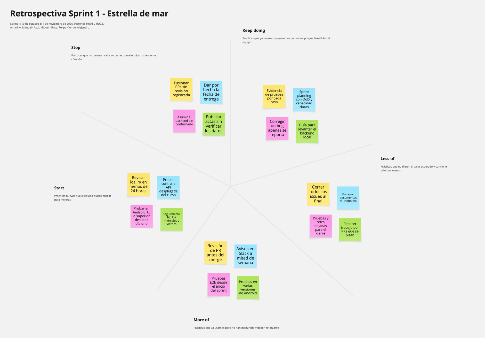

# Retrospectiva del Sprint 1

Retrospectiva del equipo sobre el Sprint 1 (2026-10-19 a 2026-11-01, historias HU01 y HU02), hecha con la técnica de estrella de mar (*Starfish*) en Miro, la misma que usamos en la [[retrospectiva del Inception|Retrospectiva]]. Las notas se agruparon en las cinco categorías y se contrastaron con la evidencia del repositorio: issues, pull requests, inventario de pruebas y actas.

### [Tablero de la retrospectiva en Miro](https://miro.com/app/board/uXjVETPFm1k=/)

## Comportamiento del equipo durante el Sprint 1

El equipo cumplió el objetivo del sprint: las dos historias comprometidas (HU01, 5 SP, y HU02, 3 SP, para un total de 8 SP) quedaron integradas en `develop` y la app lista el catálogo y muestra el detalle de un álbum contra BackVynils. Las pruebas respaldan el resultado: los 13 casos aplicables del [[inventario de pruebas|Inventario-pruebas-Sprint-1]] pasan, hay 7 pruebas E2E con Espresso (3 del listado y 4 del detalle) y los dos defectos encontrados, el contenido bajo la barra de estado en Android 15 (#90) y el nombre de track truncado (#94), se corrigieron antes del cierre. Lo que mejor funcionó fue la documentación técnica: el diseño arquitectónico, la estrategia y el inventario de pruebas quedaron publicados en la wiki durante la semana, con evidencia por caso, y la guía de [[BackVynils|Backend-BackVynils]] permitió que todos corrieran el backend en local. El sprint planning dejó capacidad, responsables y Definition of Done claros desde el 19 de octubre.

Los problemas estuvieron en la coordinación y el ritmo. De los 23 pull requests del sprint, solo 3 (#78, #85 y #98) tienen una revisión registrada en GitHub, aunque el contrato exige la aprobación de otro integrante. Los issues se cerraron en lotes (24 de octubre y 26-27 de octubre) y no al terminar cada tarea, y varias entregas se concentraron al final: las pruebas E2E del detalle se cerraron el 29 de octubre, el acta de la semana 4 el 31 y el APK, el release y esta retrospectiva siguen para el último día. Hubo retrabajo por pull requests que se pisaron (la estrategia de pruebas se fusionó, se revirtió en #88 y se volvió a fusionar en #89) y por supuestos sin verificar: la estimación del acta de la semana 3 se corrigió en #79, la fecha de entrega se confirmó como sábado en la semana 4 y solo entonces se supo que el APK debe apuntar a la API desplegada del curso (`https://backvynils-q6yc.onrender.com/`), mientras el equipo había trabajado y probado contra un backend local.

## Resultados por categoría

| Categoría | Notas del equipo |
|---|---|
| **Keep doing** (seguir haciendo) | Evidencia de pruebas por cada caso · Sprint planning con DoD y capacidad claras · Corregir un bug apenas se reporta · Guía para levantar el backend local |
| **More of** (hacer más) | Revisión de PR antes del merge · Avisos en Slack a mitad de semana · Pruebas E2E desde el inicio del sprint · Pruebas en varias versiones de Android |
| **Less of** (hacer menos) | Cerrar todos los issues al final · Entregar documentos el último día · Pruebas y retro dejadas para el cierre · Rehacer trabajo por PRs que se pisan |
| **Stop** (dejar de hacer) | Fusionar PRs sin revisión registrada · Dar por hecha la fecha de entrega · Asumir el backend sin confirmarlo · Publicar actas sin verificar los datos |
| **Start** (empezar a hacer) | Revisar los PR en menos de 24 horas · Probar contra la API desplegada del curso · Probar en Android 15 o superior desde el día uno · Seguimiento fijo los miércoles y viernes |

## Seguimiento de las acciones del Inception

| Acción acordada en el Inception | Estado | Evidencia |
|---|---|---|
| Hacer el sprint planning y estimar antes de desarrollar. | Cumplida | Sprint planning del 19 de octubre en el [[acta de la semana 3|Actas_Sprint-1]]. |
| Ningún issue pasa de TO-DO sin responsable y cada integrante mueve su issue al cambiar de estado. | Parcial | Las tareas de las historias tienen responsable, pero los issues se cerraron en lotes. |
| Actualizar la wiki y el tablero al terminar cada tarea. | Parcial | La documentación técnica se publicó durante la semana; el acta de la semana 4 y la retrospectiva quedaron para el cierre. |
| Revisar Slack a diario y avisar de bloqueos o riesgos de retraso. | Sin evidencia en el repositorio | Se mantiene como acción. |
| Avisar con anticipación si no se puede asistir a una reunión. | Cumplida | Miguel avisó su ausencia del jueves en la reunión de la semana 3. |
| Integrar todo cambio por pull request revisado por otro integrante. | No cumplida | Solo 3 de 23 pull requests tienen revisión registrada. |
| Entregables listos antes del domingo y rúbrica como checklist. | Parcial | La entrega se fijó para el sábado, pero el APK, el release y la retrospectiva se cierran ese mismo día. |

## Acciones de mejora para el Sprint 2

| Acción | Origen en la retrospectiva |
|---|---|
| Todo pull request a `develop` necesita una aprobación registrada en GitHub antes del squash merge, y se activa la protección de la rama para exigirla. Quien no reciba revisión en 24 horas lo avisa en Slack. | Stop: fusionar sin revisión · More of: revisión de PR · Start: revisar en 24 horas |
| Cada pull request lleva `Closes #N` y el issue se cierra al fusionarlo, no en lote al final del sprint. | Less of: cerrar todos los issues al final |
| Dejar las tareas de documentación y pruebas terminadas el jueves y anotar en el acta la fecha límite real de la entrega al planear el sprint. | Less of: entregar el último día · Stop: dar por hecha la fecha |
| Confirmar con el curso las decisiones de infraestructura (backend y API desplegada) en el sprint planning, y probar contra la API desplegada antes de generar el APK. | Stop: asumir el backend · Start: probar contra la API del curso |
| Avisar en Slack qué archivos o documentos va a tocar cada quien antes de abrir un pull request que pueda pisar a otro. | Less of: rehacer trabajo por PRs que se pisan |
| Escribir las pruebas E2E junto con la implementación de cada historia y ejecutarlas en un emulador de Android 15 o superior y en uno de Android 5.0. | More of: E2E desde el inicio y varias versiones · Start: Android 15 o superior |
| Hacer el seguimiento asíncrono en Slack cada miércoles y viernes (qué hice, qué haré, qué me bloquea), como indican las reglas de trabajo. | Start: seguimiento fijo · More of: avisos a mitad de semana |
| Verificar las estimaciones y los datos de cada acta contra el backlog antes de publicarla. | Stop: actas sin verificar |
| Mantener la evidencia de pruebas por caso, el Definition of Done del sprint planning y la guía del backend actualizada. | Keep doing |
