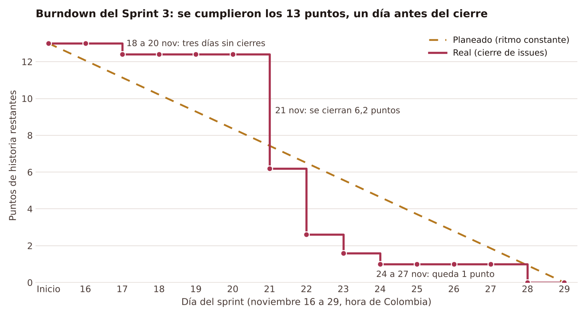

# Retrospectiva del Sprint 3

Retrospectiva del equipo sobre el Sprint 3 (2026-11-16 a 2026-11-29, historias HU06, HU07 y HU08), el último sprint del MVP. Se contrastó lo planeado en el sprint planning del [[acta de la semana 7|Actas_Sprint-3]] con la evidencia del repositorio: issues, pull requests, ejecuciones de pruebas, actas y la gráfica de velocidad. También se revisó el cumplimiento de las acciones que dejó la [[retrospectiva del Sprint 2|Retrospectiva-Sprint-2]].

## Velocidad del Sprint 3

**Velocidad: 13 puntos de historia.** El equipo se comprometió con 13 (HU06, 3 puntos; HU07, 5 puntos, y HU08, 5 puntos) y entregó los 13. Con los tres sprints, el MVP suma 31 puntos y la velocidad promedio es de 10,3 puntos por sprint.

| Sprint | Comprometido | Entregado |
|---|---:|---:|
| Sprint 1 | 8 | 8 |
| Sprint 2 | 10 | 10 |
| Sprint 3 | 13 | 13 |

### Cómo se calculó

Con el mismo método de las gráficas del [[Sprint 1|Sprint-2]] y del [[Sprint 2|Sprint-3]]:

- **Puntos por tarea:** solo las historias tienen puntos, así que se repartieron por igual entre sus 5 tareas: 0,6 puntos por tarea de HU06 y 1 por tarea de HU07 y de HU08. Es una convención de esta gráfica, no una estimación del equipo.
- **Línea planeada:** ritmo constante durante los 14 días del sprint.
- **Línea real:** fecha de cierre de cada tarea en GitHub, en hora de Colombia. Cada tarea se cerró al fusionar su pull request con `Closes #N`, así que la fecha de cierre es la de integración a `develop`.

| Día | Planeado restante | Real restante | Ejecutado | Tareas cerradas |
|---|---:|---:|---:|---|
| 16 nov | 12,07 | 13,0 | 0 | |
| 17 nov | 11,14 | 12,4 | 0,6 | #49 |
| 18 nov | 10,21 | 12,4 | 0 | |
| 19 nov | 9,29 | 12,4 | 0 | |
| 20 nov | 8,36 | 12,4 | 0 | |
| 21 nov | 7,43 | 6,2 | 6,2 | #51, #52, #55, #56, #57, #59, #60 |
| 22 nov | 6,50 | 2,6 | 3,6 | #50, #54, #61, #62 |
| 23 nov | 5,57 | 1,6 | 1,0 | #58 |
| 24 nov | 4,64 | 1,0 | 0,6 | #53 |
| 25 nov | 3,71 | 1,0 | 0 | |
| 26 nov | 2,79 | 1,0 | 0 | |
| 27 nov | 1,86 | 1,0 | 0 | |
| 28 nov | 0,93 | 0 | 1,0 | #63 |
| 29 nov | 0 | 0 | 0 | |

### Estimación frente a ejecución

La estimación volvió a acertar en el total: el compromiso subió de 10 a 13 puntos (30 % más que la velocidad del Sprint 2) y se entregó completo. Las 15 tareas de las tres historias quedaron integradas en `develop` el 28 de noviembre, un día antes del cierre planeado, y con ellas las 8 historias del MVP. El ritmo, de nuevo, fue por saltos:

- **16 a 20 de noviembre:** solo se cerró el layout del detalle de coleccionista (#49), el 17, junto con la estrategia de pruebas (#65). Del 18 al 20 no se cerró ninguna tarea con puntos.
- **21 de noviembre:** se cerraron 7 tareas y 6,2 puntos, casi la mitad del sprint, y se fusionaron 10 pull requests ese mismo día. La curva cruza la línea planeada y desde ahí queda por debajo.
- **22 a 24 de noviembre:** se cerraron otras 6 tareas: el servicio del detalle de coleccionista (#50), el formulario de álbum (#54), la capa de datos y la hoja para agregar tracks (#61 y #62), y las pruebas E2E de HU07 y HU06 (#58 y #53).
- **24 a 28 de noviembre:** quedó 1 punto, las pruebas E2E de HU08 (#63). Su pull request se abrió el 24 y se fusionó el 28, después de ejecutarlas en emuladores con API 21 y API 35.

Los puntos tampoco miden todo el esfuerzo del sprint. De los 35 issues del milestone, 17 no tenían puntos: los 8 artefactos de diseño, pruebas y documentación (arquitectura, estrategia, inventario, desempeño, reconocimiento, accesibilidad, release y esta retrospectiva), los 6 defectos de accesibilidad (#169 a #174), el defecto de las pruebas en API 21 (#181), la documentación de buenas prácticas (#177) y una mejora de desempeño (#183). Ese trabajo se concentró al final: la revisión de accesibilidad se integró el 24 de noviembre, y el análisis de desempeño, las buenas prácticas y las pruebas de reconocimiento el 28. El inventario de pruebas (#66) y el release (#70) quedaron para el día de la entrega.

## Comportamiento del equipo durante el Sprint 3

El equipo cumplió el objetivo del proyecto: las 8 historias del MVP quedaron implementadas, con 13 puntos en el último sprint, el compromiso más alto de los tres. HU06 muestra el detalle de un coleccionista con sus favoritos, su colección y sus comentarios; HU07 crea álbumes con validación y vista previa de la portada, y HU08 agrega tracks desde una hoja inferior sin salir del detalle del álbum. La calidad también creció: la suite tiene 54 pruebas E2E con Espresso, que cubren las 8 historias, y 175 pruebas unitarias. La suite completa se ejecutó en emuladores con API 21 y API 35, y lo que falló en API 21 se corrigió (#181) antes del cierre. La revisión de accesibilidad encontró y corrigió 6 defectos, y el análisis de desempeño no encontró fugas de memoria.

Los problemas fueron los mismos de los sprints anteriores, ahora más visibles por el tamaño del sprint. La primera semana casi no tuvo integración, y casi la mitad de los puntos llegó en un solo día, el 21 de noviembre. Ese día, la vista del detalle de coleccionista (#52) se integró antes que su servicio (#50), así que durante unas 27 horas la app de `develop` se cerraba al abrir un coleccionista. El servicio lo terminó un integrante distinto del responsable para desbloquear la vista. La revisión de pull requests no mejoró: 7 de los 25 pull requests fusionados a `develop` tienen una aprobación registrada en GitHub (28 %, frente a 31 % en el Sprint 2), y todas las aprobaciones las hizo un mismo integrante. La documentación no funcional se cerró el último día y no el viernes 27, como se había acordado.

## Seguimiento de las acciones del Sprint 2

| Acción acordada en la retrospectiva del Sprint 2 | Estado | Evidencia |
|---|---|---|
| Exigir una aprobación en la protección de `develop` y repartir las revisiones entre los cuatro integrantes. | No cumplida | La protección de `develop` sigue sin exigir aprobaciones. 7 de 25 pull requests tienen aprobación (28 %, frente a 31 % en el Sprint 2), todas del mismo integrante. |
| Integrar cada tarea apenas está lista, en pull requests pequeños, y empezar las tareas que dependen de otras contra servicios falsos. | Parcial | El repositorio y ViewModel del detalle de coleccionista (#51) se integró antes que su servicio, probado con servicios falsos. Pero 6,2 de los 13 puntos se integraron el mismo día, y la vista del detalle (#52) entró antes que el servicio que necesitaba (#50). |
| Revisar la gráfica de velocidad el miércoles 25 de noviembre y decidir ese día si algo se recorta. | Sin evidencia | No hay registro de esa revisión en las actas. Ese día faltaba 1 de los 13 puntos, así que no hacía falta recortar. |
| Avisar en el canal del equipo antes de tomar una tarea que tiene otro responsable. | Parcial | No hubo retrabajo como el de #136 y #144 en el Sprint 2. El servicio del detalle de coleccionista (#50) lo resolvió un integrante distinto del responsable, y no quedó registro en el repositorio de un aviso previo. |
| Dejar la documentación y las pruebas no funcionales listas a más tardar el viernes 27 de noviembre. | Parcial | La revisión de accesibilidad se integró el 24 de noviembre. El análisis de desempeño, las buenas prácticas y las pruebas de reconocimiento se integraron el 28, y el inventario y el release quedaron para el día de la entrega. |
| Ejecutar la suite de Espresso en un emulador con Android 5.0 (API 21) antes del release. | Cumplida | El 24 de noviembre la suite completa se ejecutó en API 21 y API 35 (52 de 54 pruebas en cada una). Los fallos de API 21 se registraron en #181 y se corrigieron; después, las pruebas de accesibilidad pasaron 14 de 14 en API 21. |
| Cerrar cada historia apenas se cierra su última tarea. | No cumplida | #6, #7 y #8 se cerraron el 28 de noviembre, varios días después de la mayoría de sus tareas. |
| Mantener `Closes #N` en cada pull request, la evidencia por caso en el inventario y el Definition of Done del sprint planning. | Cumplida | Las 15 tareas con puntos se cerraron al fusionar su pull request, y el acta de la semana 7 tiene su Definition of Done. |

## Lecciones del proyecto

Como es el último sprint, las acciones quedan como lecciones para próximos proyectos del equipo:

| Lección | Origen |
|---|---|
| Configurar desde el primer día la protección de la rama de integración para que exija una aprobación, y repartir las revisiones. Un acuerdo sin la regla en GitHub no se cumplió en ninguno de los tres sprints. | 3 de 23, 8 de 26 y 7 de 25 pull requests con aprobación en los sprints 1, 2 y 3 |
| Integrar una vista solo cuando su servicio ya está en la rama de integración, o integrarla oculta detrás de la navegación. | La app de `develop` se cerró durante unas 27 horas al abrir un coleccionista |
| Repartir la integración a lo largo del sprint: pull requests pequeños desde la primera semana y servicios falsos para no esperar dependencias. | En los tres sprints la curva bajó por saltos; en el Sprint 3, casi la mitad de los puntos llegó en un solo día |
| Planear la documentación y las pruebas no funcionales como tareas con fecha intermedia, no como cierre del sprint. | En los tres sprints esos artefactos se concentraron en los últimos días |
| Ejecutar la suite completa en la versión mínima de Android antes de cada release, no solo en el emulador reciente. | En el Sprint 3 aparecieron fallos que solo ocurrían en API 21 (#181 y la prueba de premios del detalle de artista) |
| Mantener lo que funcionó: `Closes #N` en cada pull request, servicios falsos para probar ViewModels y repositorios, pruebas E2E con datos propios y una estrategia de pruebas por sprint. | Las 8 historias se entregaron completas, con 54 pruebas E2E y 175 pruebas unitarias |
