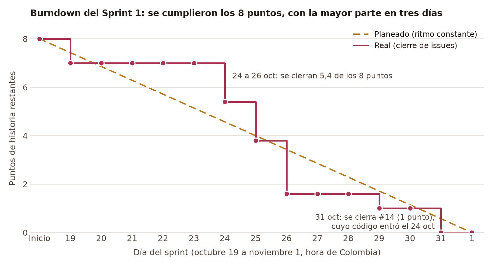

# Sprint 2 (2026-11-02 a 2026-11-15)

**Historias:** HU03 Consultar el listado de artistas, HU04 Consultar la información detallada de un artista, HU05 Consultar listado de coleccionistas

## Sprint Planning
- [[Actas de reunión|Actas_Sprint-2]]: evidencia de las reuniones de las semanas 5 y 6

## Velocidad del Sprint 1

**Velocidad: 8 puntos de historia.** El equipo se comprometió con 8 (HU01, 5 puntos, y HU02, 3 puntos) y entregó los 8. Es la referencia para los siguientes sprints.

### Cómo se calculó

- **Puntos por tarea:** solo las historias tienen puntos, así que se repartieron por igual entre sus 5 tareas: 1 punto por tarea de HU01 y 0,6 por tarea de HU02. Es una convención de esta gráfica, no una estimación del equipo.
- **Por qué tareas y no historias:** #1 y #2 se cerraron el 31 de octubre, así que contarlas a ellas dejaría la curva plana en 8 hasta el último día.
- **Línea planeada:** ritmo constante durante los 14 días del sprint.
- **Línea real:** fecha de cierre de cada tarea en GitHub, en hora de Colombia. Un cierre marca cuándo se integró o se cerró la tarea, no cuándo se hizo el trabajo.

| Día | Planeado restante | Real restante | Ejecutado | Tareas cerradas |
|---|---:|---:|---:|---|
| 19 oct | 7,43 | 7,0 | 1,0 | #13 |
| 20 oct | 6,86 | 7,0 | 0 | |
| 21 oct | 6,29 | 7,0 | 0 | |
| 22 oct | 5,71 | 7,0 | 0 | |
| 23 oct | 5,14 | 7,0 | 0 | |
| 24 oct | 4,57 | 5,4 | 1,6 | #15, #19 |
| 25 oct | 4,00 | 3,8 | 1,6 | #16, #20 |
| 26 oct | 3,43 | 1,6 | 2,2 | #17, #18, #21 |
| 27 oct | 2,86 | 1,6 | 0 | |
| 28 oct | 2,29 | 1,6 | 0 | |
| 29 oct | 1,71 | 1,0 | 0,6 | #22 |
| 30 oct | 1,14 | 1,0 | 0 | |
| 31 oct | 0,57 | 0 | 1,0 | #14 |
| 1 nov | 0 | 0 | 0 | |

### Estimación frente a ejecución

La estimación acertó en el total: lo comprometido fue lo entregado, sin historias que pasaran al siguiente sprint. El ritmo no fue el planeado:

- **19 a 23 de octubre:** se cerró 1 de los 8 puntos. Del 20 al 24 el equipo estuvo por encima de la línea planeada. En esos días avanzaron tareas sin puntos, como la capa de red (#10) y el sprint planning (#76).
- **24 a 26 de octubre:** se cerraron 5,4 puntos, el 67,5 %. Desde el 25 la curva queda por debajo de la línea planeada y ya no vuelve a superarla.
- **27 a 31 de octubre:** solo quedaban las pruebas E2E del detalle (#22) y #14. El código de #14 entró el 24 de octubre con el [PR #83](https://github.com/manuel-jose-marin/vinilos-mobile/pull/83), pero el issue no se cerró hasta el 31. Contado por esa fecha, el último punto se habría quemado el 29 de octubre.

Los puntos tampoco miden todo el esfuerzo. De los 27 issues del milestone, 15 no tenían puntos: 4 de configuración, 5 de documentación y pruebas, 3 de gestión del sprint y 3 defectos no planeados (#90, #94 y #105). El trabajo del último día tampoco aparece en la curva: la API del curso dejó de responder y hubo que desplegar un backend propio y regenerar el APK.

### Comportamiento del equipo

- **Cumplió el compromiso,** aunque el avance se concentró a mitad de sprint y no fue constante.
- **El tablero no reflejó el avance real.** Las tareas se cerraron en lotes, y 5 de los 7 cierres del 31 de octubre (#14, #26, #75, #1 y #2) ocurrieron en poco más de tres minutos. Coincide con lo que señaló la [[retrospectiva|Retrospectiva-Sprint-1]].
- **Las historias se cerraron al final,** aunque casi todas sus tareas ya llevaban días cerradas.

### Qué implica para el Sprint 2

- **El compromiso sube a 10 puntos,** 2 más que la velocidad medida (25 %), y además se suman el análisis de desempeño y las micro-optimizaciones. Es un riesgo que conviene vigilar con la curva a mitad de sprint, no al final.
- **Cerrar cada issue al fusionar** con `Closes #N`, como acordó la retrospectiva, para que el burndown del Sprint 2 mida el avance real.
- **Registrar como issue el trabajo no planeado,** para que se vea aunque no tenga puntos.

## Diseño arquitectónico
- [[Diseño arquitectónico del Sprint 2|Diseno-arquitectonico-Sprint-2]]: diagramas de paquetes, componentes y clases de HU01 a HU05, endpoints, flujo de datos y desempeño

## Estrategia de pruebas
- [[Estrategia de pruebas del Sprint 2|Estrategia-pruebas-Sprint-2]]: aplicación bajo pruebas, objetivos, presupuesto, pirámide de pruebas, distribución por HU, cronograma y gestión de riesgos

## Artefactos de prueba
- [[Inventario de pruebas|Inventario-pruebas-Sprint-2]]
- Scripts / casos de prueba en Espresso: _pendiente_
- Reportes de defectos: _pendiente_

## Análisis de desempeño
_Pendiente._

## Micro-optimizaciones
- [[Micro-optimizaciones del Sprint 2|Micro-optimizaciones-Sprint-2]]: hallazgos de Android Lint corregidos, antes y después

## APK y release
_Pendiente._

## Retrospectiva
_Pendiente._
