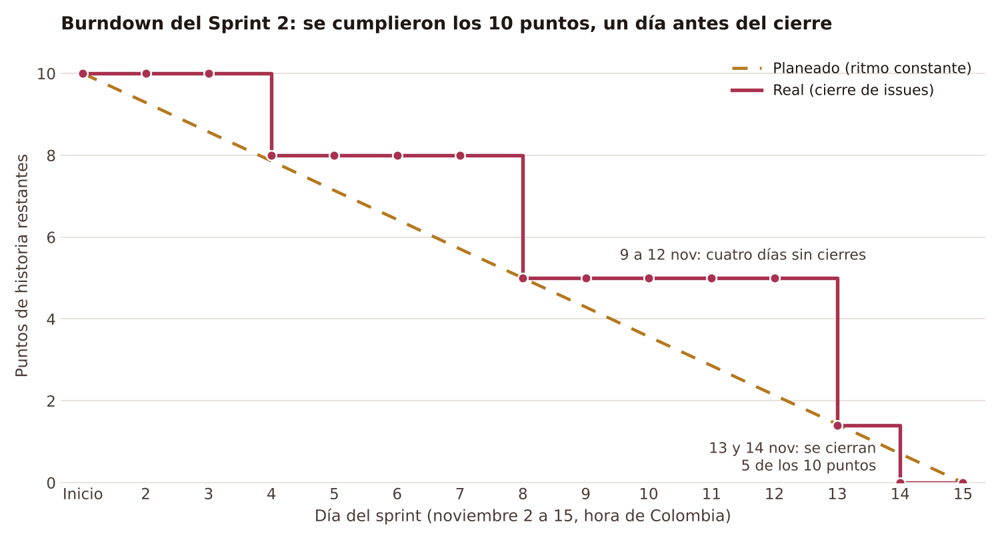

# Sprint 3 (2026-11-16 a 2026-11-29)

**Historias:** HU06 Consultar la información detallada de coleccionista, HU07 Crear un álbum, HU08 Asociar tracks con un álbum

## Sprint Planning
- [[Actas de reunión|Actas_Sprint-3]]: evidencia de la reunión de la semana 7 y Sprint Planning de la Iteración 3

## Velocidad del Sprint 2

**Velocidad: 10 puntos de historia.** El equipo se comprometió con 10 (HU03, 3 puntos; HU04, 5 puntos, y HU05, 2 puntos) y entregó los 10. Con el Sprint 1, el promedio es de 9 puntos por sprint.

### Cómo se calculó

Con el mismo método de la [[gráfica del Sprint 1|Sprint-2]]:

- **Puntos por tarea:** solo las historias tienen puntos, así que se repartieron por igual entre sus 5 tareas: 0,6 puntos por tarea de HU03, 1 por tarea de HU04 y 0,4 por tarea de HU05. Es una convención de esta gráfica, no una estimación del equipo.
- **Por qué tareas y no historias:** #3, #4 y #5 se cerraron el 15 de noviembre, así que contarlas a ellas dejaría la curva plana en 10 hasta el último día.
- **Línea planeada:** ritmo constante durante los 14 días del sprint.
- **Línea real:** fecha de cierre de cada tarea en GitHub, en hora de Colombia. En este sprint cada tarea se cerró al fusionar su pull request con `Closes #N`, así que la fecha de cierre es la de integración a `develop`.

| Día | Planeado restante | Real restante | Ejecutado | Tareas cerradas |
|---|---:|---:|---:|---|
| 2 nov | 9,29 | 10,0 | 0 | |
| 3 nov | 8,57 | 10,0 | 0 | |
| 4 nov | 7,86 | 8,0 | 2,0 | #29, #33, #39 |
| 5 nov | 7,14 | 8,0 | 0 | |
| 6 nov | 6,43 | 8,0 | 0 | |
| 7 nov | 5,71 | 8,0 | 0 | |
| 8 nov | 5,00 | 5,0 | 3,0 | #28, #30, #34, #38, #42 |
| 9 nov | 4,29 | 5,0 | 0 | |
| 10 nov | 3,57 | 5,0 | 0 | |
| 11 nov | 2,86 | 5,0 | 0 | |
| 12 nov | 2,14 | 5,0 | 0 | |
| 13 nov | 1,43 | 1,4 | 3,6 | #31, #32, #35, #36, #40 |
| 14 nov | 0,71 | 0 | 1,4 | #37, #41 |
| 15 nov | 0 | 0 | 0 | |

### Estimación frente a ejecución

La estimación volvió a acertar en el total: el compromiso subió de 8 a 10 puntos (25 % más que la velocidad del Sprint 1) y se entregó completo, sin historias que pasaran al Sprint 3. Las tareas con puntos terminaron el 14 de noviembre, un día antes del cierre. El ritmo, en cambio, fue por saltos:

- **2 y 3 de noviembre:** sin cierres de tareas con puntos. El sprint planning fue en la reunión del 3 de noviembre ([[acta de la semana 5|Actas_Sprint-2]]).
- **4 a 8 de noviembre:** se cerraron 5 de los 10 puntos en dos tandas. El 4 entraron los servicios de artistas y coleccionistas y el layout del detalle de artista (#29, #33 y #39). El 8 entraron el repositorio y ViewModel del listado de artistas, el servicio del detalle de artista, los layouts de los dos listados y las pruebas E2E del listado de coleccionistas. Cuatro de los cinco cierres del 8 (#30, #34, #38 y #42) ocurrieron en menos de dos minutos, al fusionar seguidos los pull requests #122 a #125. El 8 de noviembre la curva toca la línea planeada.
- **9 a 12 de noviembre:** cuatro días sin cierres. Las tareas que quedaban dependían unas de otras: la vista del detalle de artista esperaba su repositorio y ViewModel (#35) y la vista de coleccionistas esperaba el suyo (#40). Además, los pull requests #126 y #127 seguían pendientes de aprobación en la [[reunión del 10 de noviembre|Actas_Sprint-2]].
- **13 y 14 de noviembre:** se cerraron los 5 puntos restantes: las tres vistas, los repositorios y ViewModels del detalle de artista y del listado de coleccionistas, y las pruebas E2E del listado y del detalle de artista. La curva baja de la línea planeada el 13 y termina el 14.

Los puntos tampoco miden todo el esfuerzo. De los 35 issues del milestone, 17 no tenían puntos: 9 de documentación, pruebas y gestión del sprint, 2 de desempeño (#113 y #114) y 6 defectos no planeados (#134 y #138 a #142). Ese trabajo se concentró al final: el 15 de noviembre se cerraron 14 issues, entre ellos el inventario de pruebas (#45), el análisis de desempeño (#46), el release (#47), las micro-optimizaciones (#113), las corrutinas y memoria (#114) y los seis defectos.

### Comportamiento del equipo

- **Cumplió el compromiso con un 25 % más de alcance,** y además entregó el análisis de desempeño, las micro-optimizaciones y las prácticas de corrutinas y memoria, que no tenían puntos.
- **El tablero ya refleja la integración real.** Cada tarea se cerró en el mismo minuto en que se fusionó su pull request, como acordó la [[retrospectiva del Sprint 1|Retrospectiva-Sprint-1]]. Lo que sigue ocurriendo es que los pull requests se integran por tandas, y por eso la curva baja por saltos.
- **Las dependencias entre tareas frenaron la mitad del sprint.** Las vistas esperaban sus repositorios y la aprobación de pull requests, y del 9 al 12 de noviembre no se integró ninguna tarea con puntos.
- **Hubo retrabajo en #114.** Dos integrantes resolvieron la misma tarea en pull requests distintos (#136 y #144). #136 se fusionó y una hora después se revirtió con #147 para integrar #144. Esa reversión también cerró el crash al salir de la app que encontró el perfilamiento (#138 a #142).
- **La revisión de pull requests mejoró, pero no es la regla.** 8 de los 26 pull requests fusionados a `develop` (31 %) tienen una aprobación registrada en GitHub, frente a 3 de 23 en el Sprint 1. La protección de `develop` está activa, pero no exige aprobaciones.
- **Las historias se volvieron a cerrar al final.** #3, #4 y #5 se cerraron el 15 de noviembre, aunque sus tareas terminaron el 14.

### Qué implica para el Sprint 3

- **El compromiso sube a 13 puntos,** 3 más que la velocidad medida (30 %) y 4 más que el promedio de los dos sprints. Además se suman la revisión de accesibilidad, las pruebas de reconocimiento y el análisis de desempeño. La curva se revisa a mitad de sprint, el miércoles 25 de noviembre, para decidir a tiempo si algo se recorta.
- **Integrar cada tarea apenas está lista,** en pull requests pequeños, y empezar las tareas que dependen de otras contra servicios falsos (`fakes/`), como propone la [[estrategia de pruebas|Estrategia-pruebas-Sprint-3]], para no repetir los cuatro días sin cierres.
- **Exigir una aprobación en la protección de `develop`** y repartir las revisiones entre los cuatro integrantes.
- **Avisar en el canal del equipo antes de empezar una tarea que no es propia,** para evitar otro caso como #136 y #144.
- **Dejar la documentación y las pruebas no funcionales listas a más tardar el viernes 27,** según el cronograma de la estrategia, y no el día del cierre.

## Diseño arquitectónico
- [[Diseño arquitectónico del Sprint 3|Diseno-arquitectonico-Sprint-3]]: diagramas de paquetes, componentes y clases de HU01 a HU08, endpoints, flujo de datos, navegación, accesibilidad y desempeño

## Estrategia de pruebas
[Estrategia de pruebas del Sprint 3](Estrategia-pruebas-Sprint-3): objetivos, técnicas, pruebas por criterio de HU06, HU07 y HU08, datos de prueba, cronograma y riesgos.

## Artefactos de prueba
- Inventario de pruebas: _pendiente_
- Scripts / casos de prueba en Espresso: _pendiente_
- Reportes de defectos: _pendiente_

## Micro-optimizaciones y buenas prácticas
- [[Micro-optimizaciones del Sprint 3|Micro-optimizaciones-Sprint-3]]: optimizaciones de HU06, HU07 y HU08 y pasada de Android Lint
- [[Buenas prácticas de memoria, ANRs y accesibilidad|Buenas-practicas-Sprint-3]]: prácticas de las ocho historias y dónde se aplican en el código

## Análisis de desempeño
- [[Análisis de desempeño del Sprint 3|Analisis-desempeno-Sprint-3]]: arranque, fluidez, CPU y memoria de HU01 a HU08 en emulador, con los datos de las 5 corridas

## Pruebas de reconocimiento y exploración sistemática
_Pendiente._

## Revisión de accesibilidad
[Revisión de accesibilidad del Sprint 3](Accesibilidad-Sprint-3): método, resultado por regla del diseño, los 6 defectos corregidos (#169 a #174) y lo que falta revisar a mano con TalkBack.

## APK y release
_Pendiente._

## Retrospectiva
_Pendiente._
